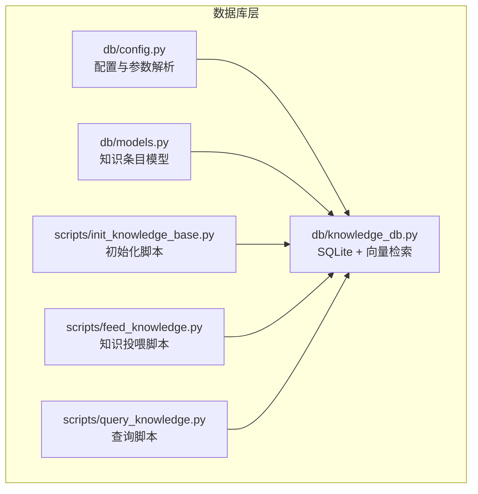
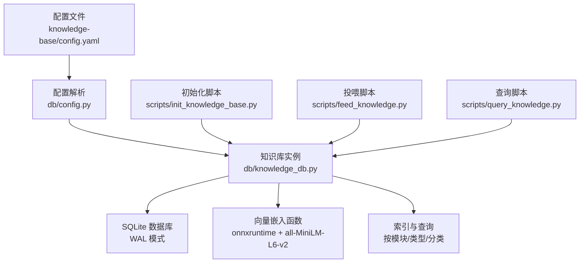
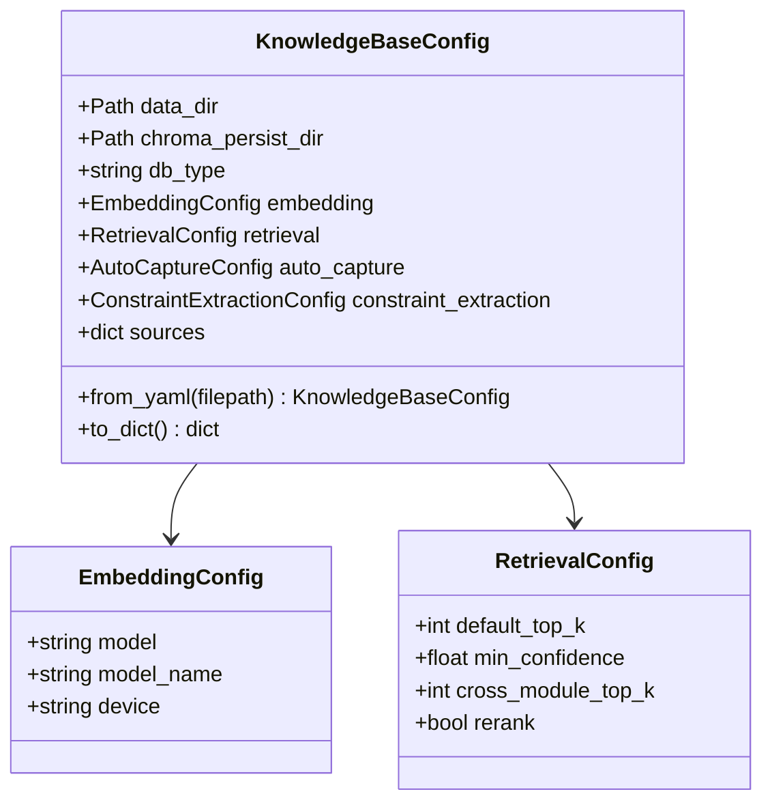
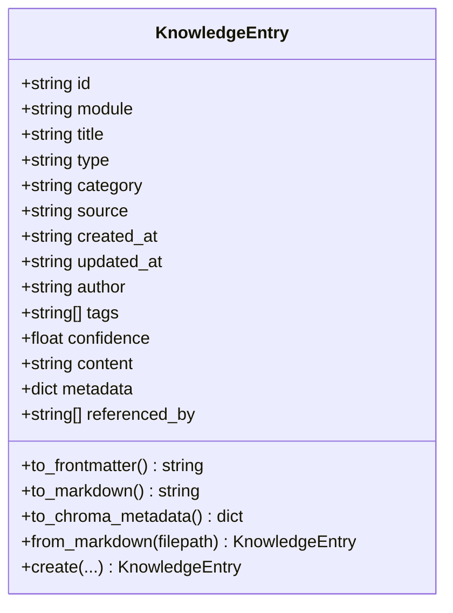
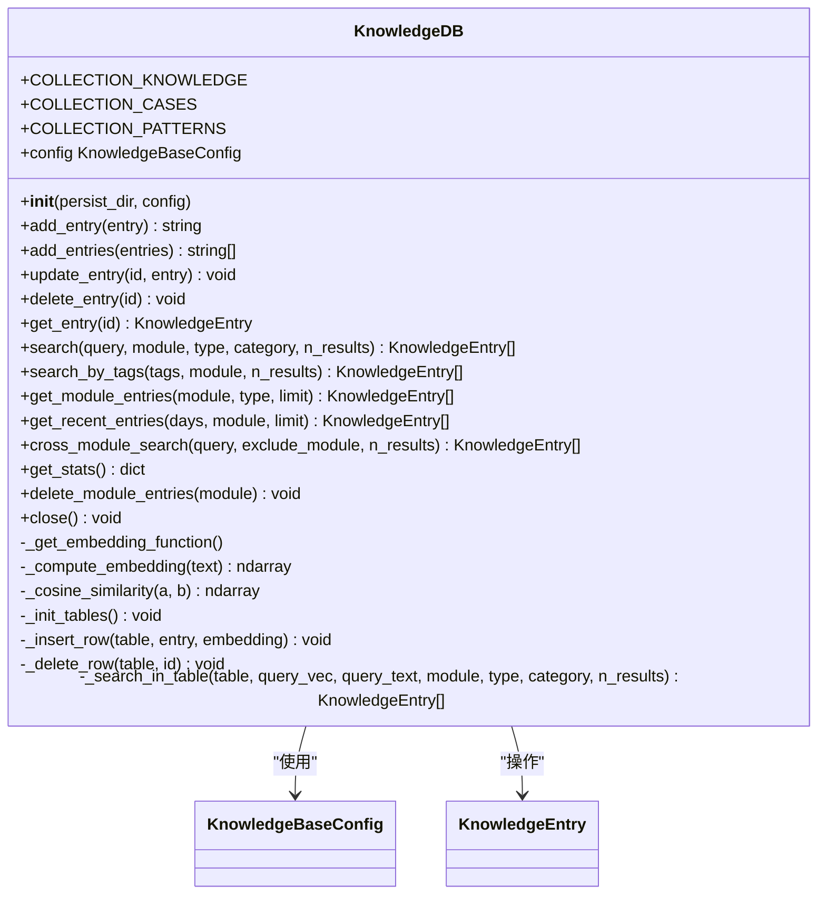
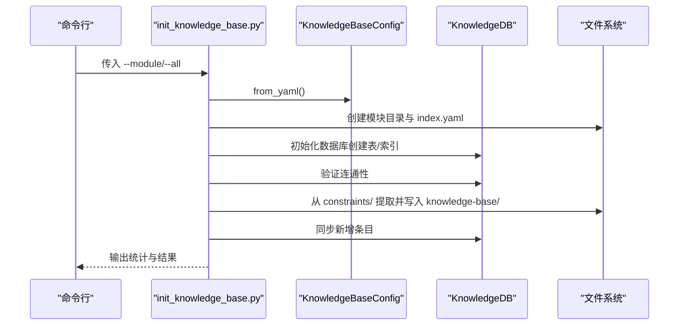
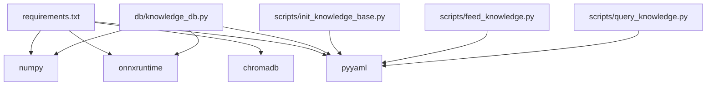

# 数据库配置

<cite>
**本文引用的文件**   
- [db/config.py](file://db/config.py)
- [db/models.py](file://db/models.py)
- [db/knowledge_db.py](file://db/knowledge_db.py)
- [db/__init__.py](file://db/__init__.py)
- [knowledge-base/config.yaml](file://knowledge-base/config.yaml)
- [scripts/init_knowledge_base.py](file://scripts/init_knowledge_base.py)
- [scripts/feed_knowledge.py](file://scripts/feed_knowledge.py)
- [scripts/query_knowledge.py](file://scripts/query_knowledge.py)
- [requirements.txt](file://requirements.txt)
</cite>

## 目录
1. [简介](#简介)
2. [项目结构](#项目结构)
3. [核心组件](#核心组件)
4. [架构总览](#架构总览)
5. [详细组件分析](#详细组件分析)
6. [依赖分析](#依赖分析)
7. [性能考虑](#性能考虑)
8. [故障排查指南](#故障排查指南)
9. [结论](#结论)
10. [附录](#附录)

## 简介
本文件聚焦于数据库配置与实现，涵盖：
- 数据库连接与初始化流程
- 表结构定义与索引策略
- 事务与并发控制
- 向量数据库（ChromaDB）相关配置与嵌入模型设置
- 相似度计算与检索策略
- 连接池与性能监控
- 配置示例、备份与扩容方案
- 优化、故障恢复与安全配置

## 项目结构
数据库相关代码集中在 db/ 目录，配合知识库配置文件 knowledge-base/config.yaml 与若干自动化脚本（初始化、投喂、查询）。

**图表来源**
- [db/config.py:1-182](file://db/config.py#L1-L182)
- [db/models.py:1-247](file://db/models.py#L1-L247)
- [db/knowledge_db.py:1-589](file://db/knowledge_db.py#L1-L589)
- [scripts/init_knowledge_base.py:1-246](file://scripts/init_knowledge_base.py#L1-L246)
- [scripts/feed_knowledge.py:1-320](file://scripts/feed_knowledge.py#L1-L320)
- [scripts/query_knowledge.py:1-200](file://scripts/query_knowledge.py#L1-L200)

**章节来源**
- [db/__init__.py:1-9](file://db/__init__.py#L1-L9)
- [knowledge-base/config.yaml:1-36](file://knowledge-base/config.yaml#L1-L36)

## 核心组件
- 配置管理：从 YAML 加载数据库、嵌入、检索、来源等配置，并提供默认值与覆盖逻辑。
- 数据模型：知识条目数据结构与 frontmatter/ChromaDB 元数据互转。
- 知识库实现：基于 SQLite 的向量知识库，支持语义检索、跨模块检索、统计与维护操作。
- 自动化脚本：初始化、投喂、查询，贯穿知识库生命周期。

**章节来源**
- [db/config.py:94-182](file://db/config.py#L94-L182)
- [db/models.py:52-247](file://db/models.py#L52-L247)
- [db/knowledge_db.py:93-589](file://db/knowledge_db.py#L93-L589)
- [scripts/init_knowledge_base.py:154-246](file://scripts/init_knowledge_base.py#L154-L246)
- [scripts/feed_knowledge.py:196-320](file://scripts/feed_knowledge.py#L196-L320)
- [scripts/query_knowledge.py:116-200](file://scripts/query_knowledge.py#L116-L200)

## 架构总览
数据库层采用“配置驱动 + 纯 Python 实现”的策略：
- 配置来源：knowledge-base/config.yaml
- 存储后端：SQLite（WAL 模式）
- 向量嵌入：onnxruntime + DefaultEmbeddingFunction（all-MiniLM-L6-v2，384维）
- 检索策略：语义相似度（余弦）或文本降级匹配
- 索引策略：按模块/类型/分类建立基础索引
- 事务控制：显式提交/回滚，外键开启
- 连接管理：单进程连接，无连接池

**图表来源**
- [knowledge-base/config.yaml:1-36](file://knowledge-base/config.yaml#L1-L36)
- [db/config.py:94-182](file://db/config.py#L94-L182)
- [db/knowledge_db.py:101-127](file://db/knowledge_db.py#L101-L127)
- [requirements.txt:7-8](file://requirements.txt#L7-L8)

## 详细组件分析

### 配置管理（KnowledgeBaseConfig）
- 支持从 YAML 加载数据库类型、持久化目录、嵌入模型、检索参数、来源开关、自动捕获与约束提取等配置。
- 默认值覆盖：如默认 top_k、最小置信度、默认嵌入模型等。
- 配置来源优先级：YAML > 默认值；部分字段可选择性覆盖。

**图表来源**
- [db/config.py:65-182](file://db/config.py#L65-L182)

**章节来源**
- [db/config.py:94-182](file://db/config.py#L94-L182)
- [knowledge-base/config.yaml:2-36](file://knowledge-base/config.yaml#L2-L36)

### 数据模型（KnowledgeEntry）
- 定义知识条目字段：标识、模块、标题、类型、分类、来源、时间戳、作者、标签、置信度、正文、元数据、引用关系等。
- 校验字段合法性（type/category/source/confidence）。
- 支持 Markdown + YAML frontmatter 的双向转换。
- 支持转为 ChromaDB metadata（列表/对象序列化为 JSON 字符串）。

**图表来源**
- [db/models.py:52-247](file://db/models.py#L52-L247)

**章节来源**
- [db/models.py:52-247](file://db/models.py#L52-L247)

### 知识库实现（KnowledgeDB）
- 初始化：创建持久化目录与 SQLite 数据库，启用 WAL 与外键，初始化三张表（知识、案例、模式），并创建索引。
- 表结构：包含主键 id、模块、标题、类型、分类、来源、时间戳、作者、置信度、标签、正文、额外元数据、引用关系、向量字段（二进制）。
- 索引策略：按模块、类型、分类建立基础索引，加速过滤与统计。
- 事务控制：显式 commit，外键开启；删除/更新/插入均在事务内完成。
- 向量嵌入：尝试加载 onnxruntime + DefaultEmbeddingFunction（all-MiniLM-L6-v2），失败则降级为文本匹配。
- 相似度计算：余弦相似度，支持阈值过滤与 top-k 返回。
- 检索接口：语义搜索、跨模块搜索、按标签搜索、按模块/类型/分类过滤、最近条目、统计信息。
- 维护操作：增删改查、模块级删除、统计聚合。

**图表来源**
- [db/knowledge_db.py:93-589](file://db/knowledge_db.py#L93-L589)

**章节来源**
- [db/knowledge_db.py:101-127](file://db/knowledge_db.py#L101-L127)
- [db/knowledge_db.py:158-164](file://db/knowledge_db.py#L158-L164)
- [db/knowledge_db.py:174-200](file://db/knowledge_db.py#L174-L200)
- [db/knowledge_db.py:228-308](file://db/knowledge_db.py#L228-L308)
- [db/knowledge_db.py:375-432](file://db/knowledge_db.py#L375-L432)
- [db/knowledge_db.py:433-462](file://db/knowledge_db.py#L433-L462)
- [db/knowledge_db.py:463-518](file://db/knowledge_db.py#L463-L518)
- [db/knowledge_db.py:519-571](file://db/knowledge_db.py#L519-L571)

### 初始化流程（scripts/init_knowledge_base.py）
- 从 YAML 加载配置，创建知识库目录结构与模块 index.yaml。
- 初始化数据库（创建表与索引），验证连通性。
- 可从 constraints/ 提取约束为知识条目，写入 knowledge-base 并同步到数据库。
- 输出统计信息与模块初始化结果。

**图表来源**
- [scripts/init_knowledge_base.py:154-246](file://scripts/init_knowledge_base.py#L154-L246)
- [db/config.py:94-182](file://db/config.py#L94-L182)
- [db/knowledge_db.py:101-127](file://db/knowledge_db.py#L101-L127)

**章节来源**
- [scripts/init_knowledge_base.py:154-246](file://scripts/init_knowledge_base.py#L154-L246)

### 知识投喂（scripts/feed_knowledge.py）
- 支持 Markdown、PDF、Word 等格式解析，生成 KnowledgeEntry。
- 保存为 Markdown 文件至 knowledge-base/，并写入数据库。
- 支持增量模式（基于 ID 判断）。
- 更新模块 index.yaml 并输出投喂报告与统计。

**章节来源**
- [scripts/feed_knowledge.py:196-320](file://scripts/feed_knowledge.py#L196-L320)

### 知识查询（scripts/query_knowledge.py）
- 语义搜索、跨模块搜索、统计、最近条目展示。
- 支持按模块、类型、分类过滤与 top-k 控制。
- 展示条目元数据、相似度、摘要等。

**章节来源**
- [scripts/query_knowledge.py:116-200](file://scripts/query_knowledge.py#L116-L200)

## 依赖分析
- 运行时依赖：numpy、onnxruntime、chromadb（用于嵌入函数）、pyyaml。
- 数据库依赖：SQLite（内置）。
- 脚本依赖：click、rich、GitPython（由 requirements.txt 指定）。

**图表来源**
- [requirements.txt:1-9](file://requirements.txt#L1-L9)
- [db/knowledge_db.py:132-156](file://db/knowledge_db.py#L132-L156)

**章节来源**
- [requirements.txt:1-9](file://requirements.txt#L1-L9)

## 性能考虑
- 向量嵌入
  - 使用 onnxruntime + DefaultEmbeddingFunction（all-MiniLM-L6-v2，384维）。
  - 若不可用则降级为文本匹配（包含查询）。
- 相似度计算
  - 余弦相似度，批量向量化与归一化，阈值过滤与 top-k 截断。
- 索引策略
  - 基础索引：模块、类型、分类，提升过滤与统计效率。
- 事务与并发
  - 单连接、显式提交；外键开启；无连接池。
- I/O 与存储
  - SQLite WAL 模式提升并发读写；向量以二进制存储，减少序列化开销。
- 扩展建议
  - 当数据量增长时，可考虑：
    - 引入连接池（如 sqlite3 连接池封装）。
    - 分表/分区（按模块或时间）。
    - 增加复合索引（如 module+type、module+category）。
    - 引入缓存层（LRU/Redis）存放热门查询结果。
    - 使用更高效的向量库（如 FAISS）进行大规模相似度检索。

[本节为通用性能指导，无需特定文件引用]

## 故障排查指南
- 嵌入不可用
  - 现象：日志提示 ONNX 嵌入不可用并降级。
  - 处理：确认 onnxruntime 版本符合 requirements；若仍失败，系统将以文本匹配继续运行。
- 数据库初始化失败
  - 现象：初始化脚本报错或连通性验证失败。
  - 处理：检查持久化目录权限、磁盘空间；确认 SQLite 可用；查看日志异常堆栈。
- 查询无结果
  - 现象：语义搜索返回空。
  - 处理：调低检索阈值（min_confidence）；检查条目是否已向量化；尝试文本降级匹配。
- 投喂失败
  - 现象：投喂报告中出现失败条目。
  - 处理：检查文件格式解析库（pdfplumber/docx）是否安装；查看具体异常信息。
- 统计异常
  - 现象：统计信息不一致。
  - 处理：确认数据库已提交；检查是否存在并发写入导致的瞬态不一致。

**章节来源**
- [db/knowledge_db.py:132-156](file://db/knowledge_db.py#L132-L156)
- [scripts/init_knowledge_base.py:144-152](file://scripts/init_knowledge_base.py#L144-L152)
- [scripts/feed_knowledge.py:260-283](file://scripts/feed_knowledge.py#L260-L283)

## 结论
本数据库配置以“纯 Python + SQLite”为核心，结合 onnxruntime 的轻量向量嵌入，实现了可部署、易维护的知识库系统。通过配置驱动与脚本化流程，能够快速完成初始化、投喂与查询。随着数据规模增长，建议引入连接池、缓存与更高效的向量检索方案以进一步提升性能与稳定性。

[本节为总结，无需特定文件引用]

## 附录

### 数据库连接配置
- 持久化目录：从配置读取，未指定时默认位于项目根下的知识库目录。
- 初始化：创建目录与 SQLite 文件，启用 WAL 与外键，初始化三张表与索引。
- 连接管理：单连接实例，显式提交；关闭时释放资源。

**章节来源**
- [db/knowledge_db.py:101-127](file://db/knowledge_db.py#L101-L127)

### 表结构定义与索引策略
- 表名映射：知识、案例、模式三类集合对应三张表。
- 字段：主键 id、模块、标题、类型、分类、来源、时间戳、作者、置信度、标签（JSON）、正文、额外元数据（JSON）、引用关系（JSON）、向量（二进制）。
- 索引：按模块、类型、分类建立基础索引，加速过滤与统计。

**章节来源**
- [db/knowledge_db.py:26-56](file://db/knowledge_db.py#L26-L56)

### 事务设置
- PRAGMA：journal_mode=WAL、foreign_keys=ON。
- 事务：显式 commit；删除/更新/插入均在事务内完成。

**章节来源**
- [db/knowledge_db.py:118-120](file://db/knowledge_db.py#L118-L120)
- [db/knowledge_db.py:309-363](file://db/knowledge_db.py#L309-L363)

### ChromaDB 向量数据库配置
- 嵌入模型：onnxruntime + DefaultEmbeddingFunction（all-MiniLM-L6-v2，384维）。
- 相似度：余弦相似度，阈值过滤与 top-k 截断。
- 降级策略：嵌入不可用时退化为文本包含匹配。

**章节来源**
- [db/knowledge_db.py:132-156](file://db/knowledge_db.py#L132-L156)
- [db/knowledge_db.py:185-199](file://db/knowledge_db.py#L185-L199)
- [knowledge-base/config.yaml:3-7](file://knowledge-base/config.yaml#L3-L7)

### 相似度计算配置
- 配置项：default_top_k、min_confidence、cross_module_top_k、rerank。
- 计算：余弦相似度；阈值过滤；按相似度降序取前 k。

**章节来源**
- [db/config.py:33-38](file://db/config.py#L33-L38)
- [db/knowledge_db.py:281-294](file://db/knowledge_db.py#L281-L294)
- [db/knowledge_db.py:555-568](file://db/knowledge_db.py#L555-L568)

### 数据库初始化流程
- 读取配置 → 创建目录与 index.yaml → 初始化数据库（建表/索引）→ 验证连通性 → 可选：从 constraints/ 提取并同步 → 输出统计。

**章节来源**
- [scripts/init_knowledge_base.py:154-246](file://scripts/init_knowledge_base.py#L154-L246)

### 连接池配置与性能监控
- 连接池：当前未引入连接池，建议在高并发场景下增加连接池封装。
- 性能监控：可通过日志记录慢查询与异常；建议增加埋点统计检索耗时与命中率。

[本节为通用建议，无需特定文件引用]

### 配置示例
- 数据库类型与持久化目录：参考配置文件中的 database 段。
- 嵌入模型：默认使用 onnxruntime + all-MiniLM-L6-v2。
- 检索参数：default_top_k、min_confidence、cross_module_top_k、rerank。
- 来源开关与自动捕获：sources、auto_capture。

**章节来源**
- [knowledge-base/config.yaml:2-36](file://knowledge-base/config.yaml#L2-L36)

### 备份策略
- SQLite 备份：直接复制 .db 文件；建议在停写或 WAL checkpoint 后进行。
- 元数据备份：知识条目 Markdown 文件可作为元数据备份；必要时可重建数据库。

[本节为通用建议，无需特定文件引用]

### 扩容方案
- 存储：分表/分区（按模块/时间）；SSD 存储提升 I/O。
- 计算：引入缓存层；使用更高效向量库（FAISS）；批量预计算嵌入。
- 并发：引入连接池；读写分离；只读副本。

[本节为通用建议，无需特定文件引用]

### 优化、故障恢复与安全配置
- 优化：索引优化、阈值调整、缓存命中率提升、批量写入。
- 故障恢复：WAL 模式具备崩溃恢复能力；定期备份；降级策略保障服务可用。
- 安全：限制持久化目录访问权限；仅允许受信用户写入；敏感元数据脱敏。

[本节为通用建议，无需特定文件引用]