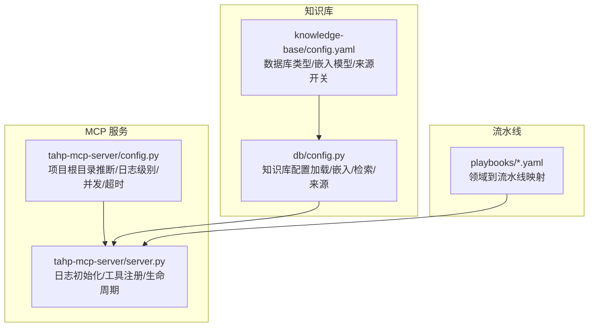
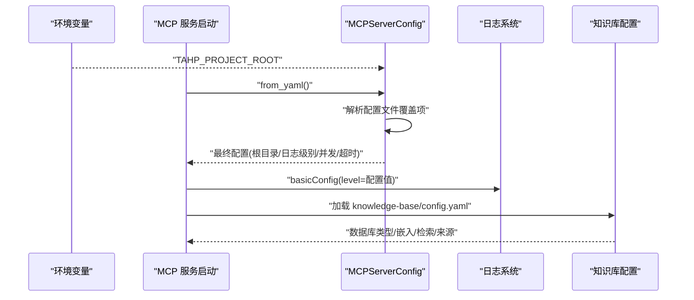
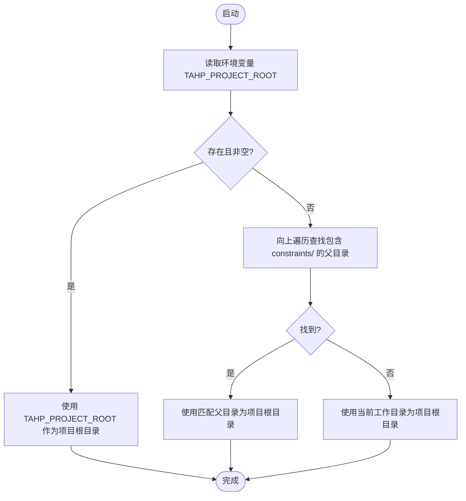
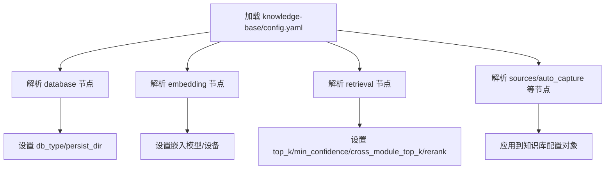
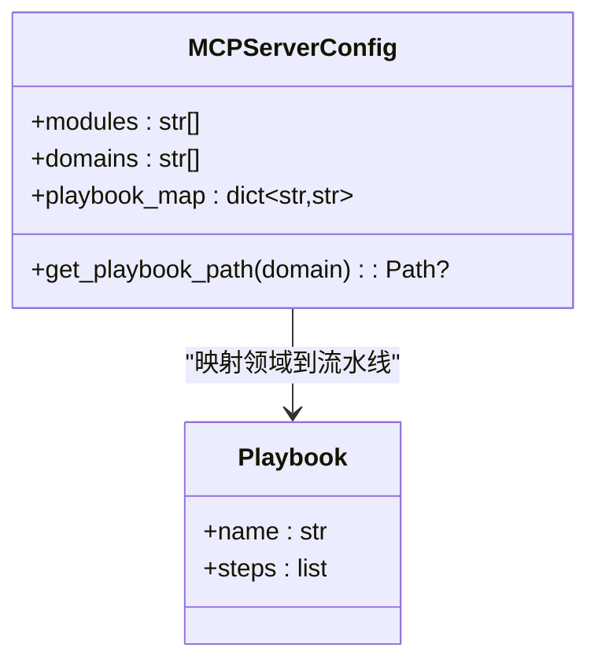
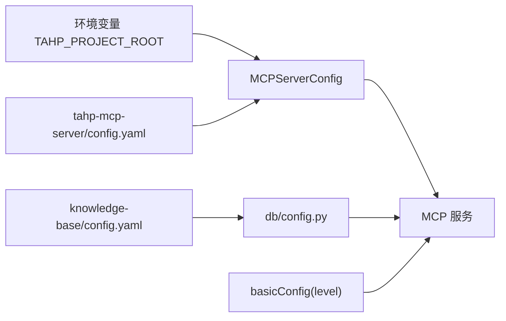

# 环境变量管理

<cite>
**本文引用的文件**
- [tahp-mcp-server/config.py](file://tahp-mcp-server/config.py)
- [tahp-mcp-server/server.py](file://tahp-mcp-server/server.py)
- [db/config.py](file://db/config.py)
- [knowledge-base/config.yaml](file://knowledge-base/config.yaml)
- [playbooks/bug-analysis-pipeline.yaml](file://playbooks/bug-analysis-pipeline.yaml)
- [scripts/requirements.txt](file://scripts/requirements.txt)
</cite>

## 目录
1. [简介](#简介)
2. [项目结构](#项目结构)
3. [核心组件](#核心组件)
4. [架构总览](#架构总览)
5. [详细组件分析](#详细组件分析)
6. [依赖分析](#依赖分析)
7. [性能考虑](#性能考虑)
8. [故障排除指南](#故障排除指南)
9. [结论](#结论)
10. [附录](#附录)

## 简介
本文件系统性阐述 TAHP 项目的环境变量管理策略，重点覆盖以下方面：
- 关键环境变量的定义、优先级与覆盖机制
- TAHP_PROJECT_ROOT、日志级别、数据库类型与持久化位置等关键变量的设置方法
- 不同部署环境（本地开发、容器化、Kubernetes、CI/CD）中的配置策略
- 敏感信息保护与安全最佳实践
- 环境变量验证、调试技巧与故障排除方法

## 项目结构
TAHP 采用多模块协作的分层架构，环境变量主要影响以下模块：
- MCP 服务配置：负责项目根目录推断、日志级别、并发与超时参数等
- 知识库配置：负责数据库类型、嵌入模型、检索参数、来源开关等
- Playbook 配置：定义不同领域的执行流水线映射

图表来源
- [tahp-mcp-server/config.py:18-34](file://tahp-mcp-server/config.py#L18-L34)
- [tahp-mcp-server/server.py:84-90](file://tahp-mcp-server/server.py#L84-L90)
- [db/config.py:94-161](file://db/config.py#L94-L161)
- [knowledge-base/config.yaml:1-36](file://knowledge-base/config.yaml#L1-L36)
- [playbooks/bug-analysis-pipeline.yaml:1-43](file://playbooks/bug-analysis-pipeline.yaml#L1-L43)

章节来源
- [tahp-mcp-server/config.py:18-34](file://tahp-mcp-server/config.py#L18-L34)
- [tahp-mcp-server/server.py:84-90](file://tahp-mcp-server/server.py#L84-L90)
- [db/config.py:94-161](file://db/config.py#L94-L161)
- [knowledge-base/config.yaml:1-36](file://knowledge-base/config.yaml#L1-L36)
- [playbooks/bug-analysis-pipeline.yaml:1-43](file://playbooks/bug-analysis-pipeline.yaml#L1-L43)

## 核心组件
本节聚焦环境变量在核心组件中的应用与优先级。

- 项目根目录推断与覆盖
  - 优先级：环境变量 > 上层目录检测 > 当前工作目录
  - 环境变量：TAHP_PROJECT_ROOT
  - 推断逻辑：自 MCP 服务目录向上查找包含 constraints/ 的父目录；若未找到则退回当前工作目录

- 日志级别
  - 默认值：INFO
  - 设置方式：通过配置文件覆盖；MCP 服务启动时使用基础日志配置

- 并发与超时
  - 默认最大并发任务数：5
  - 默认任务超时（秒）：600
  - 可通过配置文件覆盖

- 数据库类型与持久化位置
  - 知识库配置来源于 knowledge-base/config.yaml
  - 支持数据库类型与持久化目录由 YAML 配置决定

章节来源
- [tahp-mcp-server/config.py:18-34](file://tahp-mcp-server/config.py#L18-L34)
- [tahp-mcp-server/config.py:49-56](file://tahp-mcp-server/config.py#L49-L56)
- [tahp-mcp-server/config.py:130-161](file://tahp-mcp-server/config.py#L130-L161)
- [tahp-mcp-server/server.py:84-90](file://tahp-mcp-server/server.py#L84-L90)
- [db/config.py:116-121](file://db/config.py#L116-L121)
- [knowledge-base/config.yaml:2-4](file://knowledge-base/config.yaml#L2-L4)

## 架构总览
环境变量与配置在系统中的交互流程如下：

图表来源
- [tahp-mcp-server/config.py:18-34](file://tahp-mcp-server/config.py#L18-L34)
- [tahp-mcp-server/config.py:130-161](file://tahp-mcp-server/config.py#L130-L161)
- [tahp-mcp-server/server.py:84-90](file://tahp-mcp-server/server.py#L84-L90)
- [db/config.py:94-161](file://db/config.py#L94-L161)
- [knowledge-base/config.yaml:1-36](file://knowledge-base/config.yaml#L1-L36)

## 详细组件分析

### 组件 A：MCP 服务配置与环境变量
- 项目根目录推断
  - 优先使用环境变量 TAHP_PROJECT_ROOT
  - 若未设置，则向上查找包含 constraints/ 的父目录
  - 若仍未找到，则退回当前工作目录
- 日志级别
  - 默认 INFO，可通过配置文件覆盖
- 并发与超时
  - 默认并发 5，超时 600 秒，均可通过配置文件覆盖
- 目录派生
  - 基于 project_root 派生 constraints/playbooks/knowledge-base/tools/scripts/reports 等目录

图表来源
- [tahp-mcp-server/config.py:18-34](file://tahp-mcp-server/config.py#L18-L34)

章节来源
- [tahp-mcp-server/config.py:18-34](file://tahp-mcp-server/config.py#L18-L34)
- [tahp-mcp-server/config.py:49-56](file://tahp-mcp-server/config.py#L49-L56)
- [tahp-mcp-server/config.py:130-161](file://tahp-mcp-server/config.py#L130-L161)

### 组件 B：知识库配置与数据库连接字符串
- 数据库类型与持久化目录
  - 由 knowledge-base/config.yaml 的 database 节点控制
  - type 字段决定数据库类型（如 sqlite-onnx）
  - persist_dir 指定持久化目录
- 嵌入模型与检索参数
  - embedding 节点控制嵌入模型与设备
  - retrieval 节点控制 top_k、最小置信度、跨模块 top_k、重排序等
- 来源开关与自动捕获
  - sources 控制手动注入、自动捕获、跨模块同步
  - auto_capture 控制各类自动行为的阈值与条件

图表来源
- [db/config.py:94-161](file://db/config.py#L94-L161)
- [knowledge-base/config.yaml:1-36](file://knowledge-base/config.yaml#L1-L36)

章节来源
- [db/config.py:94-161](file://db/config.py#L94-L161)
- [knowledge-base/config.yaml:1-36](file://knowledge-base/config.yaml#L1-L36)

### 组件 C：Playbook 映射与领域配置
- 领域到流水线映射
  - MCPServerConfig.playbook_map 将领域（如 bug_analysis/code_adaptation/version_adaptation/carrier_porting）映射到对应 YAML 流水线文件
- 流水线文件示例
  - bug-analysis-pipeline.yaml 展示了跨模块并行分析与汇总的典型结构

图表来源
- [tahp-mcp-server/config.py:74-79](file://tahp-mcp-server/config.py#L74-L79)
- [playbooks/bug-analysis-pipeline.yaml:1-43](file://playbooks/bug-analysis-pipeline.yaml#L1-L43)

章节来源
- [tahp-mcp-server/config.py:74-79](file://tahp-mcp-server/config.py#L74-L79)
- [playbooks/bug-analysis-pipeline.yaml:1-43](file://playbooks/bug-analysis-pipeline.yaml#L1-L43)

## 依赖分析
- MCP 服务配置依赖
  - 依赖环境变量 TAHP_PROJECT_ROOT 进行根目录推断
  - 依赖配置文件 tahp-mcp-server/config.yaml 进行覆盖
- 知识库配置依赖
  - 依赖 knowledge-base/config.yaml 进行数据库类型、嵌入、检索与来源的配置
- 日志系统依赖
  - MCP 服务启动时通过 basicConfig 设置日志级别

图表来源
- [tahp-mcp-server/config.py:18-34](file://tahp-mcp-server/config.py#L18-L34)
- [tahp-mcp-server/config.py:130-161](file://tahp-mcp-server/config.py#L130-L161)
- [db/config.py:94-161](file://db/config.py#L94-L161)
- [knowledge-base/config.yaml:1-36](file://knowledge-base/config.yaml#L1-L36)
- [tahp-mcp-server/server.py:84-90](file://tahp-mcp-server/server.py#L84-L90)

章节来源
- [tahp-mcp-server/config.py:18-34](file://tahp-mcp-server/config.py#L18-L34)
- [tahp-mcp-server/config.py:130-161](file://tahp-mcp-server/config.py#L130-L161)
- [db/config.py:94-161](file://db/config.py#L94-L161)
- [knowledge-base/config.yaml:1-36](file://knowledge-base/config.yaml#L1-L36)
- [tahp-mcp-server/server.py:84-90](file://tahp-mcp-server/server.py#L84-L90)

## 性能考虑
- 日志级别
  - 在生产环境中建议使用 INFO 或更高，避免 DEBUG 带来的性能开销
- 并发与超时
  - 合理设置 max_concurrent_tasks 与 task_timeout_sec，避免资源争用与僵尸任务
- 数据库类型与嵌入模型
  - sqlite-onnx 的嵌入模型无需 C++ 依赖，适合纯 Python 环境；若需更强中文支持，可考虑替换为多语言模型
- 检索参数
  - 适当调整 min_confidence 与 top_k，平衡召回率与响应速度

## 故障排除指南
- 项目根目录不正确
  - 现象：无法定位 constraints/playbooks/knowledge-base 等目录
  - 排查：确认 TAHP_PROJECT_ROOT 是否设置；检查目录层级是否包含 constraints/
  - 参考路径：[tahp-mcp-server/config.py:18-34](file://tahp-mcp-server/config.py#L18-L34)
- 日志级别无效
  - 现象：日志输出不符合预期
  - 排查：确认配置文件中 log_level 是否被正确加载；检查 MCP 服务启动时 basicConfig 的日志级别
  - 参考路径：[tahp-mcp-server/server.py:84-90](file://tahp-mcp-server/server.py#L84-L90), [tahp-mcp-server/config.py:130-161](file://tahp-mcp-server/config.py#L130-L161)
- 数据库类型或持久化目录异常
  - 现象：知识库初始化失败或数据未持久化
  - 排查：确认 knowledge-base/config.yaml 的 database.type 与 persist_dir；确保目录可写
  - 参考路径：[db/config.py:116-121](file://db/config.py#L116-L121), [knowledge-base/config.yaml:2-4](file://knowledge-base/config.yaml#L2-L4)
- 并发任务过多导致资源紧张
  - 现象：CPU/内存飙升，任务超时
  - 排查：降低 max_concurrent_tasks，延长 task_timeout_sec
  - 参考路径：[tahp-mcp-server/config.py:53-56](file://tahp-mcp-server/config.py#L53-L56), [tahp-mcp-server/config.py:130-161](file://tahp-mcp-server/config.py#L130-L161)

章节来源
- [tahp-mcp-server/config.py:18-34](file://tahp-mcp-server/config.py#L18-L34)
- [tahp-mcp-server/server.py:84-90](file://tahp-mcp-server/server.py#L84-L90)
- [db/config.py:116-121](file://db/config.py#L116-L121)
- [knowledge-base/config.yaml:2-4](file://knowledge-base/config.yaml#L2-L4)
- [tahp-mcp-server/config.py:53-56](file://tahp-mcp-server/config.py#L53-L56)

## 结论
- TAHP 的环境变量管理遵循“环境变量优先、配置文件覆盖”的原则，确保灵活部署与一致行为
- TAHP_PROJECT_ROOT 是定位项目根目录的关键变量，应确保其在不同环境中的正确设置
- 日志级别、并发与超时、数据库类型与持久化目录等均支持通过配置文件覆盖，便于在不同环境间切换
- 建议在生产环境中严格区分日志级别、限制并发、明确数据库类型与持久化策略，并结合 CI/CD 进行自动化验证

## 附录

### A. 关键环境变量与配置项对照
- TAHP_PROJECT_ROOT
  - 作用：项目根目录推断
  - 优先级：高于默认推断，低于配置文件覆盖
  - 参考路径：[tahp-mcp-server/config.py:18-34](file://tahp-mcp-server/config.py#L18-L34)
- 日志级别（log_level）
  - 作用：控制日志输出详细程度
  - 默认值：INFO
  - 参考路径：[tahp-mcp-server/config.py:49](file://tahp-mcp-server/config.py#L49), [tahp-mcp-server/server.py:84-90](file://tahp-mcp-server/server.py#L84-L90)
- 并发与超时（max_concurrent_tasks, task_timeout_sec）
  - 作用：控制任务并发与超时
  - 默认值：5, 600
  - 参考路径：[tahp-mcp-server/config.py:53-56](file://tahp-mcp-server/config.py#L53-L56), [tahp-mcp-server/config.py:130-161](file://tahp-mcp-server/config.py#L130-L161)
- 数据库类型与持久化（knowledge-base/config.yaml）
  - 作用：控制知识库后端与持久化位置
  - 参考路径：[db/config.py:116-121](file://db/config.py#L116-L121), [knowledge-base/config.yaml:2-4](file://knowledge-base/config.yaml#L2-L4)

### B. 不同部署环境中的配置策略
- 本地开发
  - 使用默认推断或显式设置 TAHP_PROJECT_ROOT
  - 日志级别建议为 INFO
- Docker 容器化
  - 通过 docker run -e 或 docker-compose environment 注入 TAHP_PROJECT_ROOT
  - 将知识库持久化目录挂载到宿主机卷
- Kubernetes
  - 使用 ConfigMap/Secret 管理配置与敏感信息
  - 通过环境变量注入 TAHP_PROJECT_ROOT
  - 将知识库持久化目录映射到 PVC
- CI/CD
  - 在流水线中设置环境变量与密钥
  - 使用静态检查与单元测试验证配置加载

### C. 敏感信息保护与安全最佳实践
- 不在配置文件中存储敏感信息
- 使用 Secret 管理数据库连接串、API 密钥等
- 限制日志输出敏感字段
- 定期轮换密钥与证书

### D. 环境变量验证与调试技巧
- 验证项目根目录
  - 在启动日志中查看 project_root
  - 参考路径：[tahp-mcp-server/server.py:456](file://tahp-mcp-server/server.py#L456)
- 验证配置文件加载
  - 检查配置文件是否存在与可读
  - 参考路径：[tahp-mcp-server/config.py:139-141](file://tahp-mcp-server/config.py#L139-L141)
- 验证知识库配置
  - 检查 knowledge-base/config.yaml 的 database 节点
  - 参考路径：[db/config.py:116-121](file://db/config.py#L116-L121)
- 调试日志
  - 临时提升日志级别至 DEBUG（仅限开发环境）
  - 参考路径：[tahp-mcp-server/server.py:84-90](file://tahp-mcp-server/server.py#L84-L90)