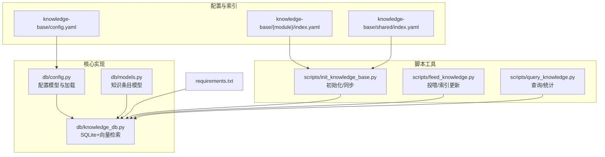
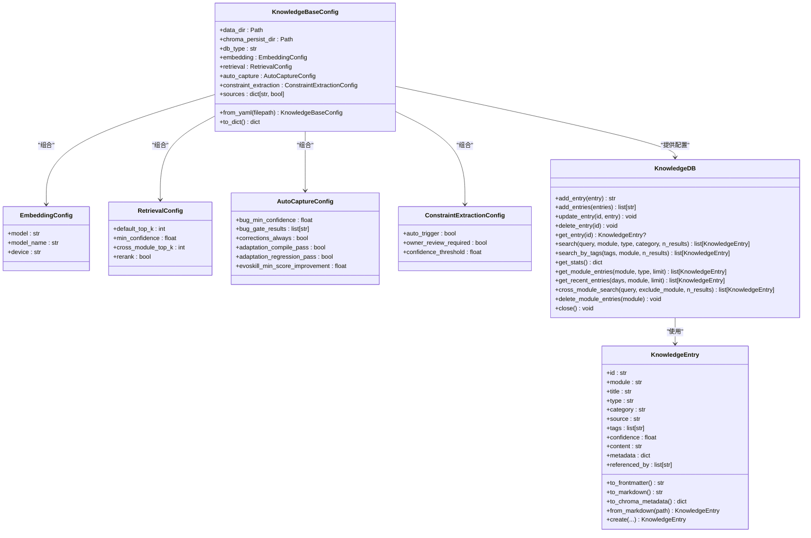
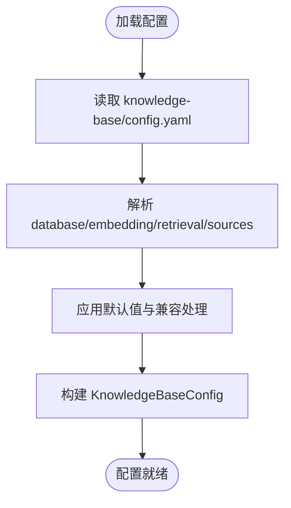
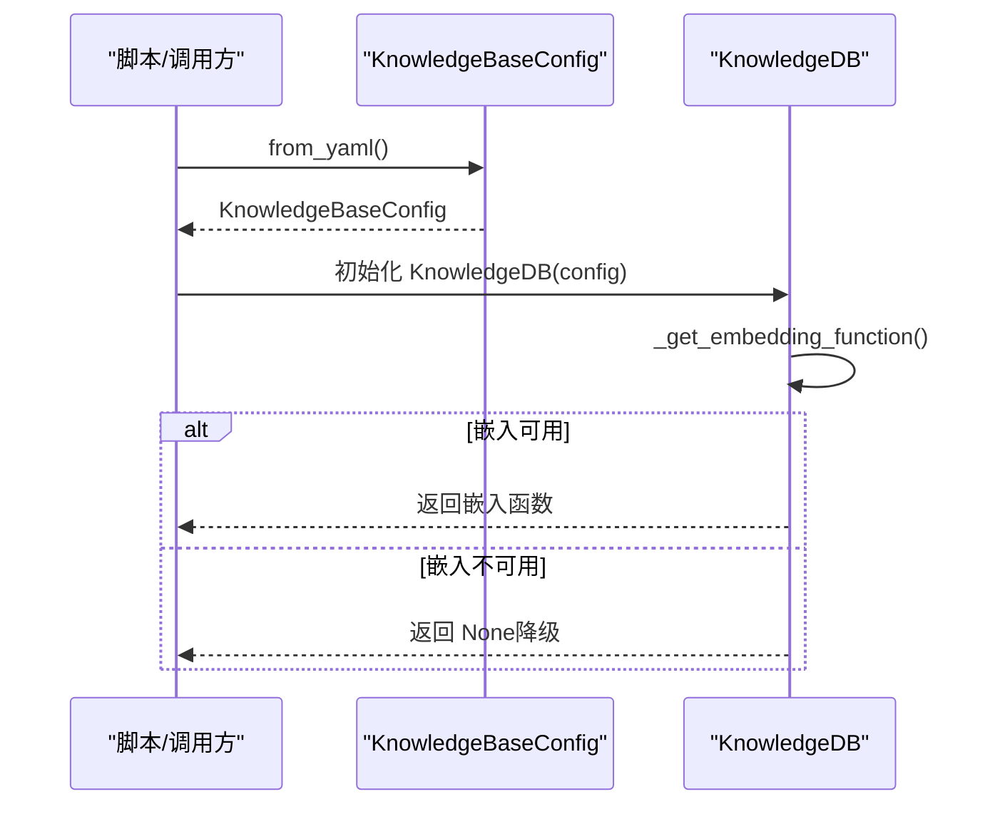
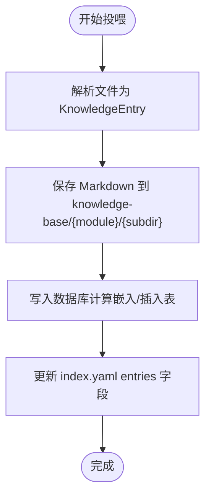
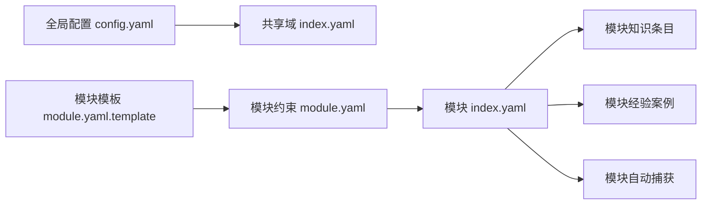
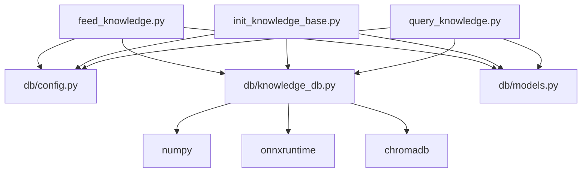
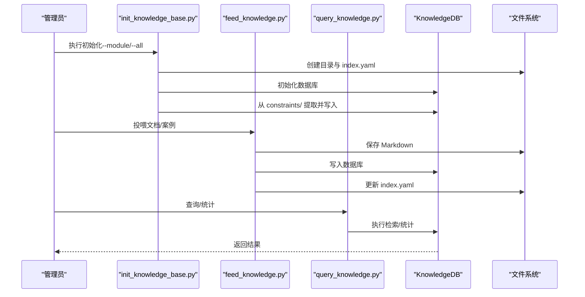

# 知识库配置

<cite>
**本文引用的文件**   
- [config.yaml](file://knowledge-base/config.yaml)
- [index.yaml（内核驱动模块）](file://knowledge-base/kernel-driver/index.yaml)
- [index.yaml（共享域）](file://knowledge-base/shared/index.yaml)
- [config.py](file://db/config.py)
- [knowledge_db.py](file://db/knowledge_db.py)
- [models.py](file://db/models.py)
- [init_knowledge_base.py](file://scripts/init_knowledge_base.py)
- [feed_knowledge.py](file://scripts/feed_knowledge.py)
- [query_knowledge.py](file://scripts/query_knowledge.py)
- [requirements.txt](file://requirements.txt)
- [module.yaml（内核驱动）](file://constraints/kernel-driver/module.yaml)
- [module.yaml（通信模块）](file://constraints/telephony/module.yaml)
- [module.yaml.template](file://templates/module-template/module.yaml.template)
</cite>

## 目录
1. [简介](#简介)
2. [项目结构](#项目结构)
3. [核心组件](#核心组件)
4. [架构总览](#架构总览)
5. [详细组件分析](#详细组件分析)
6. [依赖分析](#依赖分析)
7. [性能考虑](#性能考虑)
8. [故障排查指南](#故障排查指南)
9. [结论](#结论)
10. [附录](#附录)

## 简介
本文件面向知识库配置与运维人员，系统性阐述知识库配置文件结构、向量嵌入配置、索引管理与存储参数；对比不同模块的知识库配置差异、共享配置与模块特定配置；给出索引创建、维护与优化策略；提供配置示例、性能调优参数与存储容量规划建议，并覆盖迁移、备份恢复与故障诊断方法。

## 项目结构
知识库相关的核心位置与职责如下：
- 配置与索引
  - 全局配置：knowledge-base/config.yaml
  - 模块索引：knowledge-base/{module}/index.yaml
  - 共享域索引：knowledge-base/shared/index.yaml
- 核心实现
  - 配置模型与加载：db/config.py
  - 知识库数据库与检索：db/knowledge_db.py
  - 数据模型与序列化：db/models.py
- 脚本工具
  - 初始化知识库：scripts/init_knowledge_base.py
  - 投喂知识条目：scripts/feed_knowledge.py
  - 查询与统计：scripts/query_knowledge.py
- 依赖
  - requirements.txt

**图示来源**
- [config.yaml:1-36](file://knowledge-base/config.yaml#L1-L36)
- [index.yaml（内核驱动模块）:1-8](file://knowledge-base/kernel-driver/index.yaml#L1-L8)
- [index.yaml（共享域）:1-8](file://knowledge-base/shared/index.yaml#L1-L8)
- [config.py:64-182](file://db/config.py#L64-L182)
- [knowledge_db.py:93-589](file://db/knowledge_db.py#L93-L589)
- [models.py:52-247](file://db/models.py#L52-L247)
- [init_knowledge_base.py:154-246](file://scripts/init_knowledge_base.py#L154-L246)
- [feed_knowledge.py:196-320](file://scripts/feed_knowledge.py#L196-L320)
- [query_knowledge.py:116-200](file://scripts/query_knowledge.py#L116-L200)
- [requirements.txt:1-9](file://requirements.txt#L1-L9)

**章节来源**
- [config.yaml:1-36](file://knowledge-base/config.yaml#L1-L36)
- [index.yaml（内核驱动模块）:1-8](file://knowledge-base/kernel-driver/index.yaml#L1-L8)
- [index.yaml（共享域）:1-8](file://knowledge-base/shared/index.yaml#L1-L8)
- [config.py:64-182](file://db/config.py#L64-L182)
- [knowledge_db.py:93-589](file://db/knowledge_db.py#L93-L589)
- [models.py:52-247](file://db/models.py#L52-L247)
- [init_knowledge_base.py:154-246](file://scripts/init_knowledge_base.py#L154-L246)
- [feed_knowledge.py:196-320](file://scripts/feed_knowledge.py#L196-L320)
- [query_knowledge.py:116-200](file://scripts/query_knowledge.py#L116-L200)
- [requirements.txt:1-9](file://requirements.txt#L1-L9)

## 核心组件
- 配置模型（KnowledgeBaseConfig）
  - 负责从 YAML 加载全局配置，包括数据库类型、嵌入模型、检索参数、自动捕获与约束提取开关等。
  - 支持 sources 开关控制手动投喂、自动捕获与跨模块同步。
- 知识库数据库（KnowledgeDB）
  - 基于 SQLite + numpy 的向量知识库，支持语义检索、过滤检索、跨模块查询。
  - 默认使用 onnxruntime + all-MiniLM-L6-v2（384维）进行嵌入；若不可用则退化为文本包含匹配。
  - 维护多集合表（知识、案例、模式），并提供统计、最近条目、跨模块检索等能力。
- 数据模型（KnowledgeEntry）
  - 定义知识条目的字段、校验规则与 Markdown/YAML frontmatter 的双向转换。
  - 支持类型、分类、来源、置信度、标签、元数据等标准化字段。
- 脚本工具
  - 初始化：创建模块目录与索引、从 constraints/ 提取约束为知识条目并同步到数据库。
  - 投喂：解析 Markdown/PDF/Word，生成知识条目并写入 knowledge-base 与数据库，同时更新模块索引。
  - 查询：语义搜索、跨模块搜索、统计与最近条目展示。

**章节来源**
- [config.py:64-182](file://db/config.py#L64-L182)
- [knowledge_db.py:93-589](file://db/knowledge_db.py#L93-L589)
- [models.py:52-247](file://db/models.py#L52-L247)
- [init_knowledge_base.py:154-246](file://scripts/init_knowledge_base.py#L154-L246)
- [feed_knowledge.py:196-320](file://scripts/feed_knowledge.py#L196-L320)
- [query_knowledge.py:116-200](file://scripts/query_knowledge.py#L116-L200)

## 架构总览
下图展示了知识库配置、数据模型与数据库实现之间的交互关系，以及脚本工具如何驱动初始化、投喂与查询流程。

**图示来源**
- [config.py:24-182](file://db/config.py#L24-L182)
- [knowledge_db.py:93-589](file://db/knowledge_db.py#L93-L589)
- [models.py:52-247](file://db/models.py#L52-L247)

## 详细组件分析

### 配置文件结构与字段详解
- 全局配置（knowledge-base/config.yaml）
  - 版本号、数据库类型与持久化目录、嵌入模型选择、来源开关、自动捕获策略、检索参数、约束提取策略。
  - 注意：配置中的“database”部分与“embedding”部分在加载逻辑中存在兼容处理，确保 both 生效。
- 模块索引（knowledge-base/{module}/index.yaml）
  - 记录模块版本、更新时间、条目分类（docs/cases/auto）与条目 ID 列表。
- 共享域索引（knowledge-base/shared/index.yaml）
  - 记录共享域版本、更新时间与共享类别清单。

**图示来源**
- [config.yaml:1-36](file://knowledge-base/config.yaml#L1-L36)
- [config.py:94-161](file://db/config.py#L94-L161)

**章节来源**
- [config.yaml:1-36](file://knowledge-base/config.yaml#L1-L36)
- [index.yaml（内核驱动模块）:1-8](file://knowledge-base/kernel-driver/index.yaml#L1-L8)
- [index.yaml（共享域）:1-8](file://knowledge-base/shared/index.yaml#L1-L8)
- [config.py:94-161](file://db/config.py#L94-L161)

### 向量嵌入配置与降级策略
- 默认嵌入模型
  - 使用 chromadb 内置的 DefaultEmbeddingFunction（基于 onnxruntime + all-MiniLM-L6-v2，384维）。
- 设备与模型
  - 配置项支持 model、model_name、device；当前实现固定为 CPU 且使用内置模型。
- 降级策略
  - 若 onnxruntime 不可用或嵌入函数不可用，则退化为文本包含匹配（不进行向量相似度计算）。

**图示来源**
- [config.py:94-161](file://db/config.py#L94-L161)
- [knowledge_db.py:132-156](file://db/knowledge_db.py#L132-L156)

**章节来源**
- [config.py:24-30](file://db/config.py#L24-L30)
- [knowledge_db.py:132-156](file://db/knowledge_db.py#L132-L156)

### 索引管理与存储参数
- 索引文件
  - 模块级 index.yaml：记录模块条目分类与 ID 列表，由投喂与初始化脚本维护。
  - 共享域 index.yaml：记录共享类别清单。
- 存储结构
  - SQLite 数据库文件位于配置的持久化目录（默认 .chroma_db/knowledge.db）。
  - 多表结构：kb_knowledge、kb_cases、kb_patterns，均包含 module/type/category/source 等常用过滤字段与 embedding 二进制列。
  - WAL 模式开启，外键约束启用，提升并发与一致性。
- 索引维护
  - 投喂脚本在保存 Markdown 与写入数据库后，更新模块 index.yaml 的 entries 字段。
  - 初始化脚本创建模块目录与 index.yaml，并可从 constraints/ 提取约束为知识条目。

**图示来源**
- [feed_knowledge.py:149-182](file://scripts/feed_knowledge.py#L149-L182)
- [feed_knowledge.py:268-283](file://scripts/feed_knowledge.py#L268-L283)
- [knowledge_db.py:201-227](file://db/knowledge_db.py#L201-L227)
- [knowledge_db.py:309-331](file://db/knowledge_db.py#L309-L331)

**章节来源**
- [feed_knowledge.py:149-182](file://scripts/feed_knowledge.py#L149-L182)
- [feed_knowledge.py:268-283](file://scripts/feed_knowledge.py#L268-L283)
- [knowledge_db.py:34-56](file://db/knowledge_db.py#L34-L56)
- [knowledge_db.py:201-227](file://db/knowledge_db.py#L201-L227)
- [knowledge_db.py:309-331](file://db/knowledge_db.py#L309-L331)

### 模块特定配置与共享配置
- 共享配置
  - 全局检索参数（default_top_k、min_confidence、cross_module_top_k、rerank）与来源开关（manual_feed、auto_capture、cross_module_sync）在全局配置中统一管理。
- 模块特定配置
  - 模块索引 index.yaml 记录模块条目分类与 ID 列表，用于快速定位与增量同步。
  - 模块约束文件（constraints/{module}/module.yaml）定义模块边界、依赖与域覆盖范围，影响知识抽取与同步策略。
- 模板与初始化
  - 模板文件 templates/module-template/module.yaml.template 提供模块初始化模板，辅助生成 module.yaml 并自动生成对应约束文件。

**图示来源**
- [config.yaml:9-35](file://knowledge-base/config.yaml#L9-L35)
- [index.yaml（内核驱动模块）:1-8](file://knowledge-base/kernel-driver/index.yaml#L1-L8)
- [index.yaml（共享域）:1-8](file://knowledge-base/shared/index.yaml#L1-L8)
- [module.yaml（内核驱动）:1-30](file://constraints/kernel-driver/module.yaml#L1-L30)
- [module.yaml（通信模块）:1-43](file://constraints/telephony/module.yaml#L1-L43)
- [module.yaml.template:1-70](file://templates/module-template/module.yaml.template#L1-L70)

**章节来源**
- [config.yaml:9-35](file://knowledge-base/config.yaml#L9-L35)
- [index.yaml（内核驱动模块）:1-8](file://knowledge-base/kernel-driver/index.yaml#L1-L8)
- [index.yaml（共享域）:1-8](file://knowledge-base/shared/index.yaml#L1-L8)
- [module.yaml（内核驱动）:1-30](file://constraints/kernel-driver/module.yaml#L1-L30)
- [module.yaml（通信模块）:1-43](file://constraints/telephony/module.yaml#L1-L43)
- [module.yaml.template:1-70](file://templates/module-template/module.yaml.template#L1-L70)

### 索引创建、维护与优化策略
- 创建
  - 初始化脚本创建模块目录与 index.yaml；从 constraints/ 提取约束为知识条目并写入数据库。
- 维护
  - 投喂脚本在新增条目后更新 index.yaml 的 entries 字段与 updated 时间戳。
  - 查询脚本支持统计、最近条目与跨模块检索，便于发现与清理冗余条目。
- 优化
  - 调整检索阈值（min_confidence）与 top_k，平衡召回与精度。
  - 在高并发场景下，确保 SQLite WAL 模式与外键约束开启，避免锁争用。
  - 对大文本内容进行摘要与标签化，提升检索效率与可读性。

**章节来源**
- [init_knowledge_base.py:61-77](file://scripts/init_knowledge_base.py#L61-L77)
- [init_knowledge_base.py:209-224](file://scripts/init_knowledge_base.py#L209-L224)
- [feed_knowledge.py:158-182](file://scripts/feed_knowledge.py#L158-L182)
- [query_knowledge.py:116-200](file://scripts/query_knowledge.py#L116-L200)
- [knowledge_db.py:118-119](file://db/knowledge_db.py#L118-L119)
- [knowledge_db.py:281-294](file://db/knowledge_db.py#L281-L294)

## 依赖分析
- 外部依赖
  - YAML 解析、命令行、富文本输出、GitPython、JSON Schema、NumPy、ONNX Runtime、ChromaDB。
- 内部依赖
  - 脚本工具依赖 db/config.py 与 db/knowledge_db.py；知识库实现依赖 models.py 的数据模型。

**图示来源**
- [requirements.txt:1-9](file://requirements.txt#L1-L9)
- [feed_knowledge.py:29-31](file://scripts/feed_knowledge.py#L29-L31)
- [init_knowledge_base.py:27-28](file://scripts/init_knowledge_base.py#L27-L28)
- [query_knowledge.py:27-29](file://scripts/query_knowledge.py#L27-L29)
- [knowledge_db.py:19-22](file://db/knowledge_db.py#L19-L22)

**章节来源**
- [requirements.txt:1-9](file://requirements.txt#L1-L9)
- [feed_knowledge.py:29-31](file://scripts/feed_knowledge.py#L29-L31)
- [init_knowledge_base.py:27-28](file://scripts/init_knowledge_base.py#L27-L28)
- [query_knowledge.py:27-29](file://scripts/query_knowledge.py#L27-L29)
- [knowledge_db.py:19-22](file://db/knowledge_db.py#L19-L22)

## 性能考虑
- 嵌入计算
  - 使用 CPU 上的 onnxruntime 模型；如需加速，可在具备 GPU 的环境中调整设备配置（当前实现固定为 CPU）。
- 检索性能
  - 启用 min_confidence 与 top_k 控制召回与排序成本；cross_module_top_k 限制跨模块返回数量。
  - 对高频查询建立索引（module/type/category）以减少扫描开销。
- 存储与并发
  - SQLite WAL 模式提升并发读写；外键约束保证一致性但可能增加写入开销。
  - 大量条目时建议定期统计与归档不活跃内容，缩小检索空间。
- 文本处理
  - 对长文档进行摘要与标签化，减少嵌入维度与相似度计算成本。

[本节为通用指导，无需具体文件分析]

## 故障排查指南
- 嵌入不可用
  - 现象：无法计算向量，退化为文本包含匹配。
  - 排查：确认 onnxruntime 版本满足要求；检查 chromadb 的 DefaultEmbeddingFunction 是否可用。
- 数据库连接失败
  - 现象：初始化数据库时报错。
  - 排查：确认持久化目录存在且可写；检查 SQLite 文件权限与磁盘空间。
- 索引未更新
  - 现象：新增条目后 index.yaml 未变化。
  - 排查：确认投喂脚本执行成功；检查 index.yaml 路径与写入权限。
- 查询结果为空
  - 现象：语义搜索返回空。
  - 排查：降低 min_confidence；检查检索过滤条件（module/type/category）；确认条目已写入数据库。
- 统计异常
  - 现象：统计数量与预期不符。
  - 排查：检查各集合表是否存在；确认条目类型与分类正确；必要时重建索引。

**章节来源**
- [knowledge_db.py:141-156](file://db/knowledge_db.py#L141-L156)
- [knowledge_db.py:118-119](file://db/knowledge_db.py#L118-L119)
- [feed_knowledge.py:158-182](file://scripts/feed_knowledge.py#L158-L182)
- [query_knowledge.py:131-141](file://scripts/query_knowledge.py#L131-L141)

## 结论
本知识库配置体系以 YAML 为中心，结合 SQLite 存储与 onnxruntime 嵌入，提供模块化、可扩展的知识管理能力。通过合理的检索阈值、索引维护与存储优化策略，可在多模块场景下实现高效的知识检索与治理。建议在生产环境持续监控嵌入可用性、索引完整性与检索性能，并制定定期备份与容量规划策略。

[本节为总结性内容，无需具体文件分析]

## 附录

### 配置文件示例与字段说明
- 全局配置（knowledge-base/config.yaml）
  - 数据库类型与持久化目录：决定存储后端与路径。
  - 嵌入模型：默认使用内置 all-MiniLM-L6-v2（384维）。
  - 来源开关：控制手动投喂、自动捕获与跨模块同步。
  - 自动捕获策略：针对不同流水线阶段的最低置信度与门禁结果过滤。
  - 检索参数：default_top_k、min_confidence、cross_module_top_k、rerank。
  - 约束提取：自动触发、负责人审核与置信度阈值。
- 模块索引（knowledge-base/{module}/index.yaml）
  - 记录模块版本、更新时间与条目分类（docs/cases/auto）及 ID 列表。
- 共享域索引（knowledge-base/shared/index.yaml）
  - 记录共享域版本、更新时间与共享类别清单。

**章节来源**
- [config.yaml:1-36](file://knowledge-base/config.yaml#L1-L36)
- [index.yaml（内核驱动模块）:1-8](file://knowledge-base/kernel-driver/index.yaml#L1-L8)
- [index.yaml（共享域）:1-8](file://knowledge-base/shared/index.yaml#L1-L8)

### 索引创建与维护流程
- 初始化
  - 创建模块目录与 index.yaml；从 constraints/ 提取约束为知识条目并写入数据库。
- 投喂
  - 解析文件为知识条目；保存 Markdown；写入数据库；更新 index.yaml。
- 查询
  - 支持语义搜索、跨模块搜索、统计与最近条目展示。

**图示来源**
- [init_knowledge_base.py:154-246](file://scripts/init_knowledge_base.py#L154-L246)
- [feed_knowledge.py:196-320](file://scripts/feed_knowledge.py#L196-L320)
- [query_knowledge.py:116-200](file://scripts/query_knowledge.py#L116-L200)
- [knowledge_db.py:93-589](file://db/knowledge_db.py#L93-L589)

### 存储容量规划与备份恢复
- 容量规划
  - 估算每条知识条目的平均大小（含 Markdown、JSON 元数据与二进制嵌入），结合预期条目增长趋势制定磁盘配额。
  - 对历史不活跃条目进行归档或冷存储，减少热数据规模。
- 备份
  - 定期备份 SQLite 数据库文件与 knowledge-base 目录。
  - 备份 index.yaml 与各模块 docs/cases/auto 目录。
- 恢复
  - 从备份恢复数据库文件与知识目录；重新初始化数据库连接；验证检索功能与统计一致性。

[本节为通用指导，无需具体文件分析]