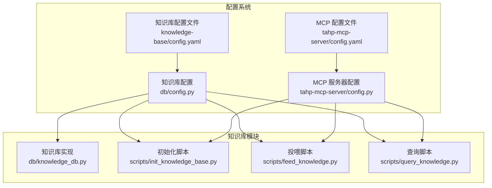
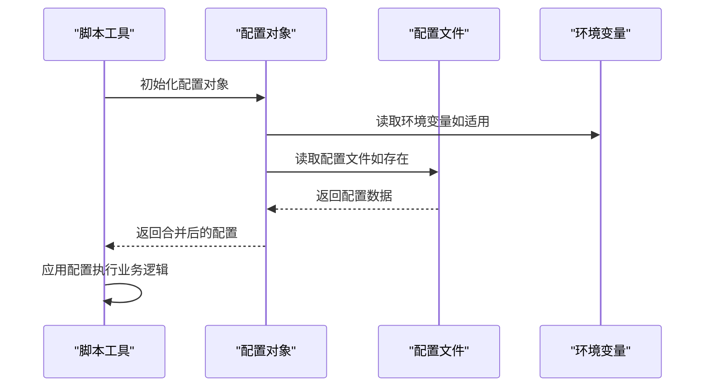
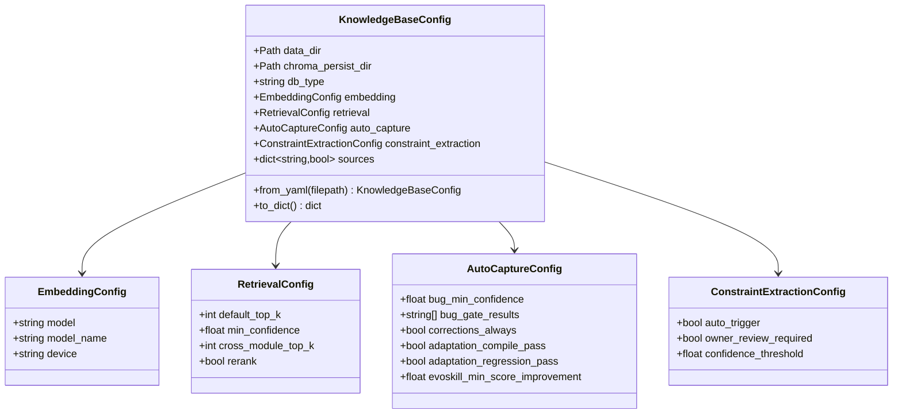
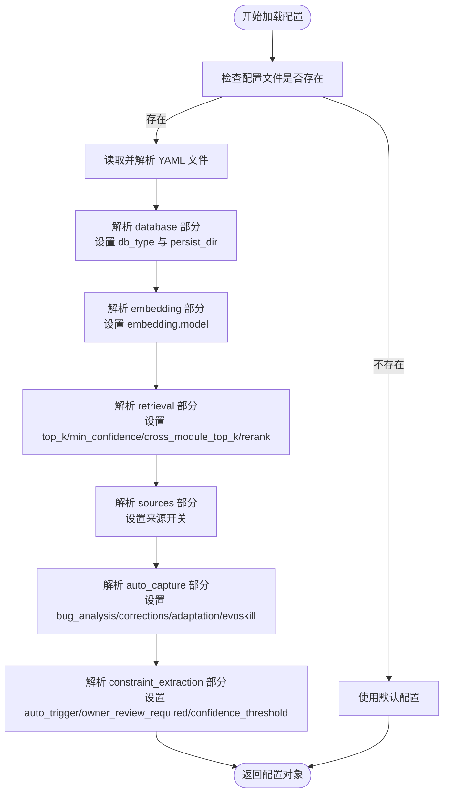
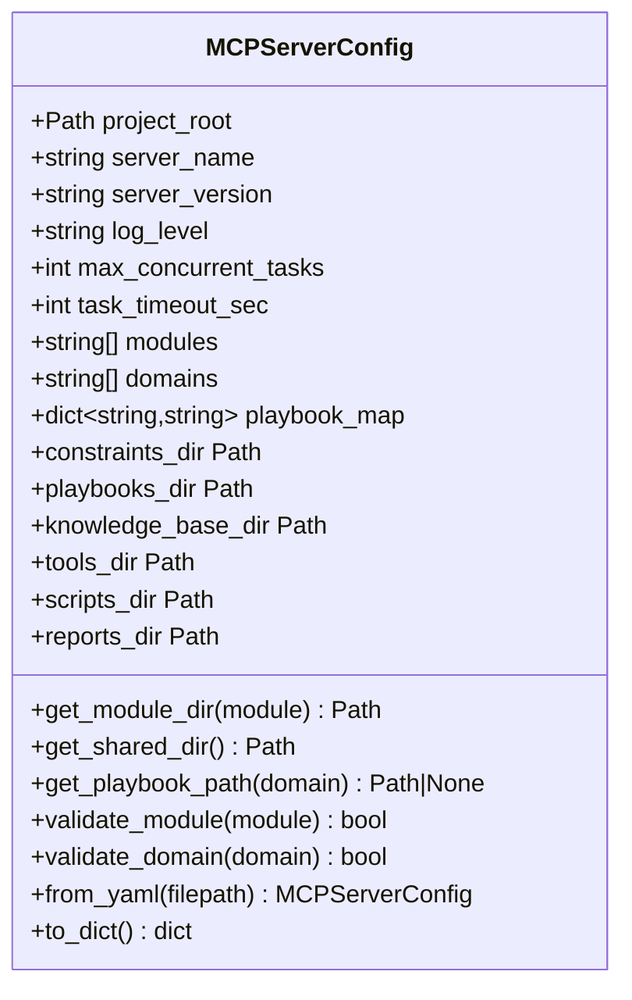
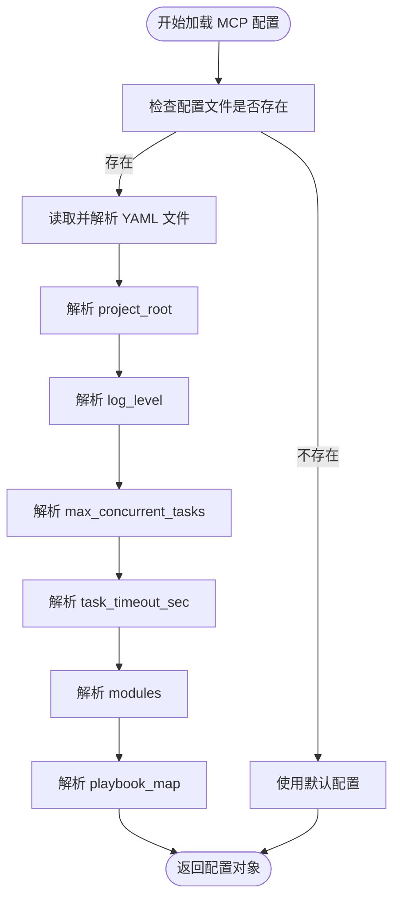
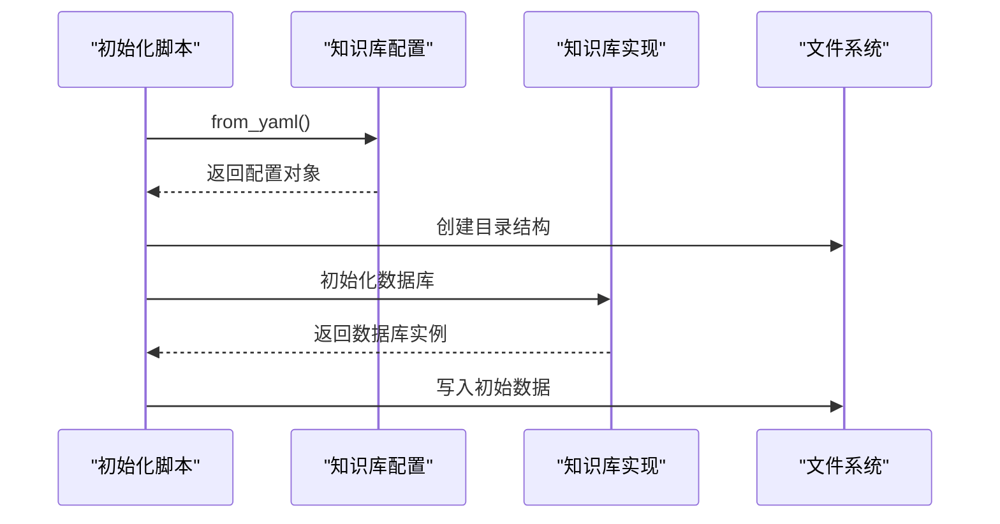
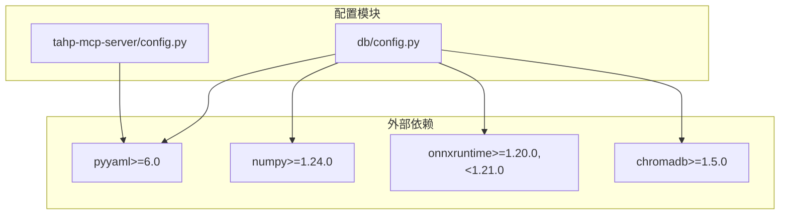

# 配置管理系统

<cite>
**本文档引用的文件**
- [db/config.py](file://db/config.py)
- [knowledge-base/config.yaml](file://knowledge-base/config.yaml)
- [tahp-mcp-server/config.py](file://tahp-mcp-server/config.py)
- [tahp-mcp-server/pyproject.toml](file://tahp-mcp-server/pyproject.toml)
- [db/knowledge_db.py](file://db/knowledge_db.py)
- [scripts/init_knowledge_base.py](file://scripts/init_knowledge_base.py)
- [scripts/feed_knowledge.py](file://scripts/feed_knowledge.py)
- [scripts/query_knowledge.py](file://scripts/query_knowledge.py)
- [requirements.txt](file://requirements.txt)
</cite>

## 目录
1. [简介](#简介)
2. [项目结构](#项目结构)
3. [核心组件](#核心组件)
4. [架构概览](#架构概览)
5. [详细组件分析](#详细组件分析)
6. [依赖分析](#依赖分析)
7. [性能考虑](#性能考虑)
8. [故障排除指南](#故障排除指南)
9. [结论](#结论)
10. [附录](#附录)

## 简介
本文件全面阐述 TAHP 配置管理系统的架构与实现，涵盖全局配置结构、环境变量支持、配置文件格式以及动态配置更新机制。重点描述 MCP 服务器配置、知识库配置、数据库配置等组件的配置选项与参数说明，并给出配置文件的优先级规则、继承机制与覆盖策略。同时提供配置管理的最佳实践、安全考虑与性能优化建议，解释配置系统与各模块的集成方式及配置验证机制。

## 项目结构
配置系统由以下关键部分组成：
- 知识库配置模块：负责知识库的嵌入、检索、自动捕获与来源控制等配置项的加载与应用。
- MCP 服务器配置模块：负责服务器运行参数、模块与领域映射、目录结构等配置项的加载与应用。
- 脚本工具：初始化知识库、投喂知识、查询知识等脚本均通过配置模块加载与应用配置。
- 配置文件：知识库配置文件与 MCP 服务器配置文件分别定义各组件的配置项。

**图表来源**
- [db/config.py:1-182](file://db/config.py#L1-L182)
- [knowledge-base/config.yaml:1-36](file://knowledge-base/config.yaml#L1-L36)
- [tahp-mcp-server/config.py:1-176](file://tahp-mcp-server/config.py#L1-L176)

**章节来源**
- [db/config.py:1-182](file://db/config.py#L1-L182)
- [knowledge-base/config.yaml:1-36](file://knowledge-base/config.yaml#L1-L36)
- [tahp-mcp-server/config.py:1-176](file://tahp-mcp-server/config.py#L1-L176)

## 核心组件
本节深入分析配置系统的核心组件及其职责与交互关系。

- 知识库配置（KnowledgeBaseConfig）
  - 负责从 YAML 文件加载知识库相关配置，包括数据库类型、嵌入模型、检索参数、自动捕获策略与来源开关等。
  - 提供 from_yaml 方法用于从指定路径或默认路径加载配置；to_dict 方法用于导出配置为字典。
  - 支持对 database、embedding、retrieval、sources、auto_capture、constraint_extraction 等子配置进行解析与覆盖。

- MCP 服务器配置（MCPServerConfig）
  - 负责从 YAML 文件加载服务器运行参数，包括项目根目录、日志级别、最大并发任务数、任务超时时间、模块与领域映射等。
  - 提供 from_yaml 方法用于从指定路径或默认路径加载配置；to_dict 方法用于导出配置为字典。
  - 支持对 project_root、log_level、max_concurrent_tasks、task_timeout_sec、modules、playbook_map 等配置项进行解析与覆盖。

- 知识库实现（KnowledgeDB）
  - 通过 KnowledgeBaseConfig 获取配置并初始化数据库连接与嵌入函数。
  - 提供知识库的增删改查、统计、跨模块检索等功能，配置影响检索阈值、结果数量等行为。

- 脚本工具
  - 初始化脚本：读取 KnowledgeBaseConfig 并初始化知识库目录结构与数据库。
  - 投喂脚本：读取 KnowledgeBaseConfig 并将解析后的知识条目写入知识库与本地文件。
  - 查询脚本：读取 KnowledgeBaseConfig 并执行语义搜索、跨模块搜索与统计查询。

**章节来源**
- [db/config.py:64-182](file://db/config.py#L64-L182)
- [tahp-mcp-server/config.py:36-176](file://tahp-mcp-server/config.py#L36-L176)
- [db/knowledge_db.py:93-131](file://db/knowledge_db.py#L93-L131)
- [scripts/init_knowledge_base.py:158-246](file://scripts/init_knowledge_base.py#L158-L246)
- [scripts/feed_knowledge.py:210-320](file://scripts/feed_knowledge.py#L210-L320)
- [scripts/query_knowledge.py:125-200](file://scripts/query_knowledge.py#L125-L200)

## 架构概览
配置系统采用"配置文件 + 环境变量 + 默认值"的多源加载策略，确保灵活性与可维护性。MCP 服务器与知识库模块各自维护独立的配置对象，但都遵循统一的加载流程与优先级规则。

**图表来源**
- [tahp-mcp-server/config.py:18-34](file://tahp-mcp-server/config.py#L18-L34)
- [db/config.py:94-161](file://db/config.py#L94-L161)

## 详细组件分析

### 知识库配置组件分析
知识库配置组件负责管理知识库的嵌入、检索、自动捕获与来源控制等配置项。其核心数据结构如下：

**图表来源**
- [db/config.py:24-86](file://db/config.py#L24-L86)

配置加载流程（from_yaml）的关键步骤：
- 解析 database 部分：设置 db_type 与 chroma_persist_dir。
- 解析 embedding 部分：设置 embedding.model。
- 解析 retrieval 部分：设置 default_top_k、min_confidence、cross_module_top_k、rerank。
- 解析 sources 部分：设置 sources 开关。
- 解析 auto_capture 部分：设置 bug_analysis、corrections、adaptation、evoskill 等子配置。
- 解析 constraint_extraction 部分：设置 auto_trigger、owner_review_required、confidence_threshold。

**图表来源**
- [db/config.py:94-161](file://db/config.py#L94-L161)

**章节来源**
- [db/config.py:24-182](file://db/config.py#L24-L182)
- [knowledge-base/config.yaml:1-36](file://knowledge-base/config.yaml#L1-L36)

### MCP 服务器配置组件分析
MCP 服务器配置组件负责管理服务器运行参数与目录映射。其核心数据结构如下：

**图表来源**
- [tahp-mcp-server/config.py:36-129](file://tahp-mcp-server/config.py#L36-L129)

配置加载流程（from_yaml）的关键步骤：
- 解析 project_root：设置项目根目录。
- 解析 log_level：设置日志级别。
- 解析 max_concurrent_tasks：设置最大并发任务数。
- 解析 task_timeout_sec：设置任务超时时间。
- 解析 modules：设置已注册模块列表。
- 解析 playbook_map：设置领域到 Playbook 文件的映射。

**图表来源**
- [tahp-mcp-server/config.py:130-161](file://tahp-mcp-server/config.py#L130-L161)

**章节来源**
- [tahp-mcp-server/config.py:36-176](file://tahp-mcp-server/config.py#L36-L176)

### 配置文件格式与优先级规则
- 知识库配置文件（knowledge-base/config.yaml）
  - 定义 database、sources、auto_capture、retrieval、constraint_extraction 等配置段。
  - 支持嵌套字段，如 auto_capture.bug_analysis、auto_capture.corrections、auto_capture.adaptation、auto_capture.evoskill 等。
  - 提供默认值与可选覆盖项，确保在部分字段缺失时仍能正常工作。

- MCP 服务器配置文件（tahp-mcp-server/config.yaml）
  - 定义 project_root、log_level、max_concurrent_tasks、task_timeout_sec、modules、playbook_map 等配置项。
  - 支持模块与领域的动态映射，便于扩展新的模块与领域。

- 环境变量支持
  - MCP 服务器配置支持通过环境变量 TAHP_PROJECT_ROOT 推断项目根目录，若未设置则向上查找包含 constraints/ 目录的父目录，最后回退到当前工作目录。
  - 知识库配置通过 from_yaml 方法加载配置文件，未直接暴露环境变量覆盖点。

- 继承机制与覆盖策略
  - from_yaml 方法逐项解析配置文件中的键值，仅覆盖已提供的字段，未提供的字段保持默认值。
  - sources 字典通过布尔转换确保开关值的有效性。
  - auto_capture 与 constraint_extraction 等复杂结构通过嵌套解析实现细粒度覆盖。

**章节来源**
- [knowledge-base/config.yaml:1-36](file://knowledge-base/config.yaml#L1-L36)
- [tahp-mcp-server/config.py:18-34](file://tahp-mcp-server/config.py#L18-L34)
- [db/config.py:94-161](file://db/config.py#L94-L161)

### 配置系统与模块集成方式
- 知识库模块集成
  - KnowledgeDB 在初始化时读取 KnowledgeBaseConfig 并据此建立数据库连接与嵌入函数。
  - 检索逻辑受 retrieval 配置影响，如 min_confidence 与 default_top_k。
  - 自动捕获与约束提取策略受 auto_capture 与 constraint_extraction 配置影响。

- 脚本工具集成
  - 初始化脚本、投喂脚本、查询脚本均通过 KnowledgeBaseConfig.from_yaml() 加载配置。
  - MCP 服务器配置通过 MCPServerConfig.from_yaml() 加载，用于确定目录结构与 Playbook 映射。

**图表来源**
- [scripts/init_knowledge_base.py:167-180](file://scripts/init_knowledge_base.py#L167-L180)
- [db/knowledge_db.py:101-127](file://db/knowledge_db.py#L101-L127)

**章节来源**
- [scripts/init_knowledge_base.py:158-246](file://scripts/init_knowledge_base.py#L158-L246)
- [scripts/feed_knowledge.py:210-320](file://scripts/feed_knowledge.py#L210-L320)
- [scripts/query_knowledge.py:125-200](file://scripts/query_knowledge.py#L125-L200)
- [db/knowledge_db.py:93-131](file://db/knowledge_db.py#L93-L131)

## 依赖分析
配置系统依赖关系清晰，主要外部依赖包括 YAML 解析与数据库相关库。

**图表来源**
- [requirements.txt:1-9](file://requirements.txt#L1-L9)
- [tahp-mcp-server/pyproject.toml:10-15](file://tahp-mcp-server/pyproject.toml#L10-L15)

**章节来源**
- [requirements.txt:1-9](file://requirements.txt#L1-L9)
- [tahp-mcp-server/pyproject.toml:1-19](file://tahp-mcp-server/pyproject.toml#L1-L19)

## 性能考虑
- 嵌入与检索性能
  - 使用 onnxruntime 的 DefaultEmbeddingFunction（all-MiniLM-L6-v2，384d）进行向量化，避免 C++ 依赖，提升跨平台兼容性。
  - SQLite 采用 WAL 模式与外键约束，保证事务一致性与并发安全性。
  - 检索时通过余弦相似度计算与最小置信度过滤，减少无效结果。

- 并发与超时
  - MCP 服务器配置支持最大并发任务数与任务超时时间设置，避免资源耗尽与长时间阻塞。
  - 知识库查询支持 top-k 结果限制，控制内存与 CPU 占用。

- 存储与索引
  - 知识库表包含 module、type、category 等常用过滤字段索引，提升查询效率。
  - 支持跨模块检索与按模块过滤，满足不同场景需求。

**章节来源**
- [db/knowledge_db.py:132-156](file://db/knowledge_db.py#L132-L156)
- [db/knowledge_db.py:158-164](file://db/knowledge_db.py#L158-L164)
- [db/knowledge_db.py:280-294](file://db/knowledge_db.py#L280-L294)
- [tahp-mcp-server/config.py:52-56](file://tahp-mcp-server/config.py#L52-L56)

## 故障排除指南
- 配置文件加载失败
  - 确认配置文件路径正确且具有读权限。
  - 检查 YAML 语法是否正确，避免解析异常导致使用默认配置。

- 环境变量未生效
  - 确认 TAHP_PROJECT_ROOT 环境变量设置正确，且路径指向包含 constraints/ 目录的父目录。
  - 若未设置，系统将自动向上查找，最终回退到当前工作目录。

- 嵌入功能不可用
  - 确认 onnxruntime 版本符合要求（1.20.0-1.21.0）。
  - 若嵌入不可用，系统将降级为文本包含匹配模式，不影响基本检索功能。

- 数据库连接问题
  - 确认知识库持久化目录存在且具有写权限。
  - 检查 SQLite 数据库文件完整性，必要时重建数据库。

**章节来源**
- [tahp-mcp-server/config.py:18-34](file://tahp-mcp-server/config.py#L18-L34)
- [db/knowledge_db.py:141-156](file://db/knowledge_db.py#L141-L156)
- [scripts/init_knowledge_base.py:144-152](file://scripts/init_knowledge_base.py#L144-L152)

## 结论
本配置管理系统通过清晰的配置文件结构与严格的加载流程，实现了 MCP 服务器与知识库模块的灵活配置与高效集成。系统支持环境变量与配置文件的多源加载，具备良好的可维护性与扩展性。通过合理的性能优化与故障排除策略，能够满足实际生产环境的需求。

## 附录
- 配置验证机制
  - 知识库配置通过 from_yaml 方法解析并校验字段，未提供的字段保持默认值。
  - 源开关通过布尔转换确保有效性，避免非法配置导致的功能异常。
  - 自动捕获与约束提取配置通过嵌套解析实现细粒度控制，便于按需调整策略。

- 最佳实践
  - 将配置文件与代码分离，便于版本控制与团队协作。
  - 使用环境变量进行环境差异化配置，避免硬编码敏感信息。
  - 定期备份知识库持久化目录，防止数据丢失。
  - 在生产环境中启用适当的日志级别与监控，及时发现配置问题。

**章节来源**
- [db/config.py:135-161](file://db/config.py#L135-L161)
- [tahp-mcp-server/config.py:156-161](file://tahp-mcp-server/config.py#L156-L161)