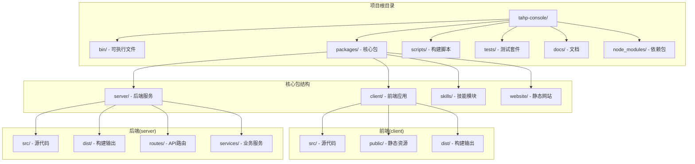
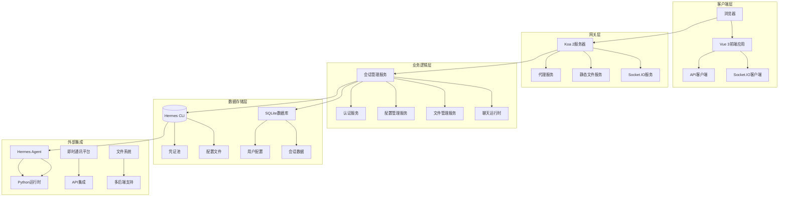
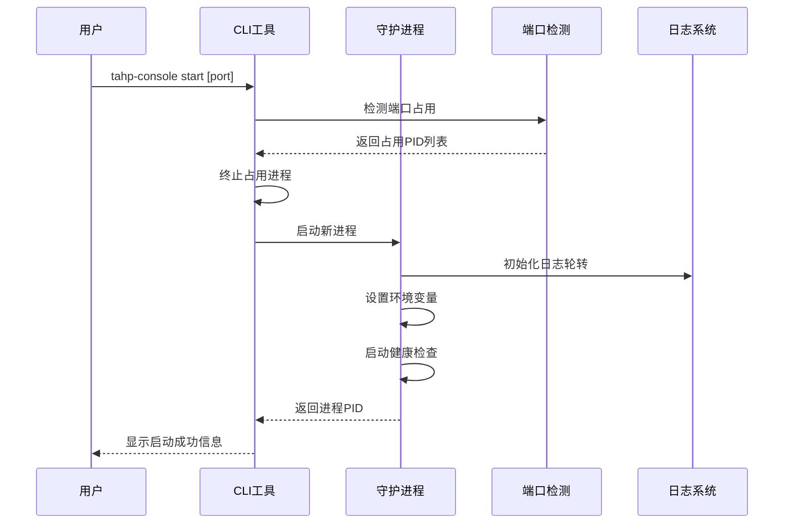
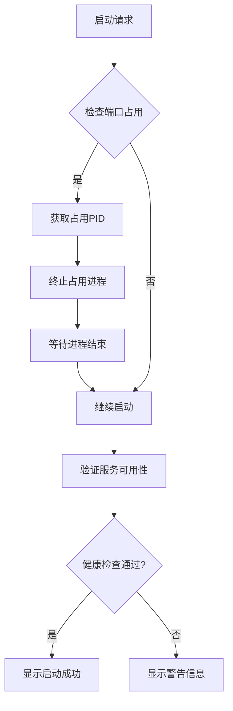
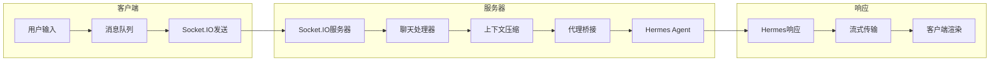

# TAHP控制台系统

<cite>
**本文档引用的文件**
- [README.md](file://README.md)
- [package.json](file://package.json)
- [DEVELOPMENT.md](file://DEVELOPMENT.md)
- [bin/tahp-console.mjs](file://bin/tahp-console.mjs)
- [Dockerfile](file://Dockerfile)
- [docker-compose.yml](file://docker-compose.yml)
- [docs/openapi.json](file://docs/openapi.json)
- [scripts/setup-tahp.mjs](file://scripts/setup-tahp.mjs)
- [scripts/generate-openapi.mjs](file://scripts/generate-openapi.mjs)
- [scripts/build-server.mjs](file://scripts/build-server.mjs)
- [vite.config.ts](file://vite.config.ts)
- [tsconfig.json](file://tsconfig.json)
</cite>

## 目录
1. [简介](#简介)
2. [项目结构](#项目结构)
3. [核心组件](#核心组件)
4. [架构概览](#架构概览)
5. [详细组件分析](#详细组件分析)
6. [依赖关系分析](#依赖关系分析)
7. [性能考虑](#性能考虑)
8. [故障排除指南](#故障排除指南)
9. [结论](#结论)

## 简介

TAHP控制台系统是一个基于Vue 3和TypeScript构建的企业级Web控制台平台，专为Android底软集成部AI平台设计。该系统是基于Hermes Web UI的分叉版本，针对传音科技的内部需求进行了深度定制。

### 主要特性

- **AI聊天管理**：支持实时聊天流传输、多会话管理、文件上传下载
- **平台通道统一配置**：支持8种主流即时通讯平台的统一配置
- **使用分析**：提供详细的令牌使用统计和成本跟踪
- **定时任务**：创建、编辑、调度各种类型的cron作业
- **模型管理**：自动发现模型、OAuth登录、多提供商支持
- **多配置文件管理**：支持多个Hermes配置文件的创建、切换和导出
- **文件浏览器**：支持本地、Docker、SSH、Singularity等多种后端的文件浏览
- **群组聊天**：多代理聊天室，支持@提及路由和上下文压缩
- **技能与记忆**：技能浏览、搜索和用户笔记管理
- **日志管理**：结构化日志解析和过滤
- **认证系统**：基于令牌的认证或可选的用户名密码登录

## 项目结构



**图表来源**
- [package.json:1-108](file://package.json#L1-L108)
- [DEVELOPMENT.md:22-29](file://DEVELOPMENT.md#L22-L29)

**章节来源**
- [package.json:1-108](file://package.json#L1-L108)
- [DEVELOPMENT.md:1-105](file://DEVELOPMENT.md#L1-L105)

## 核心组件

### 1. 可执行CLI系统

TAHP控制台的核心是一个强大的CLI工具，提供了完整的进程管理和守护进程功能。

#### 关键特性
- **守护进程管理**：支持start、stop、restart、status等命令
- **端口冲突处理**：自动检测和终止占用端口的进程
- **日志轮转**：自动管理日志文件大小和行数
- **跨平台支持**：支持Windows、Linux、macOS系统

#### 认证机制
- **默认内网模式**：未设置AUTH_TOKEN或AUTH_DISABLED时，默认关闭认证
- **令牌管理**：自动生成随机令牌或使用环境变量设置
- **兼容性**：向后兼容Hermes Web UI的环境变量

**章节来源**
- [bin/tahp-console.mjs:1-431](file://bin/tahp-console.mjs#L1-L431)

### 2. 容器化部署

系统提供了完整的Docker容器化解决方案，支持单容器部署和集成Hermes Agent。

#### Docker配置特点
- **基础镜像**：基于NousResearch Hermes Agent镜像
- **Node.js安装**：内置Node.js 23.11.0运行时
- **内存优化**：构建时增加Node.js内存限制防止OOM
- **独立运行**：强制覆盖基础镜像的默认启动脚本

**章节来源**
- [Dockerfile:1-44](file://Dockerfile#L1-L44)

### 3. 开发环境配置

提供了完整的开发环境设置和测试框架。

#### 开发工具链
- **Vite构建**：快速的开发服务器和热重载
- **TypeScript支持**：完整的类型检查和智能提示
- **测试框架**：Vitest单元测试和Playwright端到端测试
- **并发开发**：同时运行前端和后端开发服务器

**章节来源**
- [DEVELOPMENT.md:1-105](file://DEVELOPMENT.md#L1-L105)
- [vite.config.ts](file://vite.config.ts)

## 架构概览



**图表来源**
- [README.md:277-293](file://README.md#L277-L293)
- [package.json:41-106](file://package.json#L41-L106)

### 技术栈

- **前端技术**：Vue 3 + TypeScript + Vite + Naive UI + Pinia + Vue Router + vue-i18n + SCSS + markdown-it + highlight.js
- **后端技术**：Koa 2 (BFF服务器) + node-pty (Web终端)
- **数据库**：SQLite (本地会话存储)
- **实时通信**：Socket.IO (聊天流传输)
- **文件处理**：node-pty (终端) + 多后端文件系统支持

## 详细组件分析

### 1. CLI守护进程管理系统



**图表来源**
- [bin/tahp-console.mjs:196-312](file://bin/tahp-console.mjs#L196-L312)

#### 核心功能实现

**端口冲突处理流程**


**图表来源**
- [bin/tahp-console.mjs:107-148](file://bin/tahp-console.mjs#L107-L148)

**章节来源**
- [bin/tahp-console.mjs:35-431](file://bin/tahp-console.mjs#L35-L431)

### 2. 聊天运行时系统

系统基于Socket.IO实现了高性能的实时聊天功能，支持多会话管理和上下文压缩。

#### 聊天流处理架构


**图表来源**
- [README.md:34-48](file://README.md#L34-L48)

### 3. 多平台通道配置系统

系统支持8种主流即时通讯平台的统一配置管理：

| 平台 | 功能特性 |
|------|----------|
| Telegram | Bot令牌、提及控制、反应、自由回复聊天 |
| Discord | Bot令牌、提及、自动线程、反应、频道允许/忽略列表 |
| Slack | Bot令牌、提及控制、机器人消息处理 |
| WhatsApp | 启用/禁用、提及控制、提及模式 |
| Matrix | 访问令牌、服务器、自动线程、私人消息提及线程 |
| 飞书 | 应用ID/密钥、提及控制 |
| 微信 | 扫码登录（在浏览器中扫描，自动保存凭据） |
| 企业微信 | 机器人ID/密钥 |

**章节来源**
- [README.md:50-67](file://README.md#L50-L67)

### 4. 文件管理系统

支持多种后端的文件浏览和操作：

- **本地文件系统**：直接访问主机文件系统
- **Docker容器**：访问Docker容器内的文件
- **SSH连接**：远程文件系统访问
- **Singularity容器**：容器化环境文件管理

#### 文件操作能力
- 浏览、上传、下载、重命名、复制、移动、删除
- 创建目录、查看文件内容（带语法高亮）
- 支持不同文件类型的预览和编辑

**章节来源**
- [README.md:99-105](file://README.md#L99-L105)

### 5. 定时任务系统

提供完整的cron作业管理功能：

- 创建、编辑、暂停、恢复、删除定时任务
- 触发即时执行
- Cron表达式快速预设
- 任务状态监控和历史记录

## 依赖关系分析

```mermaid
graph TB
subgraph "核心依赖"
A[socket.io] --> B[实时通信]
C[node-pty] --> D[终端支持]
E[js-tiktoken] --> F[令牌计数]
G[eventsource] --> H[事件流]
I[node-edge-tts] --> J[TTS支持]
end
subgraph "开发依赖"
K[@vitejs/plugin-vue] --> L[Vite Vue插件]
M[vue-tsc] --> N[TypeScript编译]
O[vitest] --> P[测试框架]
Q[typescript] --> R[类型定义]
end
subgraph "UI组件"
S[naive-ui] --> T[组件库]
U[highlight.js] --> V[代码高亮]
W[markdown-it] --> X[Markdown渲染]
end
```

**图表来源**
- [package.json:41-106](file://package.json#L41-L106)

### 外部服务集成

系统通过代理机制集成多种外部服务：

- **Hermes Agent**：AI代理运行时
- **即时通讯平台API**：各平台的官方API
- **文件系统后端**：本地、Docker、SSH、Singularity
- **认证服务**：OAuth登录支持

**章节来源**
- [package.json:1-108](file://package.json#L1-L108)

## 性能考虑

### 1. 内存管理优化

- **Node.js内存限制**：构建时设置`--max-old-space-size=4096`防止内存溢出
- **日志轮转**：自动限制日志文件大小和行数
- **连接池管理**：合理管理Socket.IO连接和文件系统连接

### 2. 实时性能优化

- **上下文压缩**：当对话历史超过令牌阈值时自动进行对话摘要
- **流式传输**：使用Server-Sent Events实现高效的实时数据传输
- **缓存策略**：智能缓存模型元数据和常用配置

### 3. 资源利用优化

- **并发处理**：支持多会话并发处理
- **异步操作**：所有I/O操作都采用异步非阻塞方式
- **资源清理**：自动清理临时文件和过期连接

## 故障排除指南

### 1. 常见启动问题

**端口占用问题**
- 使用`tahp-console status`检查服务状态
- 使用`netstat`或`lsof`查看端口占用情况
- 系统会自动尝试终止占用进程

**权限问题**
- 确保用户对数据目录有读写权限
- 检查防火墙设置是否允许端口通信

### 2. 认证相关问题

**令牌丢失**
- 检查`~/.tahp-console/.token`文件是否存在
- 重新启动服务以生成新的随机令牌
- 或者设置`AUTH_TOKEN`环境变量

**认证失败**
- 验证Bearer令牌格式正确
- 检查`AUTH_DISABLED`环境变量设置
- 确认客户端请求头包含正确的Authorization字段

### 3. 文件系统问题

**文件上传失败**
- 检查上传目录权限
- 验证文件大小限制设置
- 确认目标后端连接正常

**文件浏览异常**
- 验证后端连接配置
- 检查网络连通性
- 查看后端服务状态

### 4. 实时通信问题

**聊天连接断开**
- 检查网络连接稳定性
- 验证Socket.IO服务器状态
- 查看浏览器开发者工具中的网络面板

**消息延迟**
- 检查服务器负载情况
- 验证代理配置
- 确认Hermes Agent运行状态

**章节来源**
- [bin/tahp-console.mjs:314-352](file://bin/tahp-console.mjs#L314-L352)

## 结论

TAHP控制台系统是一个功能完整、架构清晰的企业级Web控制台平台。通过深度定制和优化，它成功地满足了传音科技Android底软集成部的内部需求。

### 主要优势

1. **高度内网友好**：默认关闭认证，开箱即用
2. **强大的实时通信**：基于Socket.IO的高效聊天系统
3. **灵活的部署方式**：支持本地安装、Docker容器化部署
4. **全面的功能覆盖**：从聊天管理到文件系统管理的一站式解决方案
5. **优秀的开发体验**：完善的开发工具链和测试框架

### 技术亮点

- **模块化架构**：清晰的前后端分离和功能模块划分
- **现代化技术栈**：Vue 3 + TypeScript + Vite的现代开发体验
- **生产就绪**：完整的容器化部署和监控机制
- **可扩展性**：良好的插件架构和API设计

该系统为Android底软集成部提供了一个强大而易用的AI平台管理界面，显著提升了开发和运维效率。