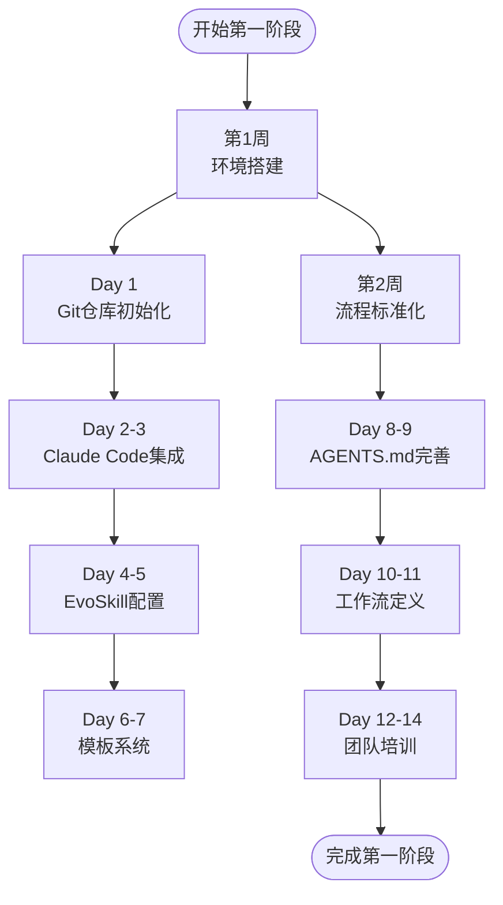
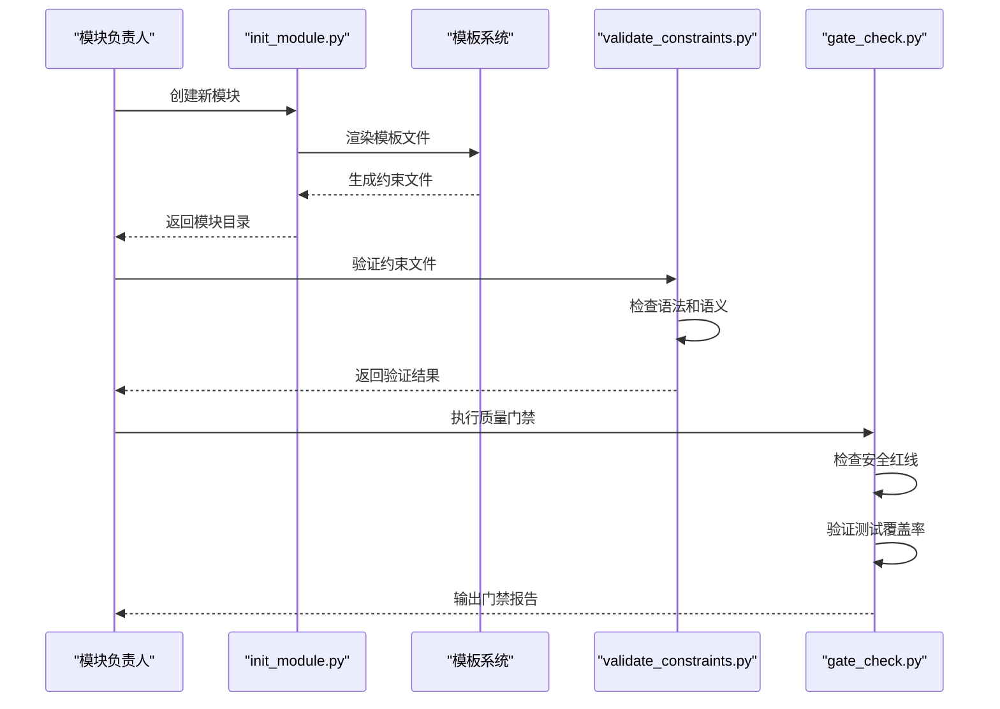
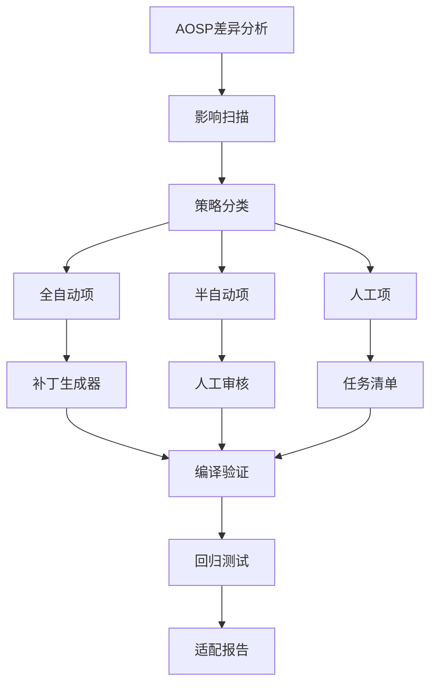
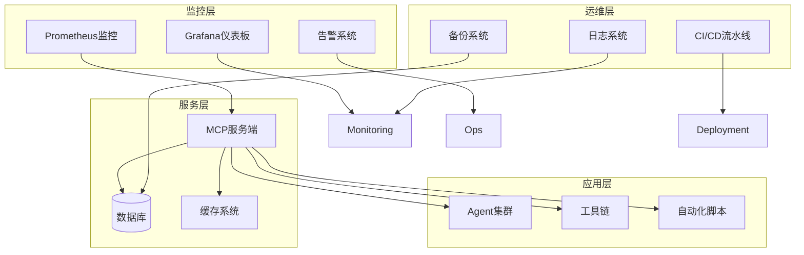

# 实施路线图

<cite>
**本文档引用的文件**
- [AGENTS.md](file://AGENTS.md)
- [.evoskill/config.toml](file://.evoskill/config.toml)
- [scripts/init_module.py](file://scripts/init_module.py)
- [scripts/validate_constraints.py](file://scripts/validate_constraints.py)
- [scripts/gate_check.py](file://scripts/gate_check.py)
- [scripts/run_evolution.py](file://scripts/run_evolution.py)
- [playbooks/code-adaptation-pipeline.yaml](file://playbooks/code-adaptation-pipeline.yaml)
- [playbooks/version-upgrade-pipeline.yaml](file://playbooks/version-upgrade-pipeline.yaml)
- [tools/aosp-diff-analyzer/tool.py](file://tools/aosp-diff-analyzer/tool.py)
- [tools/patch-generator/tool.py](file://tools/patch-generator/tool.py)
- [templates/module-template/module.yaml.template](file://templates/module-template/module.yaml.template)
</cite>

## 目录
1. [项目概述](#项目概述)
2. [第一阶段：基础设施建设（第1-2周）](#第一阶段基础设施建设第1-2周)
3. [第二阶段：约束驱动MVP（第3-4周）](#第二阶段约束驱动mvp第3-4周)
4. [第三阶段：适应引擎MVP（第5-6周）](#第三阶段适应引擎mvp第5-6周)
5. [第四阶段：规模化部署（第7-8周）](#第四阶段规模化部署第7-8周)
6. [实施指导与最佳实践](#实施指导与最佳实践)
7. [里程碑与交付物清单](#里程碑与交付物清单)
8. [风险控制与质量门禁](#风险控制与质量门禁)

## 项目概述

TAHP（TECNO AI Harness Platform）是一个双引擎AI平台，采用"诊断引擎 + 适配引擎"架构，基于约束驱动和EvoSkill自动进化实现AI辅助开发。平台服务于传音Android底软集成部，覆盖通信、驱动、内核、功耗等子部门。

平台核心特征：
- **双引擎架构**：诊断引擎负责Bug分析，适配引擎负责版本/特性/运营商移植
- **约束驱动**：通过约束文件定义业务规则和质量标准
- **AI技能进化**：基于Claude Code和EvoSkill实现技能自动优化
- **工具链集成**：提供完整的AOSP差异分析、API迁移、补丁生成工具

## 第一阶段：基础设施建设（第1-2周）

### 阶段目标
建立完整的开发环境和基础框架，确保团队具备实施后续阶段的能力。

### 关键交付物
- Git仓库初始化和分支策略
- Claude Code AI助手配置
- EvoSkill进化框架设置
- 模块模板系统
- AGENTS.md文档完善

### 详细实施计划

#### 第1周：环境搭建与工具配置

**第1天：Git仓库与基础配置**
- 初始化Git仓库，设置分支保护规则
- 配置.gitignore，排除敏感文件
- 设置远程仓库同步策略

**第2-3天：Claude Code集成**
- 安装Claude Code CLI工具
- 配置API密钥和认证
- 测试AI代码生成功能
- 设置编辑器集成（VS Code扩展）

**第4-5天：EvoSkill框架配置**
- 安装EvoSkill依赖包
- 配置.evostyle/config.toml参数
- 设置进化算法参数（变异率、交叉率等）
- 验证并行评估配置

**第6-7天：模板系统建立**
- 部署templates/module-template目录
- 配置module.yaml.template模板
- 设置约束文件模板
- 验证模板渲染功能

#### 第2周：文档与流程标准化

**第8-9天：AGENTS.md完善**
- 更新项目架构说明
- 补充快速导航链接
- 完善安全红线条款
- 添加质量门禁标准

**第10-11天：工作流定义**
- 设计CI/CD流水线
- 建立代码审查流程
- 设置自动化测试策略
- 配置监控告警机制

**第12-14天：团队培训**
- Claude Code使用培训
- EvoSkill技能训练
- 约束文件编写规范
- 工具链操作指南

**图表来源**
- [AGENTS.md:1-83](file://AGENTS.md#L1-L83)
- [.evoskill/config.toml:1-58](file://.evoskill/config.toml#L1-L58)
- [scripts/init_module.py:1-365](file://scripts/init_module.py#L1-L365)

**章节来源**
- [AGENTS.md:1-83](file://AGENTS.md#L1-L83)
- [.evoskill/config.toml:1-58](file://.evoskill/config.toml#L1-L58)
- [scripts/init_module.py:1-365](file://scripts/init_module.py#L1-L365)

## 第二阶段：约束驱动MVP（第3-4周）

### 阶段目标
建立约束驱动的核心能力，实现基本的Bug分析和代码适配功能。

### 关键交付物
- 所有者填写的约束文件
- 初始技能集合
- 测试数据集
- 基准指标体系

### 详细实施计划

#### 第3周：约束文件与技能初始化

**第15-17天：模块约束文件创建**
- 使用init_module.py创建telephony模块
- 填写module.yaml中的scope信息
- 配置bug-analysis.yaml约束规则
- 设置API迁移规则

**第18-20天：技能模板配置**
- 部署telephony-bug-analyzer技能
- 配置Claude Code提示词
- 设置EvoSkill进化参数
- 建立技能评估指标

**第21-23天：测试数据准备**
- 创建eval-data/cases目录
- 编写测试用例模板
- 建立expected输出标准
- 配置数据验证规则

#### 第4周：质量门禁与验证

**第24-26天：约束验证系统**
- 部署validate_constraints.py工具
- 配置跨模块依赖检查
- 设置语法和语义验证
- 建立严格模式检查

**第27-28天：质量门禁实施**
- 部署gate_check.py工具
- 配置P0/P1/P2门禁级别
- 建立自动化检查流程
- 设置门禁失败处理机制

**第29-30天：MVP验证**
- 运行约束文件验证
- 执行质量门禁检查
- 评估技能性能指标
- 总结MVP成果

**图表来源**
- [scripts/init_module.py:154-249](file://scripts/init_module.py#L154-L249)
- [scripts/validate_constraints.py:239-278](file://scripts/validate_constraints.py#L239-L278)
- [scripts/gate_check.py:395-415](file://scripts/gate_check.py#L395-L415)

**章节来源**
- [scripts/init_module.py:154-249](file://scripts/init_module.py#L154-L249)
- [scripts/validate_constraints.py:239-278](file://scripts/validate_constraints.py#L239-L278)
- [scripts/gate_check.py:395-415](file://scripts/gate_check.py#L395-L415)

## 第三阶段：适应引擎MVP（第5-6周）

### 阶段目标
实现适应引擎的核心功能，包括AOSP差异分析、影响扫描和API迁移规则。

### 关键交付物
- AOSP差异分析工具
- 影响扫描系统
- API迁移规则库
- 批量补丁生成器

### 详细实施计划

#### 第5周：AOSP差异分析与影响扫描

**第31-33天：AOSP差异分析工具**
- 部署aosp-diff-analyzer工具
- 配置版本对比参数
- 设置API变更检测规则
- 建立变更分类机制

**第34-36天：影响扫描系统**
- 开发影响分析算法
- 配置定制代码交叉比对
- 建立受影响文件识别
- 设置影响程度评估

#### 第6周：API迁移与补丁生成

**第37-39天：API迁移规则库**
- 建立framework-migration.yaml
- 配置HAL迁移规则
- 设置Telephony迁移策略
- 验证迁移规则有效性

**第40-42天：批量补丁生成器**
- 部署patch-generator工具
- 配置自动化补丁生成
- 建立半自动审核流程
- 设置人工干预机制

**图表来源**
- [playbooks/version-upgrade-pipeline.yaml:1-61](file://playbooks/version-upgrade-pipeline.yaml#L1-L61)
- [tools/aosp-diff-analyzer/tool.py:10-27](file://tools/aosp-diff-analyzer/tool.py#L10-L27)
- [tools/patch-generator/tool.py:3-20](file://tools/patch-generator/tool.py#L3-L20)

**章节来源**
- [playbooks/version-upgrade-pipeline.yaml:1-61](file://playbooks/version-upgrade-pipeline.yaml#L1-L61)
- [tools/aosp-diff-analyzer/tool.py:10-27](file://tools/aosp-diff-analyzer/tool.py#L10-L27)
- [tools/patch-generator/tool.py:3-20](file://tools/patch-generator/tool.py#L3-L20)

## 第四阶段：规模化部署（第7-8周）

### 阶段目标
实现平台的全面部署和规模化应用，建立完整的生产环境。

### 关键交付物
- 生产环境部署
- 监控告警系统
- 自动化运维流程
- 团队知识转移

### 详细实施计划

#### 第7周：生产环境准备

**第43-45天：环境部署**
- 配置生产服务器环境
- 部署MCP服务端
- 设置数据库连接
- 配置缓存系统

**第46-48天：监控系统**
- 部署Prometheus监控
- 配置Grafana仪表板
- 设置告警规则
- 建立日志收集系统

#### 第8周：运维与优化

**第49-51天：自动化运维**
- 配置CI/CD流水线
- 建立自动化测试
- 设置部署回滚机制
- 配置备份策略

**第52-56天：团队培训与知识转移**
- 培训运维团队
- 编写操作手册
- 建立知识库
- 制定应急响应流程

**第57-60天：性能优化与扩展**
- 优化系统性能
- 扩展并发处理能力
- 建立容量规划
- 配置负载均衡

**图表来源**
- [tahp-mcp-server/server.py](file://tahp-mcp-server/server.py)
- [db/config.py](file://db/config.py)
- [scripts/run_evolution.py:409-527](file://scripts/run_evolution.py#L409-L527)

**章节来源**
- [tahp-mcp-server/server.py](file://tahp-mcp-server/server.py)
- [db/config.py](file://db/config.py)
- [scripts/run_evolution.py:409-527](file://scripts/run_evolution.py#L409-L527)

## 实施指导与最佳实践

### 开发流程建议
1. **迭代开发**：采用敏捷方法，每2周为一个迭代周期
2. **持续集成**：建立自动化测试和部署流程
3. **代码审查**：严格执行代码审查制度
4. **文档同步**：开发与文档编写并行进行

### 技术最佳实践
1. **约束优先**：先定义约束，再实现功能
2. **测试驱动**：编写测试用例驱动开发
3. **质量门禁**：严格执行P0/P1/P2门禁标准
4. **版本控制**：使用语义化版本管理

### 团队协作
1. **角色分工**：明确模块负责人和技术负责人
2. **沟通机制**：建立每日站会和周报制度
3. **知识共享**：定期组织技术分享会
4. **培训计划**：制定AI工具使用培训计划

## 里程碑与交付物清单

### 第1阶段里程碑
- [ ] Git仓库初始化完成
- [ ] Claude Code集成配置
- [ ] EvoSkill框架部署
- [ ] 模板系统可用
- [ ] AGENTS.md文档完善

### 第2阶段里程碑
- [ ] telephony模块约束文件
- [ ] Bug分析技能配置
- [ ] 测试数据集建立
- [ ] 约束验证工具部署
- [ ] 质量门禁系统运行

### 第3阶段里程碑
- [ ] AOSP差异分析工具
- [ ] 影响扫描系统
- [ ] API迁移规则库
- [ ] 批量补丁生成器
- [ ] 适应引擎MVP完成

### 第4阶段里程碑
- [ ] 生产环境部署
- [ ] 监控告警系统
- [ ] 自动化运维流程
- [ ] 团队知识转移
- [ ] 平台规模化应用

## 风险控制与质量门禁

### 质量门禁标准
平台建立了三层质量门禁体系：

**P0门禁（阻断级）**
- 安全红线必须满足
- 约束文件必须有效
- 无硬编码密钥
- 编译必须通过

**P1门禁（警告级）**
- 测试覆盖率要求
- 文档完整性检查
- 文件命名规范
- 代码风格一致性

**P2门禁（记录级）**
- 代码复杂度控制
- 重复率评估
- 注释覆盖率
- 示例用例完整性

### 风险控制措施
1. **安全控制**：严格执行安全红线，禁止修改排除范围内的文件
2. **质量控制**：建立多层次的质量检查机制
3. **变更控制**：实施严格的变更管理和审批流程
4. **监控控制**：建立实时监控和告警机制

### 应急响应
1. **问题分级**：根据影响程度分级响应
2. **快速恢复**：建立快速回滚机制
3. **沟通协调**：建立跨部门协调机制
4. **经验总结**：定期总结改进经验