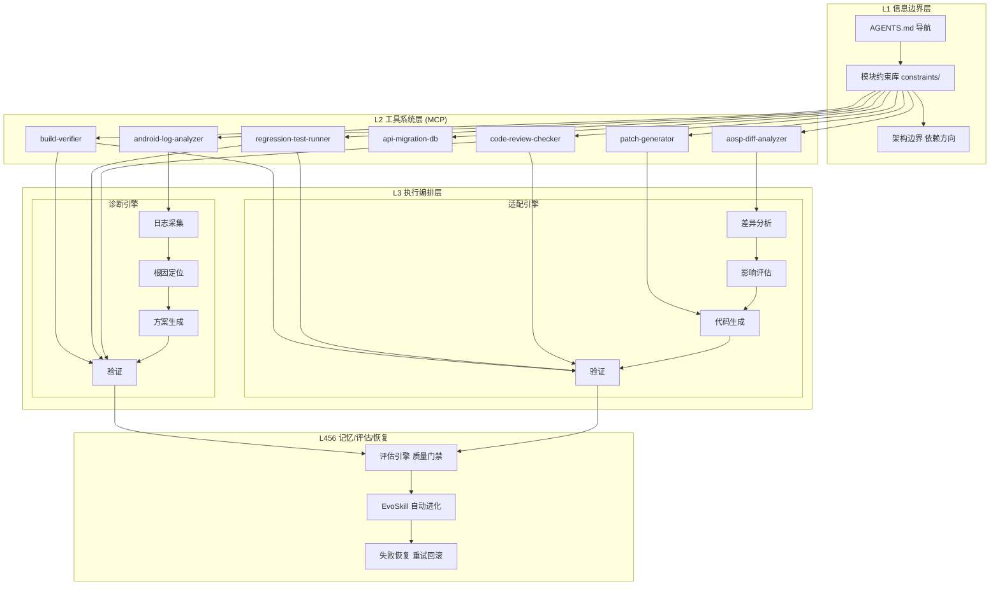
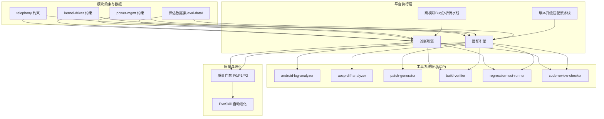
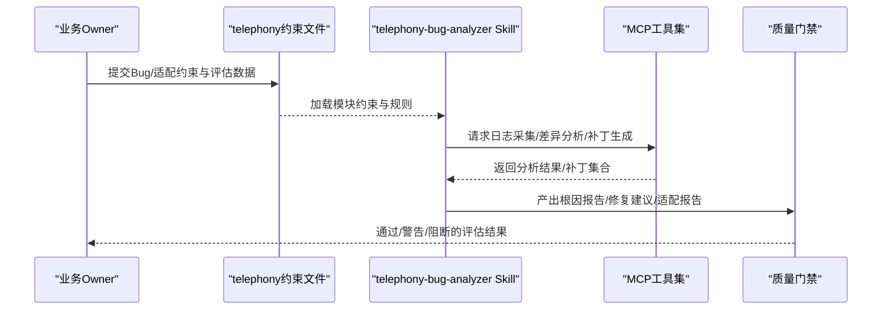
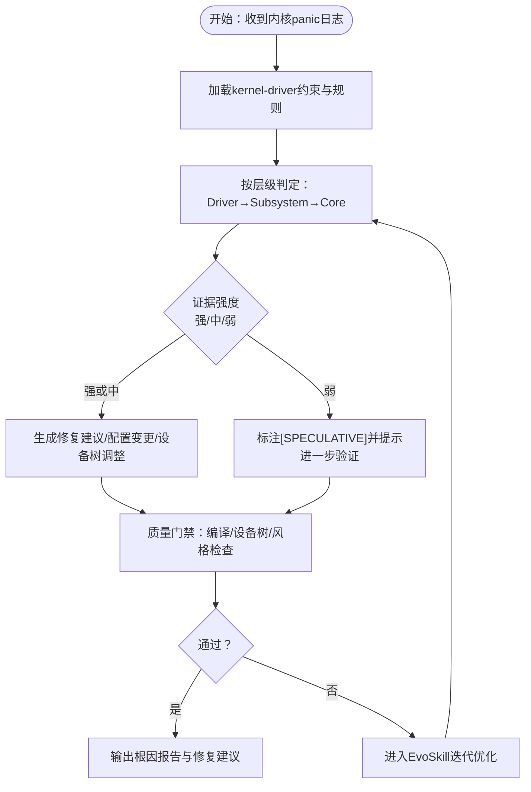
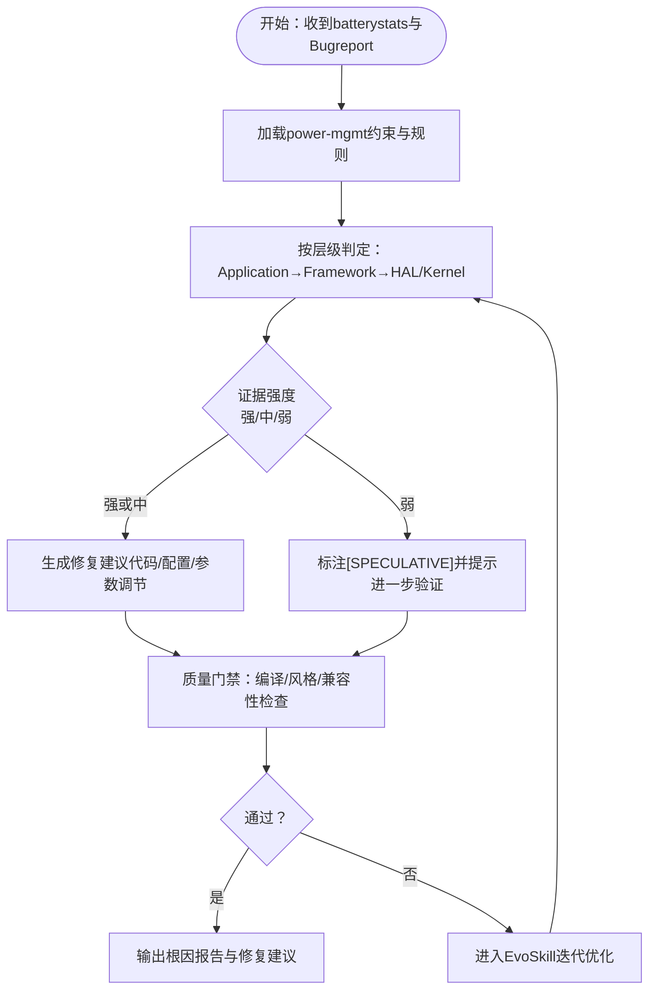
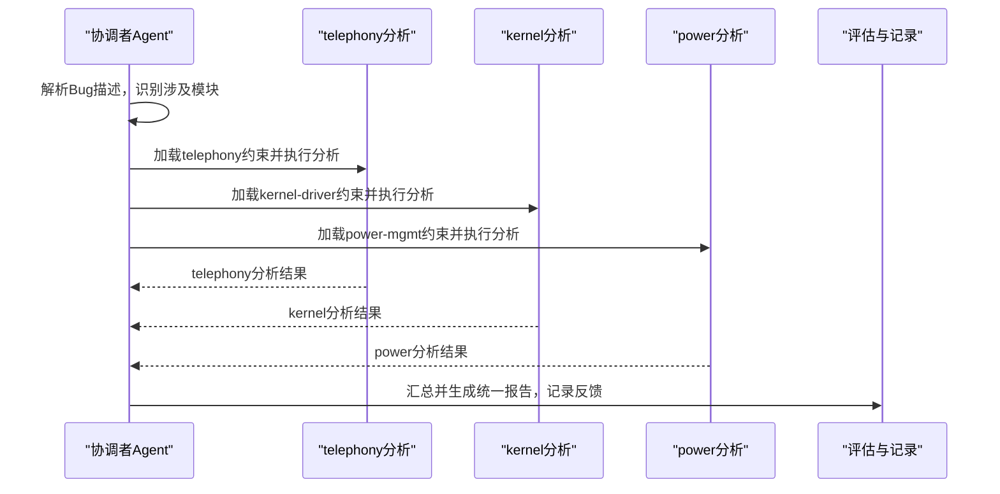
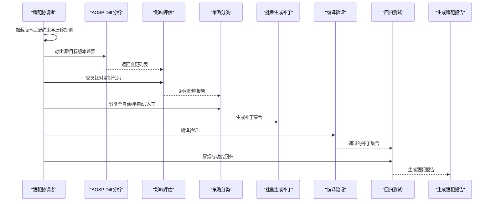
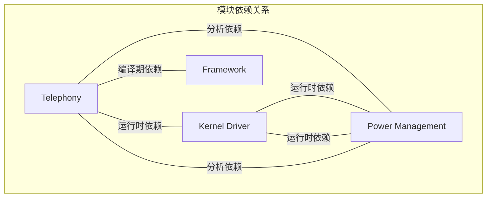

# 应用场景与价值

<cite>
**本文引用的文件**
- [系统架构概览.md](file://docs/architecture/system-overview.md)
- [android-platform.yaml](file://constraints/shared/android-platform.yaml)
- [telephony 模块约束](file://constraints/telephony/module.yaml)
- [telephony Bug分析约束](file://constraints/telephony/bug-analysis.yaml)
- [telephony 代码适配约束](file://constraints/telephony/code-adaptation.yaml)
- [telephony 版本适配约束](file://constraints/telephony/version-adaptation.yaml)
- [kernel-driver 模块约束](file://constraints/kernel-driver/module.yaml)
- [kernel-driver Bug分析约束](file://constraints/kernel-driver/bug-analysis.yaml)
- [kernel-driver 代码适配约束](file://constraints/kernel-driver/code-adaptation.yaml)
- [power-mgmt 模块约束](file://constraints/power-mgmt/module.yaml)
- [power-mgmt Bug分析约束](file://constraints/power-mgmt/bug-analysis.yaml)
- [跨模块Bug分析流水线](file://playbooks/bug-analysis-pipeline.yaml)
- [版本升级适配流水线](file://playbooks/version-upgrade-pipeline.yaml)
- [telephony-Bug分析Skill](file://skills/.claude/skills/telephony-bug-analyzer/SKILL.md)
</cite>

## 目录
1. [引言](#引言)
2. [项目结构](#项目结构)
3. [核心组件](#核心组件)
4. [架构总览](#架构总览)
5. [详细组件分析](#详细组件分析)
6. [依赖分析](#依赖分析)
7. [性能考虑](#性能考虑)
8. [故障排查指南](#故障排查指南)
9. [结论](#结论)
10. [附录](#附录)

## 引言
本文件聚焦于TAHP AI平台在Android基础软件开发中的具体应用场景与价值，围绕Telephony（电话/通信）、Kernel Driver（内核驱动）、Power Management（电源管理）三大模块，系统阐述平台如何通过“约束驱动 + 双引擎”范式，将Owner提供的约束条件转化为可自动执行的Skill，并在诊断引擎与适配引擎之间形成闭环，从而提升开发效率、降低人工成本、提高代码质量与交付稳定性。

平台的核心理念是“以约束代替SOP，以自动化替代重复劳动”。Owner只需维护YAML约束文件与少量历史案例，系统即可自动生成、进化与评估Skill，实现从“人写执行步骤”到“人写约束条件、系统自动推导执行”的跃迁。

## 项目结构
TAHP采用六层Harness架构，围绕“信息边界层（L1）—工具系统层（L2）—执行编排层（L3）—记忆/评估/恢复层（L456）”展开，配合MCP工具标准化接入与Playbook编排，形成可扩展、可演进的AI工程化平台。

- L1 信息边界层：AGENTS.md导航、模块约束库、架构边界
- L2 工具系统层（MCP）：android-log-analyzer、aosp-diff-analyzer、patch-generator、api-migration-db、build-verifier、regression-test-runner、code-review-checker
- L3 执行编排层：诊断引擎（日志采集→根因定位→方案生成→验证）与适配引擎（差异分析→影响评估→代码生成→验证）
- L456 记忆/评估/恢复：EvoSkill自动进化、评估引擎质量门禁、失败恢复重试回滚

图表来源
- [系统架构概览.md:87-127](file://docs/architecture/system-overview.md#L87-L127)

章节来源
- [系统架构概览.md:31-127](file://docs/architecture/system-overview.md#L31-L127)

## 核心组件
- 诊断引擎：面向Bug根因分析，按层级判定（Framework→RILJ→RILC→Modem）进行证据链构建与修复建议生成，支持安全门禁与质量门禁。
- 适配引擎：面向版本升级、特性移植与运营商移植，通过AOSP Diff分析、影响评估、策略分类（全自动/半自动/人工）与批量代码生成，配合编译验证与回归测试。
- 约束驱动Harness：以YAML约束文件为唯一输入，定义输入/输出、禁止事项、质量门禁与评估数据集，确保Skill可执行、可评估、可演进。
- 工具系统层（MCP）：标准化接入各类工具，统一接口与前置验证，保障跨模块协作与可复用性。
- EvoSkill进化：基于反馈历史与去重策略，持续优化Skill变体，实现“进化一次，到处可用”。

章节来源
- [系统架构概览.md:161-204](file://docs/architecture/system-overview.md#L161-L204)
- [系统架构概览.md:221-265](file://docs/architecture/system-overview.md#L221-L265)
- [系统架构概览.md:292-313](file://docs/architecture/system-overview.md#L292-L313)

## 架构总览
下图展示了平台在Android基础软件开发中的整体应用路径：从模块约束与评估数据出发，通过诊断/适配引擎与MCP工具协同，最终形成可自动执行的Skill，并在质量门禁与EvoSkill的驱动下持续优化。

图表来源
- [系统架构概览.md:292-313](file://docs/architecture/system-overview.md#L292-L313)
- [跨模块Bug分析流水线:1-43](file://playbooks/bug-analysis-pipeline.yaml#L1-L43)
- [版本升级适配流水线:1-61](file://playbooks/version-upgrade-pipeline.yaml#L1-L61)

## 详细组件分析

### Telephony（电话/通信）模块应用场景与价值
Telephony模块覆盖Framework、RILJ、Telephony Service、Telecom Framework以及RILC层，是通话、短信、数据连接与VoLTE/VoWiFi等核心能力的基础。平台在此模块的应用主要体现在：

- Bug根因分析：通过严格的层级判定（Framework→RILJ→RILC→Modem）与证据链构建，结合安全门禁与最小产出维度，快速定位根因并生成修复建议，显著缩短问题定位时间。
- 版本适配与API迁移：针对AOSP版本升级带来的API变更（如方法签名变化、常量迁移、接口变更），平台提供迁移规则库与批量适配策略，支持全自动/半自动/人工三级处理，降低升级风险与返工成本。
- 代码适配约束：限定允许/禁止修改路径、编码风格与接口变更规则，确保适配过程可控、可审计、可回归。

图表来源
- [telephony-Bug分析Skill:1-51](file://skills/.claude/skills/telephony-bug-analyzer/SKILL.md#L1-L51)
- [telephony Bug分析约束:1-110](file://constraints/telephony/bug-analysis.yaml#L1-L110)
- [telephony 代码适配约束:1-48](file://constraints/telephony/code-adaptation.yaml#L1-L48)
- [telephony 版本适配约束:1-117](file://constraints/telephony/version-adaptation.yaml#L1-L117)

章节来源
- [telephony 模块约束:11-43](file://constraints/telephony/module.yaml#L11-L43)
- [telephony Bug分析约束:1-110](file://constraints/telephony/bug-analysis.yaml#L1-L110)
- [telephony 代码适配约束:1-48](file://constraints/telephony/code-adaptation.yaml#L1-L48)
- [telephony 版本适配约束:1-117](file://constraints/telephony/version-adaptation.yaml#L1-L117)
- [telephony-Bug分析Skill:1-51](file://skills/.claude/skills/telephony-bug-analyzer/SKILL.md#L1-L51)

### Kernel Driver（内核驱动）模块应用场景与价值
Kernel Driver模块聚焦内核驱动、ARM64架构与设备树，平台在此模块的应用重点在于：

- Panic根因定位：通过内核panic日志与层级判定（Driver→Subsystem→Core），结合设备树/配置文件等上下文，快速定位驱动初始化失败、子系统异常或内核核心问题。
- 代码适配与构建验证：提供checkpatch风格检查、设备树编译验证等质量门禁，确保补丁符合内核编码规范与平台兼容性。

图表来源
- [kernel-driver Bug分析约束:1-65](file://constraints/kernel-driver/bug-analysis.yaml#L1-L65)
- [kernel-driver 代码适配约束:1-37](file://constraints/kernel-driver/code-adaptation.yaml#L1-L37)

章节来源
- [kernel-driver 模块约束:11-30](file://constraints/kernel-driver/module.yaml#L11-L30)
- [kernel-driver Bug分析约束:1-65](file://constraints/kernel-driver/bug-analysis.yaml#L1-L65)
- [kernel-driver 代码适配约束:1-37](file://constraints/kernel-driver/code-adaptation.yaml#L1-L37)

### Power Management（电源管理）模块应用场景与价值
Power Management模块覆盖Power Management Framework、Power HAL与Battery Service，平台在此模块的应用侧重于：

- 功耗根因定位：通过Battery Historian与Bugreport，按层级判定（Application→Framework→HAL/Kernel），识别WakeLock滥用、系统服务异常或底层功耗问题。
- 适配与回归：在版本升级过程中，结合API迁移与质量门禁，确保功耗策略与接口变更不影响平台稳定性。

图表来源
- [power-mgmt Bug分析约束:1-61](file://constraints/power-mgmt/bug-analysis.yaml#L1-L61)

章节来源
- [power-mgmt 模块约束:11-32](file://constraints/power-mgmt/module.yaml#L11-L32)
- [power-mgmt Bug分析约束:1-61](file://constraints/power-mgmt/bug-analysis.yaml#L1-L61)

### 跨模块Bug分析与版本适配流程
平台提供跨模块Bug分析流水线与版本升级适配流水线，分别用于多子系统协同分析与批量适配。

图表来源
- [跨模块Bug分析流水线:1-43](file://playbooks/bug-analysis-pipeline.yaml#L1-L43)

图表来源
- [版本升级适配流水线:1-61](file://playbooks/version-upgrade-pipeline.yaml#L1-L61)

章节来源
- [跨模块Bug分析流水线:1-43](file://playbooks/bug-analysis-pipeline.yaml#L1-L43)
- [版本升级适配流水线:1-61](file://playbooks/version-upgrade-pipeline.yaml#L1-L61)

## 依赖分析
模块间存在运行时与分析层面的依赖关系，平台通过约束文件明确这些依赖，确保分析与适配的准确性与完整性。

图表来源
- [telephony 模块约束:34-42](file://constraints/telephony/module.yaml#L34-L42)
- [kernel-driver 模块约束:26-29](file://constraints/kernel-driver/module.yaml#L26-L29)
- [power-mgmt 模块约束:25-31](file://constraints/power-mgmt/module.yaml#L25-L31)

章节来源
- [telephony 模块约束:34-42](file://constraints/telephony/module.yaml#L34-L42)
- [kernel-driver 模块约束:26-29](file://constraints/kernel-driver/module.yaml#L26-L29)
- [power-mgmt 模块约束:25-31](file://constraints/power-mgmt/module.yaml#L25-L31)

## 性能考虑
- 自动化程度分级：平台通过置信度阈值（如0.95/0.70）将适配任务分为全自动、半自动与人工，既保证高效率，又确保关键场景的人工把关。
- 质量门禁与评估指标：P0阻断级（编译/合规/安全红线）与P1/P2记录级（风格/Lint/复杂度）形成三层质量控制，避免低质量产物进入生产。
- EvoSkill进化：通过反馈历史与Frontier保留策略，持续优化Skill变体，减少重复劳动与错误修正成本。

章节来源
- [系统架构概览.md:196-203](file://docs/architecture/system-overview.md#L196-L203)
- [系统架构概览.md:268-289](file://docs/architecture/system-overview.md#L268-L289)
- [系统架构概览.md:221-265](file://docs/architecture/system-overview.md#L221-L265)

## 故障排查指南
- Bug分析输入缺失：若缺少必要信息（如Modem固件版本、logcat、复现步骤），应根据约束文件中的错误提示补充后再分析。
- 适配补丁未通过门禁：检查编码风格、废弃API残留、接口变更合规性与构建警告，确保满足质量门禁要求。
- 跨模块根因不一致：通过跨模块Bug分析流水线汇总各模块结果，结合安全门禁与证据链强度，形成统一报告。

章节来源
- [telephony Bug分析约束:1-110](file://constraints/telephony/bug-analysis.yaml#L1-L110)
- [kernel-driver Bug分析约束:1-65](file://constraints/kernel-driver/bug-analysis.yaml#L1-L65)
- [power-mgmt Bug分析约束:1-61](file://constraints/power-mgmt/bug-analysis.yaml#L1-L61)
- [telephony 代码适配约束:1-48](file://constraints/telephony/code-adaptation.yaml#L1-L48)
- [kernel-driver 代码适配约束:1-37](file://constraints/kernel-driver/code-adaptation.yaml#L1-L37)
- [跨模块Bug分析流水线:1-43](file://playbooks/bug-analysis-pipeline.yaml#L1-L43)

## 结论
TAHP平台通过约束驱动的Harness范式，将Telephony、Kernel Driver、Power Management三大Android基础软件模块的诊断与适配工作自动化、标准化与可评估化。平台不仅显著提升了开发效率、降低了人工成本与返工风险，还通过质量门禁与EvoSkill持续优化，确保交付质量与可演进性。随着更多模块接入与规则完善，平台将在Android底软集成领域展现更强的应用前景与价值。

## 附录
- 平台技术栈与里程碑：平台采用EvoSkill、Claude Code/Codex、MCP工具协议、YAML Playbooks与Python脚本，支持Git分支管理与本地运行，具备清晰的阶段性里程碑目标。
- 通用平台约束：Android平台通用约束涵盖API级别、构建系统、安全、兼容性与日志规范，为各模块提供统一的约束基线。

章节来源
- [系统架构概览.md:383-406](file://docs/architecture/system-overview.md#L383-L406)
- [android-platform.yaml:1-25](file://constraints/shared/android-platform.yaml#L1-L25)