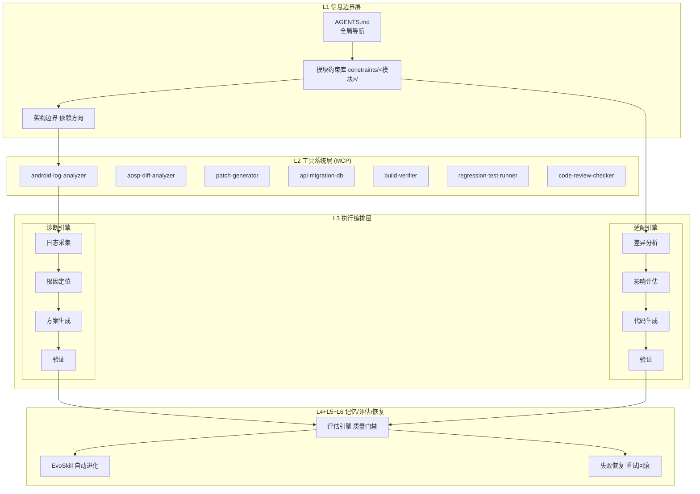
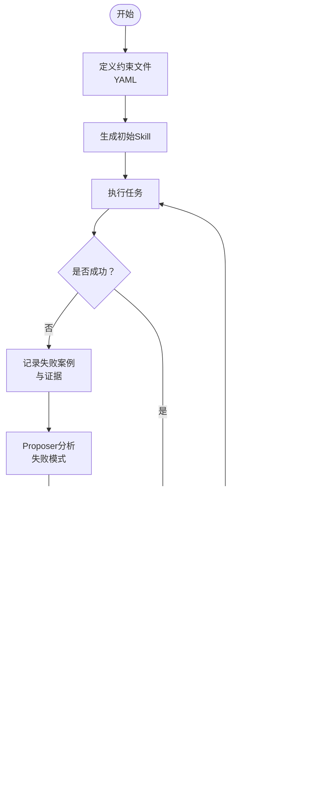
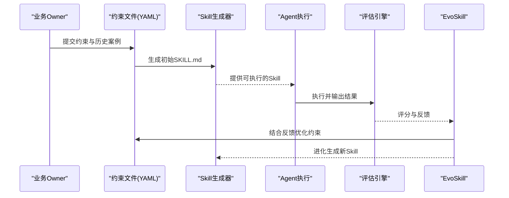
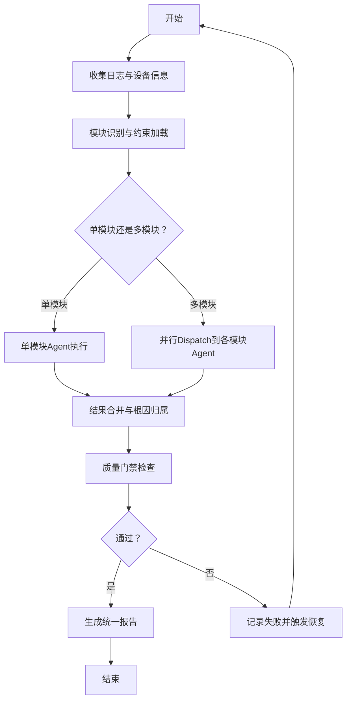
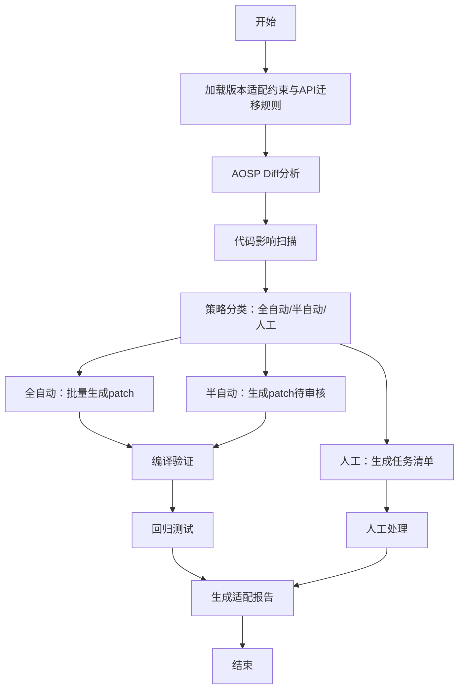
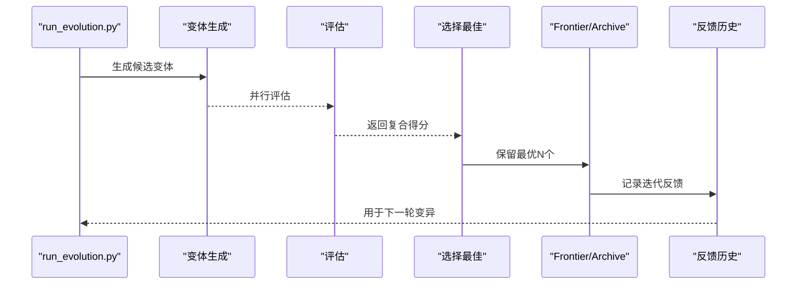
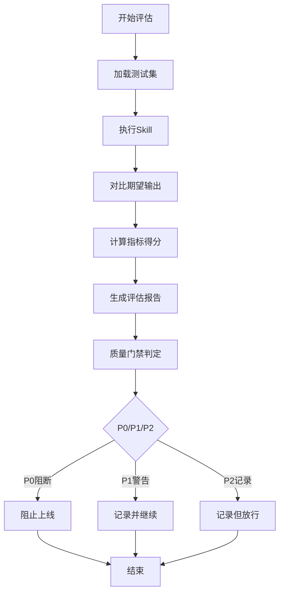
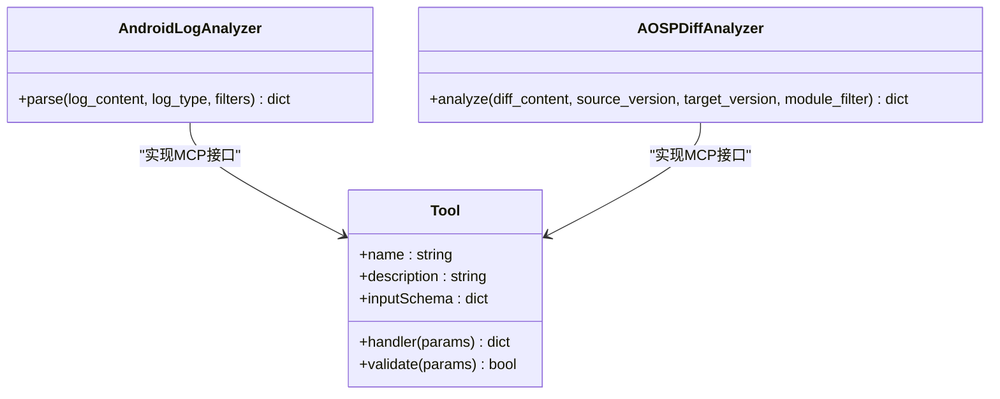
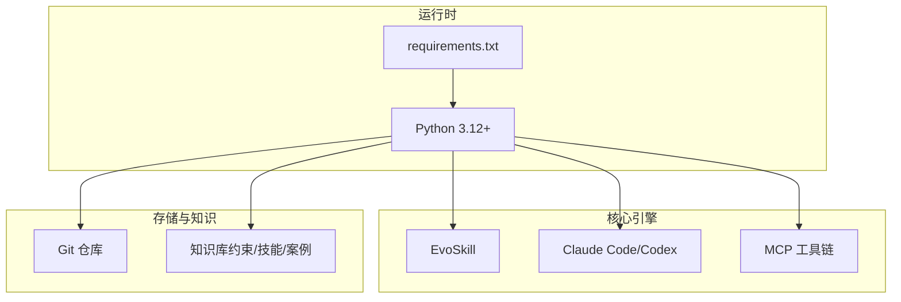

# 核心概念与理念

<cite>
**本文档引用的文件**
- [AGENTS.md](file://AGENTS.md)
- [系统架构概览.md](file://docs/architecture/system-overview.md)
- [TAHP-Architecture-Overview.html](file://TAHP-Architecture-Overview.html)
- [约束文件编写规范.md](file://TAHP-约束文件编写规范.md)
- [评估与质量门禁规范.md](file://docs/TAHP-评估与质量门禁规范.md)
- [run_evolution.py](file://scripts/run_evolution.py)
- [gate_check.py](file://scripts/gate_check.py)
- [bug-analysis-pipeline.yaml](file://playbooks/bug-analysis-pipeline.yaml)
- [version-upgrade-pipeline.yaml](file://playbooks/version-upgrade-pipeline.yaml)
- [telephony-bug-analyzer SKILL.md](file://skills/.claude/skills/telephony-bug-analyzer/SKILL.md)
- [kernel-panic-tracer SKILL.md](file://skills/.claude/skills/kernel-panic-tracer/SKILL.md)
- [android-log-analyzer tool.py](file://tools/android-log-analyzer/tool.py)
- [aosp-diff-analyzer tool.py](file://tools/aosp-diff-analyzer/tool.py)
- [requirements.txt](file://requirements.txt)
</cite>

## 目录
1. [引言](#引言)
2. [项目结构](#项目结构)
3. [核心组件](#核心组件)
4. [架构总览](#架构总览)
5. [详细组件分析](#详细组件分析)
6. [依赖分析](#依赖分析)
7. [性能考量](#性能考量)
8. [故障排查指南](#故障排查指南)
9. [结论](#结论)
10. [附录](#附录)

## 引言
TAHP（TECNO AI Harness Platform）是一个面向传音Android底软集成部的双引擎AI平台，采用“Agent = Model + Harness”范式，通过约束驱动与EvoSkill自动进化，将传统手工SOP转化为系统自动生成与自动评估的智能化工作流。平台以“信息边界层—工具系统层—执行编排层—记忆/评估/恢复层”的六层Harness架构为核心，围绕诊断引擎与适配引擎两大业务引擎，形成从约束输入到技能生成、评估、门禁、反馈闭环的完整生命周期。

## 项目结构
仓库采用按领域与层次划分的清晰结构：
- constraints：业务约束（Owner唯一输入端），按模块组织，包含module.yaml、四域约束文件与评估数据集
- skills：EvoSkill自动生成的Agent技能集合，按模型格式分目录存放
- playbooks：执行编排（Pipeline）定义，描述跨模块、跨引擎的工作流
- tools：MCP工具接口定义，标准化外部能力接入
- scripts：自动化脚本，支撑评估、进化、门禁、报告生成
- docs：深度文档与质量规范
- reports：评估报告输出
- knowledge-base：知识库（在现有结构中体现为约束与技能沉淀）

```mermaid
graph TB
A["AGENTS.md<br/>全局导航"] --> B["constraints/<模块>/"]
B --> B1["module.yaml<br/>模块元信息与边界"]
B --> B2["bug-analysis.yaml<br/>诊断约束"]
B --> B3["code-adaptation.yaml<br/>代码适配约束"]
B --> B4["version-adaptation.yaml<br/>版本适配约束"]
B --> B5["carrier-porting.yaml<br/>运营商移植约束"]
B --> B6["eval-data/<案例集>"]
C["skills/"] --> C1[".claude/skills/<技能>"]
C --> C2[".codex/skills/<技能>"]
D["playbooks/"] --> D1["bug-analysis-pipeline.yaml"]
D --> D2["version-upgrade-pipeline.yaml"]
D --> D3["feature-porting-pipeline.yaml"]
D --> D4["carrier-porting-pipeline.yaml"]
E["tools/"] --> E1["android-log-analyzer/"]
E --> E2["aosp-diff-analyzer/"]
E --> E3["patch-generator/"]
E --> E4["api-migration-db/"]
E --> E5["build-verifier/"]
E --> E6["regression-test-runner/"]
E --> E7["code-review-checker/"]
F["scripts/"] --> F1["evaluate.py"]
F --> F2["run-evolution.py"]
F --> F3["gate-check.py"]
F --> F4["init_module.py"]
F --> F5["validate_constraints.py"]
G["docs/"] --> G1["architecture/system-overview.md"]
G --> G2["quality/evaluation-metrics.md"]
G --> G3["TAHP-评估与质量门禁规范.md"]
H["reports/"] --> H1["evolution-reports/"]
H --> H2["quality-metrics/"]
```

图表来源
- [系统架构概览.md:316-379](file://docs/architecture/system-overview.md#L316-L379)
- [AGENTS.md:21-34](file://AGENTS.md#L21-L34)

章节来源
- [AGENTS.md:21-34](file://AGENTS.md#L21-L34)
- [系统架构概览.md:316-379](file://docs/architecture/system-overview.md#L316-L379)

## 核心组件
- Agent = Model + Harness：模型是CPU，Harness是操作系统。Harness将状态、工具、反馈、约束与执行环境串联，为Agent提供结构化执行环境。
- 六层Harness架构（优先级P0/P1）：
  - L1 信息边界层：定义Agent“该知道什么、不该知道什么”，P0
  - L2 工具系统层（MCP）：Agent与外部世界的交互接口，P0
  - L3 执行编排层：多步骤任务串接与并行调度，P1
  - L4 记忆与状态层：长任务中间结果管理，P1
  - L5 评估与观测层：衡量Agent是否正确，P1
  - L6 约束、校验与恢复层：错误处理与自动恢复，P0
- 双引擎工作流：
  - 诊断引擎：日志采集→根因定位→方案生成→验证输出
  - 适配引擎：差异分析→影响评估→代码生成→验证
- 四域约束体系：bug_analysis、code_adaptation、version_adaptation、carrier_porting
- Skill进化机制（EvoSkill）：约束文件→初始Skill→执行失败案例→反馈历史→Proposer分析→Generator生成→Evaluator打分→Frontier保留→下一轮迭代
- 质量门禁体系：P0（阻断）、P1（警告）、P2（记录）

章节来源
- [系统架构概览.md:131-147](file://docs/architecture/system-overview.md#L131-L147)
- [系统架构概览.md:161-204](file://docs/architecture/system-overview.md#L161-L204)
- [系统架构概览.md:206-218](file://docs/architecture/system-overview.md#L206-L218)
- [系统架构概览.md:221-261](file://docs/architecture/system-overview.md#L221-L261)
- [系统架构概览.md:268-289](file://docs/architecture/system-overview.md#L268-L289)

## 架构总览
下图展示了TAHP的整体架构与数据流：从约束输入到技能生成、执行、评估与反馈闭环，再到工具系统与门禁控制。

图表来源
- [系统架构概览.md:87-127](file://docs/architecture/system-overview.md#L87-L127)
- [TAHP-Architecture-Overview.html:119-214](file://TAHP-Architecture-Overview.html#L119-L214)

章节来源
- [系统架构概览.md:31-127](file://docs/architecture/system-overview.md#L31-L127)
- [TAHP-Architecture-Overview.html:119-214](file://TAHP-Architecture-Overview.html#L119-L214)

## 详细组件分析

### Agent = Model + Harness 架构范式
- 核心理念：模型是CPU，Harness是操作系统。Harness通过信息边界、工具系统、执行编排、记忆状态、评估观测、约束校验与恢复六个层级，将Agent置于可控、可观测、可演化的执行环境中。
- 优先级策略：P0层（信息边界与约束校验恢复）优先落地，确保“可强制执行”；P1层（工具系统、执行编排、记忆状态、评估观测）逐步完善，形成闭环。

图表来源
- [系统架构概览.md:221-261](file://docs/architecture/system-overview.md#L221-L261)
- [评估与质量门禁规范.md:108-135](file://docs/TAHP-评估与质量门禁规范.md#L108-L135)

章节来源
- [系统架构概览.md:131-157](file://docs/architecture/system-overview.md#L131-L157)
- [run_evolution.py:409-527](file://scripts/run_evolution.py#L409-L527)

### 约束驱动开发模式
- 传统模式：Owner写SOP → 人工转Skill → AI按Skill执行 → 人工迭代
- Harness模式：Owner写约束 → 系统自动生成Skill → 自动评估迭代
- 关键转变：从“人写执行步骤”升级为“人写约束条件，系统自动推导执行逻辑”
- 核心原则：若无法被机械强制执行，Agent就会偏离

图表来源
- [系统架构概览.md:148-157](file://docs/architecture/system-overview.md#L148-L157)
- [run_evolution.py:126-159](file://scripts/run_evolution.py#L126-L159)

章节来源
- [系统架构概览.md:148-157](file://docs/architecture/system-overview.md#L148-L157)
- [run_evolution.py:126-159](file://scripts/run_evolution.py#L126-L159)

### 六大核心层级与优先级实现策略（P0/P1）
- L1 信息边界层（P0）：明确模块边界、作用域、依赖关系与架构规则，确保Agent“知道该做什么、不该做什么”
- L2 工具系统层（MCP）（P0）：标准化外部工具接入，提供日志解析、AOSP差异分析、补丁生成、构建验证、回归测试等能力
- L3 执行编排层（P1）：跨模块并行分析、跨引擎流水线编排，支持条件分支与并行执行
- L4 记忆与状态层（P1）：保存中间结果、上下文窗口、执行轨迹，支撑跨步骤协作
- L5 评估与观测层（P1）：自动评估指标（准确率、完整性、一致性、时效性、可解释性），质量门禁（P0/P1/P2）
- L6 约束、校验与恢复层（P0）：安全红线、API真实性、Scope合规、编译门禁、失败重试与回滚

章节来源
- [系统架构概览.md:137-147](file://docs/architecture/system-overview.md#L137-L147)
- [评估与质量门禁规范.md:139-184](file://docs/TAHP-评估与质量门禁规范.md#L139-L184)

### 诊断引擎工作流
- 输入：日志（logcat、RIL、AT命令）、设备信息、复现步骤
- 流程：日志采集→层级判定（Framework→RILJ→RILC→Modem）→根因定位→方案生成→验证输出
- 必产出维度：根因层级、可复现性、影响范围、修复类型、严重程度、根因描述、修复建议

图表来源
- [系统架构概览.md:163-179](file://docs/architecture/system-overview.md#L163-L179)
- [bug-analysis-pipeline.yaml:6-43](file://playbooks/bug-analysis-pipeline.yaml#L6-L43)

章节来源
- [系统架构概览.md:163-179](file://docs/architecture/system-overview.md#L163-L179)
- [bug-analysis-pipeline.yaml:6-43](file://playbooks/bug-analysis-pipeline.yaml#L6-L43)

### 适配引擎工作流
- 版本升级：AOSP Diff分析→影响评估→策略分类（全自动/半自动/人工）→批量补丁→编译验证→回归测试→适配报告
- Feature移植：依赖分析→兼容性映射→代码转换→编译验证→集成与回归测试
- 运营商移植：需求解析→源码映射→差异生成→合规检查→通用回归测试

图表来源
- [系统架构概览.md:181-203](file://docs/architecture/system-overview.md#L181-L203)
- [version-upgrade-pipeline.yaml:6-61](file://playbooks/version-upgrade-pipeline.yaml#L6-L61)

章节来源
- [系统架构概览.md:181-203](file://docs/architecture/system-overview.md#L181-L203)
- [version-upgrade-pipeline.yaml:6-61](file://playbooks/version-upgrade-pipeline.yaml#L6-L61)

### 技能引擎（EvoSkill）
- 进化循环：执行→失败分析→生成变体→评估→Frontier选择→记录反馈→下一轮
- Frontier管理：保留最多N个变体，新变体需在准确率、效率或泛化能力上有改进
- 跨模型迁移：用固定LLM进化的Skills可迁移到其他LLM，实现“进化一次，到处可用”

图表来源
- [run_evolution.py:409-527](file://scripts/run_evolution.py#L409-L527)

章节来源
- [run_evolution.py:409-527](file://scripts/run_evolution.py#L409-L527)
- [系统架构概览.md:221-261](file://docs/architecture/system-overview.md#L221-L261)

### 质量门禁与评估观测
- 三级门禁（P0/P1/P2）：P0阻断（编译、Scope合规、安全红线、API真实性）；P1警告（编码风格、Lint、废弃API、TODO关联）；P2记录（复杂度、重复率、注释覆盖率）
- Skill评估指标：准确率（40%）、完整性（20%）、一致性（15%）、时效性（15%）、可解释性（10%）
- 评估流程：加载测试集→执行Skill→对比评估→生成报告→质量门禁判定

图表来源
- [评估与质量门禁规范.md:108-135](file://docs/TAHP-评估与质量门禁规范.md#L108-L135)
- [评估与质量门禁规范.md:139-184](file://docs/TAHP-评估与质量门禁规范.md#L139-L184)

章节来源
- [评估与质量门禁规范.md:108-135](file://docs/TAHP-评估与质量门禁规范.md#L108-L135)
- [评估与质量门禁规范.md:139-184](file://docs/TAHP-评估与质量门禁规范.md#L139-L184)

### 工具系统层（MCP）
- 工具协议：MCP（Model Context Protocol）标准化接入
- 工具清单：android-log-analyzer、aosp-diff-analyzer、patch-generator、api-migration-db、build-verifier、regression-test-runner、code-review-checker
- 工具接口标准：name/description/inputSchema/handler，支持前置验证（validate）

图表来源
- [android-log-analyzer tool.py:5-49](file://tools/android-log-analyzer/tool.py#L5-L49)
- [aosp-diff-analyzer tool.py:5-40](file://tools/aosp-diff-analyzer/tool.py#L5-L40)

章节来源
- [系统架构概览.md:292-313](file://docs/architecture/system-overview.md#L292-L313)
- [android-log-analyzer tool.py:5-49](file://tools/android-log-analyzer/tool.py#L5-L49)
- [aosp-diff-analyzer tool.py:5-40](file://tools/aosp-diff-analyzer/tool.py#L5-L40)

### 约束文件与知识沉淀
- 约束文件编写规范：声明式而非指令式、可验证、具体不模糊、最小必要、版本化
- 四域约束：bug-analysis、code-adaptation、version-adaptation、carrier-porting
- 评估数据集：每个模块至少准备5个案例（建议train/val/test=9/3/3），包含输入与期望输出
- 约束文件质量评分：完整性（30%）、可验证性（25%）、具体性（20%）、最小性（15%）、评估集质量（10%）

章节来源
- [约束文件编写规范.md:8-27](file://TAHP-约束文件编写规范.md#L8-L27)
- [约束文件编写规范.md:118-241](file://TAHP-约束文件编写规范.md#L118-L241)
- [约束文件编写规范.md:282-361](file://TAHP-约束文件编写规范.md#L282-L361)
- [约束文件编写规范.md:392-431](file://TAHP-约束文件编写规范.md#L392-L431)

## 依赖分析
- 技术栈与依赖：EvoSkill（Skill进化）、Claude Code/Codex（Agent运行时）、MCP（工具协议）、YAML Playbooks+Python脚本（工作流编排）、Git（版本管理）、Markdown/YAML/JSON（知识格式）、Python 3.12+（运行环境）
- 运行时依赖：pyyaml、jsonschema、click、rich、gitpython、numpy、onnxruntime、chromadb

图表来源
- [系统架构概览.md:383-396](file://docs/architecture/system-overview.md#L383-L396)
- [requirements.txt:1-9](file://requirements.txt#L1-L9)

章节来源
- [系统架构概览.md:383-396](file://docs/architecture/system-overview.md#L383-L396)
- [requirements.txt:1-9](file://requirements.txt#L1-L9)

## 性能考量
- 并行评估与并发：EvoSkill支持并发评估（默认2），可配置提高吞吐
- 迭代收敛：设置停滞阈值（默认3轮），避免无效迭代
- 指标权重：评估时可调整权重，平衡准确率、完整性、安全性与时效性
- 工具链优化：MCP工具按需分发，减少不必要的调用

## 故障排查指南
- 门禁检查（gate-check）：
  - P0阻断：安全红线缺失、硬编码密钥、约束文件非法
  - P1警告：测试覆盖不足、文档不完整、命名不规范
  - P2记录：代码风格、注释密度、示例案例
- 常见问题定位：
  - 约束文件未通过：检查module.yaml必填字段、safety_red_lines是否存在、YAML语法
  - 评估失败：查看评估报告与失败案例，结合反馈历史优化约束
  - 工具调用失败：确认MCP工具接口实现与前置验证（validate）

章节来源
- [gate_check.py:36-87](file://scripts/gate_check.py#L36-L87)
- [gate_check.py:99-187](file://scripts/gate_check.py#L99-L187)
- [gate_check.py:194-270](file://scripts/gate_check.py#L194-L270)
- [gate_check.py:277-332](file://scripts/gate_check.py#L277-L332)

## 结论
TAHP以“Agent = Model + Harness”为核心范式，通过约束驱动与EvoSkill自动进化，将传统手工SOP转化为系统自动生成与自动评估的智能化工作流。六层Harness架构（P0/P1）确保可强制执行与可演进，双引擎覆盖诊断与适配两大核心场景，质量门禁与评估观测保障交付质量。平台具备良好的扩展性与可维护性，适合在Android底软集成领域持续推广与深化应用。

## 附录
- 术语表
  - Agent：智能体，执行具体任务
  - Harness：执行环境与操作系统，提供结构化执行空间
  - EvoSkill：自动进化引擎，基于失败反馈生成与优化Skill
  - P0/P1/P2：质量门禁级别，分别对应阻断、警告与记录
  - MCP：Model Context Protocol，工具接入标准
  - 四域约束：bug_analysis、code_adaptation、version_adaptation、carrier_porting
- 相关文档
  - [系统架构概览](file://docs/architecture/system-overview.md)
  - [约束文件编写规范](file://TAHP-约束文件编写规范.md)
  - [评估与质量门禁规范](file://docs/TAHP-评估与质量门禁规范.md)