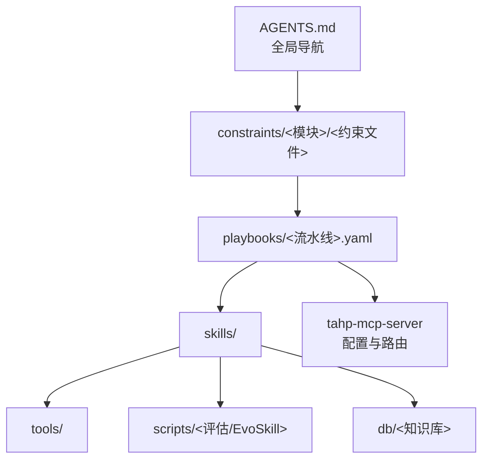
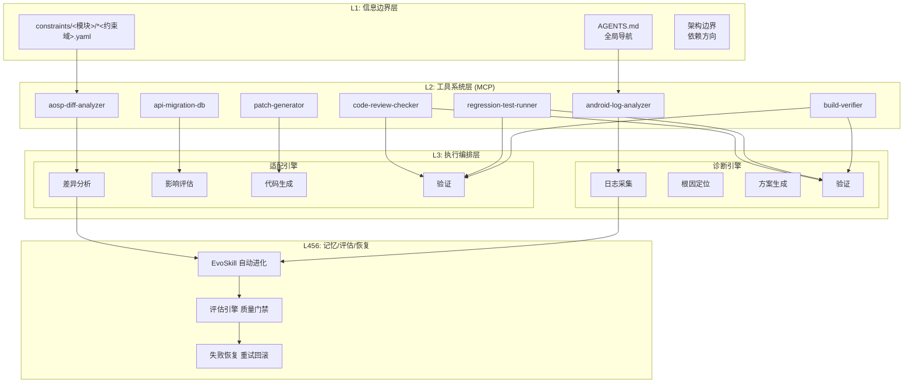
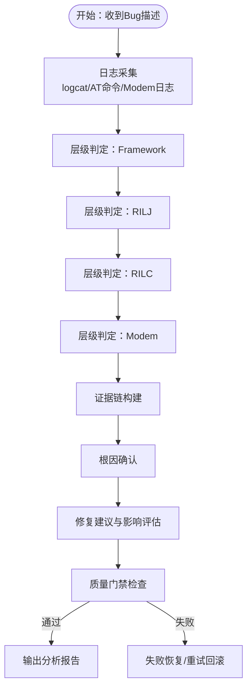
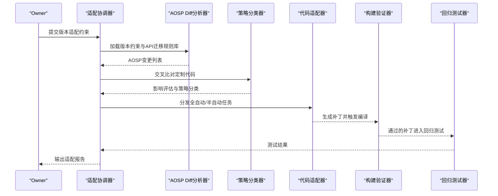
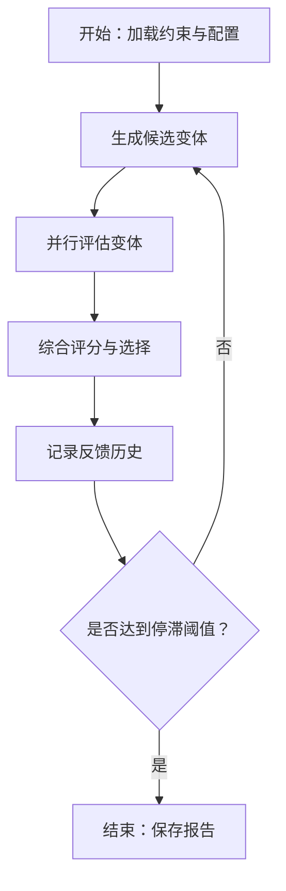
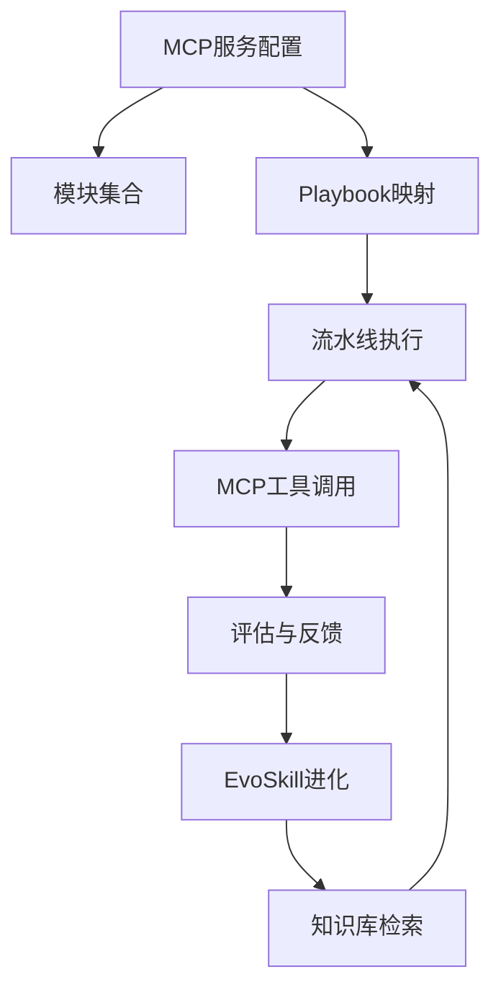

# 系统架构总览

<cite>
**本文档引用的文件**
- [系统架构概览.md](file://docs/architecture/system-overview.md)
- [AGENTS.md](file://AGENTS.md)
- [MCP服务配置.py](file://tahp-mcp-server/config.py)
- [诊断引擎流水线.yaml](file://playbooks/bug-analysis-pipeline.yaml)
- [版本升级适配流水线.yaml](file://playbooks/version-upgrade-pipeline.yaml)
- [EvoSkill运行器.py](file://scripts/run_evolution.py)
- [技能评估工具.py](file://scripts/evaluate.py)
- [知识库核心类.py](file://db/knowledge_db.py)
- [通信模块Bug分析Skill.md](file://skills/.claude/skills/telephony-bug-analyzer/SKILL.md)
- [内核Panic追踪Skill.md](file://skills/.claude/skills/kernel-panic-tracer/SKILL.md)
- [功耗泄漏检测Skill.md](file://skills/.claude/skills/power-leak-detector/SKILL.md)
- [通信模块Bug分析约束.yaml](file://constraints/telephony/bug-analysis.yaml)
- [内核驱动Bug分析约束.yaml](file://constraints/kernel-driver/bug-analysis.yaml)
</cite>

## 目录
1. [引言](#引言)
2. [项目结构](#项目结构)
3. [核心组件](#核心组件)
4. [架构总览](#架构总览)
5. [详细组件分析](#详细组件分析)
6. [依赖关系分析](#依赖关系分析)
7. [性能考量](#性能考量)
8. [故障排查指南](#故障排查指南)
9. [结论](#结论)

## 引言
TAHP（TECNO AI Harness Platform）是一个服务于传音Android底软集成部的双引擎AI平台，基于“Agent = Model + Harness”范式构建。平台通过约束驱动与EvoSkill自动进化，实现诊断引擎（Bug分析）与适配引擎（版本升级/功能移植/运营商移植）的自动化闭环。

- 诊断引擎：围绕通话/短信/功耗/内核等场景，完成日志采集→根因定位→方案生成→验证输出的全流程。
- 适配引擎：面向AOSP Diff分析→影响评估→代码生成→验证的批量适配流程，覆盖版本升级、特性移植与运营商移植。

平台采用Harness六层架构设计，自下而上分别为：信息边界层、工具系统层、执行编排层、记忆状态层、评估观测层、约束校验层。通过MCP（Model Context Protocol）标准化工具接入，结合Git与EvoSkill实现Skill的自动进化与跨模型迁移。

## 项目结构
仓库采用按域/模块组织的层次化结构，核心目录与职责如下：
- constraints/：业务约束（Owner唯一输入端），按模块与共享规则组织
- skills/：自动生成/维护的AI Skills，支持Claude与Codex格式
- playbooks/：执行编排剧本（Pipeline定义），描述跨Agent协作流程
- tools/：MCP工具接口定义，统一能力抽象
- scripts/：自动化脚本，包括EvoSkill运行、评估、质量门禁等
- db/：知识库与向量化检索
- docs/：深度文档与规范
- reports/：评估报告输出

**图表来源**
- [AGENTS.md:1-83](file://AGENTS.md#L1-L83)
- [MCP服务配置.py:36-176](file://tahp-mcp-server/config.py#L36-L176)

**章节来源**
- [系统架构概览.md:316-396](file://docs/architecture/system-overview.md#L316-L396)

## 核心组件
- 双引擎架构
  - 诊断引擎：面向Bug根因分析，强调证据链与层级判定
  - 适配引擎：面向版本/特性/运营商移植，强调影响评估与批量生成
- Harness六层架构
  - L1 信息边界层：明确Agent可访问的信息范围
  - L2 工具系统层：MCP标准化工具接入
  - L3 执行编排层：多Agent协同的流水线编排
  - L4 记忆状态层：长任务中间结果与上下文管理
  - L5 评估观测层：自动评估与反馈收集
  - L6 约束校验层：质量门禁与失败恢复
- EvoSkill进化循环：从约束文件出发，经由Skill生成、评估、选择与反馈，形成持续优化闭环
- 跨模型迁移：固定LLM上的进化成果可迁移到其他模型，实现“进化一次，到处可用”

**章节来源**
- [系统架构概览.md:13-28](file://docs/architecture/system-overview.md#L13-L28)
- [系统架构概览.md:137-147](file://docs/architecture/system-overview.md#L137-L147)
- [系统架构概览.md:221-265](file://docs/architecture/system-overview.md#L221-L265)

## 架构总览
整体架构分为三层：信息边界层（L1）、工具系统层（L2）、执行编排层（L3），以及由EvoSkill驱动的记忆/评估/恢复层（L4+L5+L6）。MCP服务负责模块与领域映射、Playbook路由与目录解析，支撑跨Agent协作。

**图表来源**
- [系统架构概览.md:87-127](file://docs/architecture/system-overview.md#L87-L127)
- [MCP服务配置.py:74-79](file://tahp-mcp-server/config.py#L74-L79)

## 详细组件分析

### 双引擎工作流程

#### 诊断引擎（Bug分析）
- 流程：日志采集 → 根因定位（Framework/RILJ/RILC/Modem层级）→ 方案生成（修复建议/影响评估）→ 验证输出（质量门禁）
- 层级判定顺序：Framework（Java）→ RILJ（Java RIL）→ RILC（C/HIDL）→ Modem
- 必产出维度：根因层级、复现概率、影响范围、修复类型、严重程度、根因描述、修复建议

**图表来源**
- [系统架构概览.md:163-180](file://docs/architecture/system-overview.md#L163-L180)
- [通信模块Bug分析约束.yaml:31-94](file://constraints/telephony/bug-analysis.yaml#L31-L94)

**章节来源**
- [系统架构概览.md:163-180](file://docs/architecture/system-overview.md#L163-L180)
- [通信模块Bug分析Skill.md:26-40](file://skills/.claude/skills/telephony-bug-analyzer/SKILL.md#L26-L40)

#### 适配引擎（版本/特性/运营商移植）
- 版本升级：AOSP Diff分析 → 影响评估 → 策略分类（全自动/半自动/人工）→ 批量适配 → 编译验证 → 回归测试 → 适配报告
- 特性移植：依赖分析 → 兼容性映射 → 代码转换 → 集成测试
- 运营商移植：需求解析 → 源码映射 → 差异生成 → 合规检查

**图表来源**
- [系统架构概览.md:181-203](file://docs/architecture/system-overview.md#L181-L203)
- [版本升级适配流水线.yaml:6-61](file://playbooks/version-upgrade-pipeline.yaml#L6-L61)

**章节来源**
- [系统架构概览.md:181-203](file://docs/architecture/system-overview.md#L181-L203)
- [版本升级适配流水线.yaml:1-61](file://playbooks/version-upgrade-pipeline.yaml#L1-L61)

### Harness六层架构详解

#### L1 信息边界层
- 职责：明确Agent可访问的信息范围与导航路径
- 体现：AGENTS.md提供快速定位与安全红线；constraints目录定义约束域与输入输出

**章节来源**
- [AGENTS.md:10-20](file://AGENTS.md#L10-L20)
- [AGENTS.md:53-60](file://AGENTS.md#L53-L60)

#### L2 工具系统层（MCP）
- 职责：标准化工具接入，按需分发给Agent
- 体现：MCP服务配置支持模块/领域映射、Playbook路由与目录解析

**章节来源**
- [MCP服务配置.py:36-129](file://tahp-mcp-server/config.py#L36-L129)

#### L3 执行编排层
- 职责：多Agent协同的流水线编排，支持并行与条件分支
- 体现：跨模块Bug分析流水线支持并行分析与统一合成；版本升级流水线覆盖构建与回归测试

**章节来源**
- [诊断引擎流水线.yaml:6-43](file://playbooks/bug-analysis-pipeline.yaml#L6-L43)
- [版本升级适配流水线.yaml:6-61](file://playbooks/version-upgrade-pipeline.yaml#L6-L61)

#### L4 记忆状态层
- 职责：长任务中间结果与上下文管理
- 体现：EvoSkill运行器记录每次迭代的最佳变体与反馈历史；知识库持久化存储与检索

**章节来源**
- [EvoSkill运行器.py:409-527](file://scripts/run_evolution.py#L409-L527)
- [知识库核心类.py:93-131](file://db/knowledge_db.py#L93-L131)

#### L5 评估观测层
- 职责：自动评估与反馈收集，形成闭环
- 体现：技能评估工具计算准确率/完整性/安全合规/时间效率等指标；EvoSkill综合评分选择最优变体

**章节来源**
- [技能评估工具.py:290-384](file://scripts/evaluate.py#L290-L384)
- [EvoSkill运行器.py:330-339](file://scripts/run_evolution.py#L330-L339)

#### L6 约束校验层
- 职责：质量门禁与失败恢复
- 体现：三级门禁（P0/P1/P2）与安全红线；跨模块知识检索与跨模型迁移

**章节来源**
- [系统架构概览.md:268-289](file://docs/architecture/system-overview.md#L268-L289)
- [知识库核心类.py:519-571](file://db/knowledge_db.py#L519-L571)

### EvoSkill进化循环与跨版本复用

#### 进化循环
- 从约束文件出发，生成候选变体 → 并行评估 → 选择最优变体 → 记录反馈 → 下一轮迭代
- 支持干跑预览、并发评估与停滞阈值控制

**图表来源**
- [EvoSkill运行器.py:409-527](file://scripts/run_evolution.py#L409-L527)

**章节来源**
- [系统架构概览.md:221-265](file://docs/architecture/system-overview.md#L221-L265)
- [EvoSkill运行器.py:68-79](file://scripts/run_evolution.py#L68-L79)

#### 跨模型迁移
- 固定LLM上的进化成果可迁移到其他模型，实现“进化一次，到处可用”，提升跨模型复用效率

**章节来源**
- [系统架构概览.md:262-265](file://docs/architecture/system-overview.md#L262-L265)

### 约束驱动的四域约束体系
- bug_analysis：诊断引擎输入（日志/复现步骤），输出分析报告
- code_adaptation：诊断引擎输入（Bug修复/代码适配），输出代码Patch
- version_adaptation：适配引擎输入（版本升级/特性移植），输出批量Patch
- carrier_porting：适配引擎输入（运营商需求），输出Carrier Patch与配置

**章节来源**
- [系统架构概览.md:206-218](file://docs/architecture/system-overview.md#L206-L218)
- [AGENTS.md:44-52](file://AGENTS.md#L44-L52)

## 依赖关系分析
- 模块与领域映射：MCP服务配置定义模块集合与Playbook映射，确保领域到流水线的正确路由
- 工具依赖：诊断与适配均依赖MCP工具（日志分析、Diff分析、补丁生成、构建验证、回归测试、代码审查）
- 知识库依赖：EvoSkill与跨模块检索依赖知识库的向量化检索与跨模块查询能力

**图表来源**
- [MCP服务配置.py:58-79](file://tahp-mcp-server/config.py#L58-L79)
- [诊断引擎流水线.yaml:6-43](file://playbooks/bug-analysis-pipeline.yaml#L6-L43)
- [版本升级适配流水线.yaml:6-61](file://playbooks/version-upgrade-pipeline.yaml#L6-L61)

**章节来源**
- [MCP服务配置.py:122-129](file://tahp-mcp-server/config.py#L122-L129)

## 性能考量
- 并行评估：EvoSkill运行器支持并发评估，缩短迭代周期
- 干跑预览：Dry-run模式用于规划与资源评估，避免无效执行
- 停滞阈值：防止过拟合与无效迭代，提升收敛效率
- 向量化检索：知识库采用ONNX嵌入函数与SQLite持久化，支持跨模块语义检索

**章节来源**
- [EvoSkill运行器.py:416-417](file://scripts/run_evolution.py#L416-L417)
- [EvoSkill运行器.py:441](file://scripts/run_evolution.py#L441)
- [知识库核心类.py:132-156](file://db/knowledge_db.py#L132-L156)

## 故障排查指南
- 约束文件缺失或不合规：检查对应模块的约束文件是否齐全，特别是必填字段与错误提示
- 工具执行失败：确认MCP工具接口实现（名称/描述/输入模式/处理器）与前置验证
- 评估失败：查看评估报告中的单项指标与错误信息，定位输出格式或安全违规
- 知识库检索异常：确认嵌入函数可用性与最小置信度设置

**章节来源**
- [通信模块Bug分析约束.yaml:1-30](file://constraints/telephony/bug-analysis.yaml#L1-L30)
- [技能评估工具.py:135-198](file://scripts/evaluate.py#L135-L198)
- [知识库核心类.py:141-156](file://db/knowledge_db.py#L141-L156)

## 结论
TAHP通过双引擎架构与Harness六层设计，实现了从约束到执行、从评估到进化的完整闭环。MCP标准化工具接入与EvoSkill自动进化机制，使得平台能够在诊断与适配两大场景中高效落地，并通过跨模块检索与跨模型迁移实现知识与能力的复用与扩展。依托质量门禁与失败恢复机制，平台在保证安全性与稳定性的同时，持续提升自动化水平与交付效率。