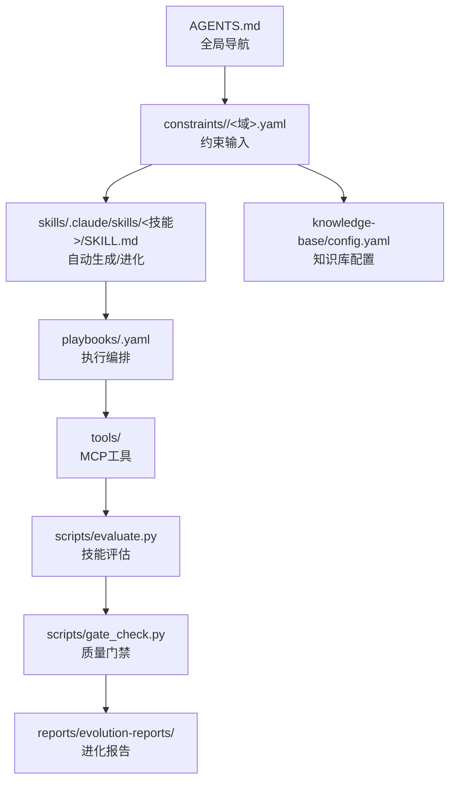
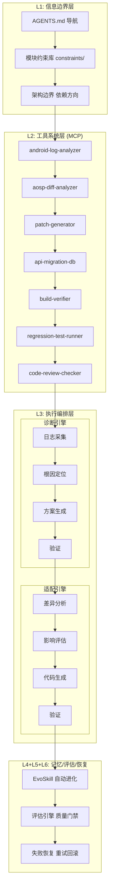
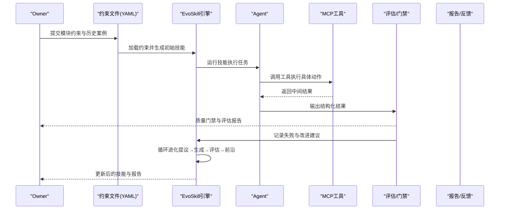
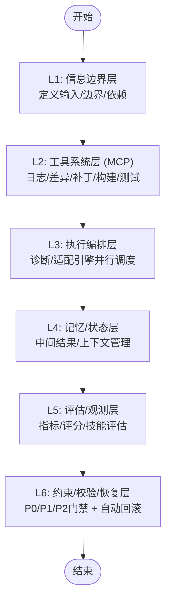
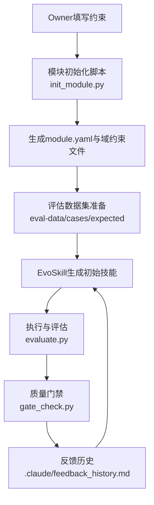
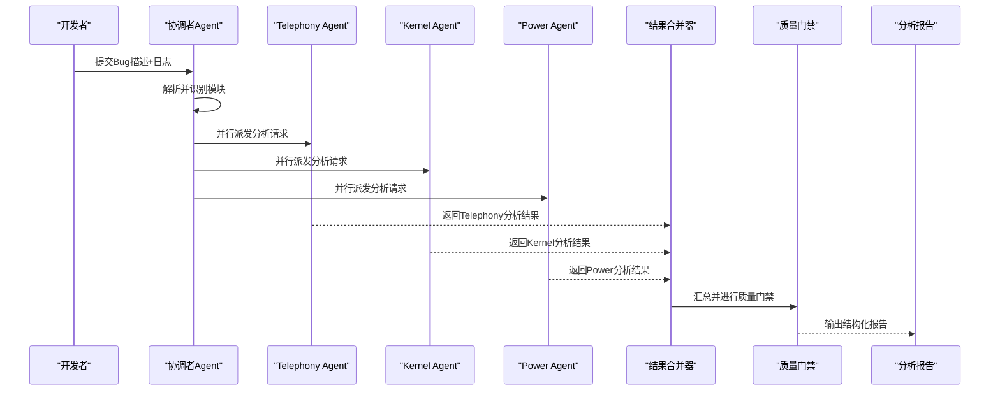
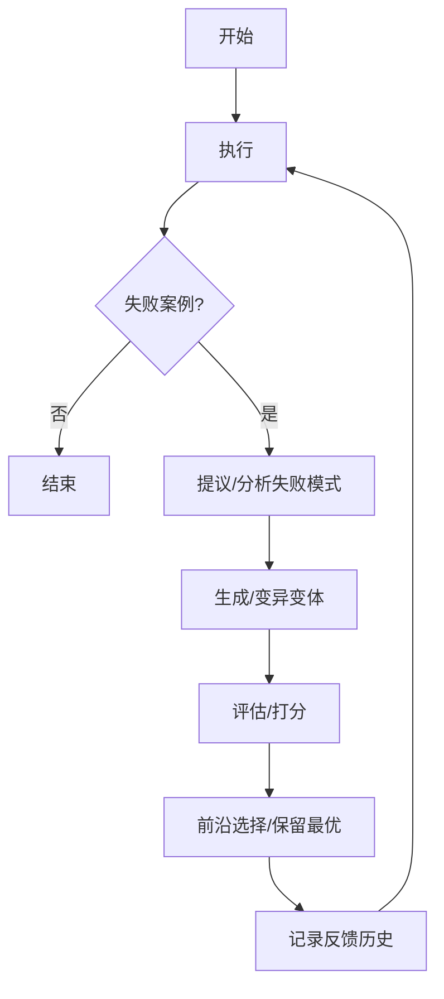
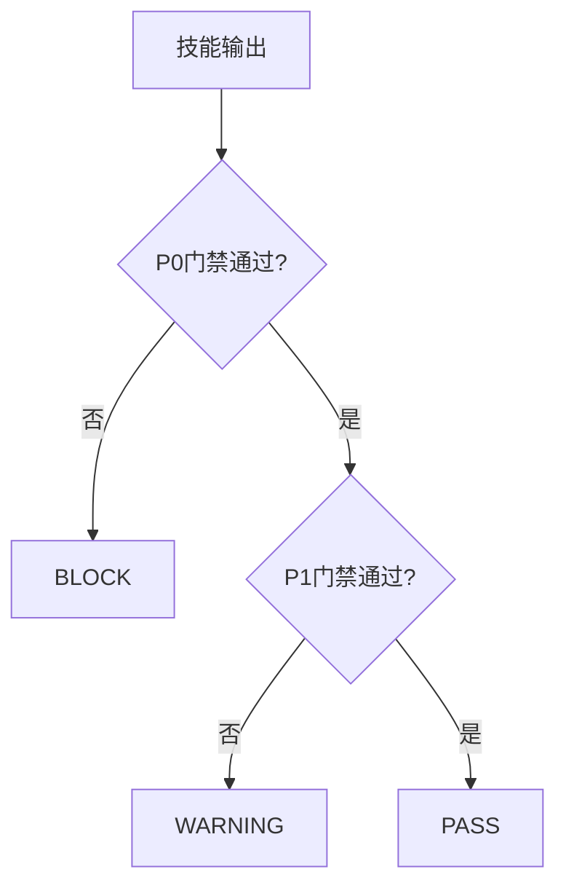
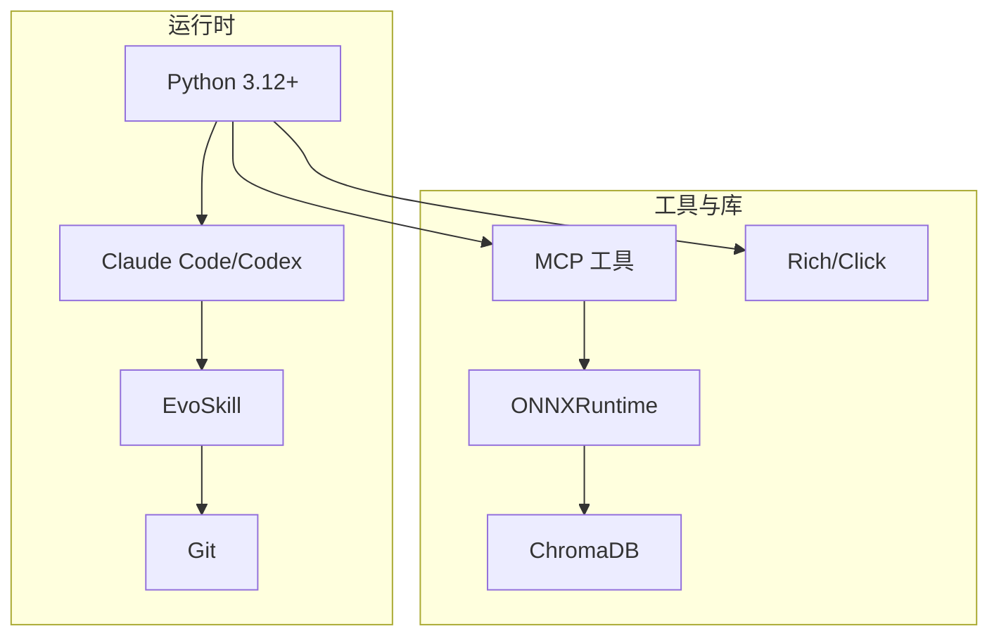

# 项目概述

<cite>
**本文引用的文件**
- [AGENTS.md](file://AGENTS.md)
- [TAHP-Architecture-Overview.html](file://TAHP-Architecture-Overview.html)
- [docs/architecture/system-overview.md](file://docs/architecture/system-overview.md)
- [TAHP-约束文件编写规范.md](file://TAHP-约束文件编写规范.md)
- [scripts/init_module.py](file://scripts/init_module.py)
- [scripts/run_evolution.py](file://scripts/run_evolution.py)
- [scripts/evaluate.py](file://scripts/evaluate.py)
- [scripts/gate_check.py](file://scripts/gate_check.py)
- [playbooks/bug-analysis-pipeline.yaml](file://playbooks/bug-analysis-pipeline.yaml)
- [skills/.claude/skills/telephony-bug-analyzer/SKILL.md](file://skills/.claude/skills/telephony-bug-analyzer/SKILL.md)
- [skills/.claude/skills/kernel-panic-tracer/SKILL.md](file://skills/.claude/skills/kernel-panic-tracer/SKILL.md)
- [knowledge-base/config.yaml](file://knowledge-base/config.yaml)
- [requirements.txt](file://requirements.txt)
</cite>

## 目录
1. [引言](#引言)
2. [项目结构](#项目结构)
3. [核心组件](#核心组件)
4. [架构总览](#架构总览)
5. [详细组件分析](#详细组件分析)
6. [依赖分析](#依赖分析)
7. [性能考量](#性能考量)
8. [故障排查指南](#故障排查指南)
9. [结论](#结论)
10. [附录](#附录)

## 引言
TAHP（TECNO AI Harness Platform）是面向传音Android底软集成部的“双引擎”AI平台，围绕“Agent = Model + Harness”的范式构建，旨在将传统手工SOP转化为由Owner以约束驱动的系统自动生成与自动评估的智能化工作流。平台通过约束驱动 + EvoSkill自动进化，实现诊断引擎（Bug分析）与适配引擎（版本/特性/运营商移植）的协同，形成从信息边界、工具系统、执行编排到记忆/评估/恢复的六层Harness架构，支撑零服务器成本的纯本地运行。

## 项目结构
仓库采用按功能域划分的清晰目录结构，便于模块化扩展与演进：
- constraints/：Owner输入端，按模块组织，包含模块基本信息、约束文件与评估数据集
- skills/：由EvoSkill自动生成的Agent技能集合，按Claude/Codex格式组织
- playbooks/：执行编排（Pipeline）定义，描述跨Agent协作流程
- tools/：MCP工具接口定义，封装日志分析、构建验证、回归测试等能力
- scripts/：自动化脚本，涵盖模块初始化、技能评估、质量门禁、EvoSkill运行等
- knowledge-base/：知识库配置与持久化，支持语义检索与跨模块同步
- docs/：深度文档，包含架构总览、约束规范、评估指标等
- reports/：评估报告输出，沉淀EvoSkill与质量门禁的结果
- templates/：模块初始化模板，加速新模块接入

图表来源
- [AGENTS.md:10-34](file://AGENTS.md#L10-L34)
- [docs/architecture/system-overview.md:318-379](file://docs/architecture/system-overview.md#L318-L379)

章节来源
- [AGENTS.md:21-34](file://AGENTS.md#L21-L34)
- [docs/architecture/system-overview.md:318-379](file://docs/architecture/system-overview.md#L318-L379)

## 核心组件
- 约束驱动（Constraints）：Owner以YAML形式声明模块边界、规则、质量标准与历史案例，系统据此自动生成与优化Agent技能
- EvoSkill（技能进化引擎）：基于失败反馈的五阶段循环（执行→提议→生成→评估→前沿），持续提升技能质量
- 质量门禁（Quality Gates）：三级门禁（P0/P1/P2），确保输出在编译、合规、安全、效率等方面达标
- 执行编排（Playbooks）：多Agent并行调度与收敛，支持跨模块Bug分析与统一报告输出
- MCP工具链（Tools）：标准化工具接口，覆盖日志分析、AOSP差异分析、补丁生成、构建验证、回归测试等
- 知识库（Knowledge Base）：SQLite+ONNX嵌入，支持跨模块检索与自动捕获

章节来源
- [docs/architecture/system-overview.md:131-157](file://docs/architecture/system-overview.md#L131-L157)
- [TAHP-Architecture-Overview.html:291-366](file://TAHP-Architecture-Overview.html#L291-L366)
- [scripts/run_evolution.py:126-159](file://scripts/run_evolution.py#L126-L159)
- [scripts/gate_check.py:36-93](file://scripts/gate_check.py#L36-L93)

## 架构总览
TAHP采用六层Harness架构，自下而上分别承担信息边界、工具系统、执行编排、记忆/状态、评估/观测、约束/校验/恢复的职责，并以双引擎（诊断/适配）贯穿执行层，形成闭环的约束驱动工作流。

图表来源
- [docs/architecture/system-overview.md:87-127](file://docs/architecture/system-overview.md#L87-L127)
- [TAHP-Architecture-Overview.html:116-181](file://TAHP-Architecture-Overview.html#L116-L181)

章节来源
- [docs/architecture/system-overview.md:137-146](file://docs/architecture/system-overview.md#L137-L146)
- [TAHP-Architecture-Overview.html:216-289](file://TAHP-Architecture-Overview.html#L216-L289)

## 详细组件分析

### Agent = Model + Harness 架构范式
- 核心理念：模型是CPU，Harness是操作系统。Harness将状态、工具、反馈、约束与执行环境串联，为Agent提供结构化执行环境
- 约束驱动：Owner不再手写SOP，而是以YAML约束描述“是什么”和“不能做什么”，系统自动生成执行步骤与技能
- 双引擎：诊断引擎负责Bug根因分析；适配引擎负责版本升级、特性移植与运营商移植

图表来源
- [docs/architecture/system-overview.md:221-251](file://docs/architecture/system-overview.md#L221-L251)
- [TAHP-Architecture-Overview.html:291-366](file://TAHP-Architecture-Overview.html#L291-L366)

章节来源
- [docs/architecture/system-overview.md:133-157](file://docs/architecture/system-overview.md#L133-L157)
- [TAHP-Architecture-Overview.html:116-117](file://TAHP-Architecture-Overview.html#L116-L117)

### 六大核心层级（Harness Layers）
- L1 信息边界层：AGENTS.md、模块约束库、架构边界，定义“Agent该知道什么、不该知道什么”
- L2 工具系统层（MCP）：日志分析、AOSP差异、补丁生成、API迁移规则库、构建验证、回归测试、代码审查
- L3 执行编排层：诊断引擎（日志采集→根因定位→方案生成→验证）与适配引擎（差异分析→影响评估→代码生成→验证）
- L4 记忆与状态层：会话持久化、中间结果、上下文窗口管理
- L5 评估与观测层：质量指标、测试评分、性能跟踪、技能评估
- L6 约束、校验与恢复层：质量门禁、自动回滚、错误恢复、约束强制执行

图表来源
- [docs/architecture/system-overview.md:137-146](file://docs/architecture/system-overview.md#L137-L146)
- [TAHP-Architecture-Overview.html:220-289](file://TAHP-Architecture-Overview.html#L220-L289)

章节来源
- [docs/architecture/system-overview.md:137-146](file://docs/architecture/system-overview.md#L137-L146)

### 约束驱动工作流与四域约束体系
- 四域约束：bug_analysis、code_adaptation、version_adaptation、carrier_porting，每域均有独立YAML Schema与评估数据集
- 约束文件规范：声明式而非指令式；可验证、具体、最小必要；版本化管理；包含前置条件、分析规则、禁止行为、必产出维度与安全红线
- 模块初始化：通过模板与脚本快速生成标准目录与初始约束文件，支持交互式与非交互式两种模式

图表来源
- [scripts/init_module.py:154-249](file://scripts/init_module.py#L154-L249)
- [TAHP-约束文件编写规范.md:118-241](file://TAHP-约束文件编写规范.md#L118-L241)
- [scripts/evaluate.py:290-384](file://scripts/evaluate.py#L290-L384)
- [scripts/gate_check.py:368-415](file://scripts/gate_check.py#L368-L415)

章节来源
- [AGENTS.md:44-51](file://AGENTS.md#L44-L51)
- [TAHP-约束文件编写规范.md:8-27](file://TAHP-约束文件编写规范.md#L8-L27)
- [scripts/init_module.py:1-12](file://scripts/init_module.py#L1-L12)

### 执行编排与跨模块Bug分析
- 跨模块Bug分析Pipeline：协调者Agent解析Bug描述，识别涉及模块，加载约束，多Agent并行分析，最终合并生成统一报告
- 并行执行：Telephony、Kernel、Power等Agent并行执行，提高吞吐与准确性
- 反馈记录：将执行轨迹记录至反馈历史，驱动EvoSkill持续改进

图表来源
- [playbooks/bug-analysis-pipeline.yaml:6-42](file://playbooks/bug-analysis-pipeline.yaml#L6-L42)
- [TAHP-Architecture-Overview.html:497-600](file://TAHP-Architecture-Overview.html#L497-L600)

章节来源
- [playbooks/bug-analysis-pipeline.yaml:1-43](file://playbooks/bug-analysis-pipeline.yaml#L1-L43)

### 技能进化机制（EvoSkill）
- 五阶段循环：执行→提议→生成→评估→前沿，基于失败案例与反馈历史进行定向改进
- 前沿管理：保留最优N个变体，替换条件包括准确率更高、效率更高或泛化能力显著更好
- 跨模型迁移：固定LLM进化的Skills可迁移到其他LLM，实现“进化一次，到处可用”

图表来源
- [docs/architecture/system-overview.md:221-251](file://docs/architecture/system-overview.md#L221-L251)
- [scripts/run_evolution.py:409-527](file://scripts/run_evolution.py#L409-L527)

章节来源
- [docs/architecture/system-overview.md:221-261](file://docs/architecture/system-overview.md#L221-L261)
- [scripts/run_evolution.py:126-159](file://scripts/run_evolution.py#L126-L159)

### 质量门禁体系
- 三级门禁：P0（阻断）→P1（警告）→P2（记录）
- P0门禁：编译通过、Scope合规、安全红线、API真实性
- P1门禁：编码风格、Lint、废弃API、TODO关联
- P2门禁：代码复杂度、重复率、注释覆盖
- 评估指标：准确率、完整性、一致性、时效性、可解释性

图表来源
- [docs/architecture/system-overview.md:268-288](file://docs/architecture/system-overview.md#L268-L288)
- [scripts/gate_check.py:36-93](file://scripts/gate_check.py#L36-L93)

章节来源
- [docs/architecture/system-overview.md:268-288](file://docs/architecture/system-overview.md#L268-L288)
- [scripts/gate_check.py:368-415](file://scripts/gate_check.py#L368-L415)

### 知识库与跨模块复用
- 知识库配置：SQLite持久化 + ONNX语义嵌入，支持自动捕获、跨模块同步与检索
- 自动捕获策略：针对诊断修正、适配编译/回归通过、EvoSkill分数提升等场景自动抽取
- 检索参数：默认Top-K、置信度阈值、跨模块Top-K与重排序开关

章节来源
- [knowledge-base/config.yaml:1-36](file://knowledge-base/config.yaml#L1-L36)

## 依赖分析
- 技术栈与运行环境：EvoSkill（技能进化）、Claude Code/Codex（Agent运行时）、MCP（工具协议）、YAML Playbooks+Python脚本（编排）、Git（版本管理）、Markdown/YAML/JSON（知识格式）、Python 3.12+（纯本地运行）
- 外部依赖：pyyaml、jsonschema、click、rich、gitpython、numpy、onnxruntime、chromadb

图表来源
- [docs/architecture/system-overview.md:383-396](file://docs/architecture/system-overview.md#L383-L396)
- [requirements.txt:1-9](file://requirements.txt#L1-L9)

章节来源
- [docs/architecture/system-overview.md:383-396](file://docs/architecture/system-overview.md#L383-L396)
- [requirements.txt:1-9](file://requirements.txt#L1-L9)

## 性能考量
- 并行评估：EvoSkill支持并发评估多个变体，缩短迭代周期
- 指标权重：准确率权重最高（35%），兼顾完整性（25%）、安全性（25%）、时效性（15%）
- 早期终止：当连续若干轮无改善时提前停止，避免无效计算
- 本地运行：零服务器成本，减少网络抖动对性能的影响

## 故障排查指南
- 约束文件质量：确保YAML格式正确、字段完整、规则可验证、命名规范
- 安全红线：禁止硬编码密钥/Token/设备标识；涉及安全相关Bug必须标记为Critical；所有代码修改必须通过编译门禁
- 评估与门禁：若评估失败，检查输入/期望输出格式、模型选择与超时设置；门禁失败时逐项核查P0/P1/P2项
- 反馈历史：关注最近迭代记录，结合失败案例进行针对性改进

章节来源
- [TAHP-约束文件编写规范.md:392-432](file://TAHP-约束文件编写规范.md#L392-L432)
- [scripts/gate_check.py:395-415](file://scripts/gate_check.py#L395-L415)
- [scripts/evaluate.py:387-408](file://scripts/evaluate.py#L387-L408)

## 结论
TAHP以“Agent = Model + Harness”为核心范式，通过约束驱动与EvoSkill自动进化，将传统手工SOP转化为系统自动生成与自动评估的智能化工作流。其六层Harness架构与双引擎设计，既保证了执行效率，又强化了质量与安全控制。依托MCP工具链与知识库，平台实现了跨模块复用与持续改进，具备良好的可扩展性与落地价值。

## 附录
- 相关文档与规范：约束编写规范、评估与质量门禁规范、架构总览HTML、系统架构概览MD
- 模块接入流程：使用init_module.py初始化新模块，按模板填写module.yaml与域约束文件，准备评估数据集并通过验证

章节来源
- [AGENTS.md:75-83](file://AGENTS.md#L75-L83)
- [docs/architecture/system-overview.md:409-420](file://docs/architecture/system-overview.md#L409-L420)