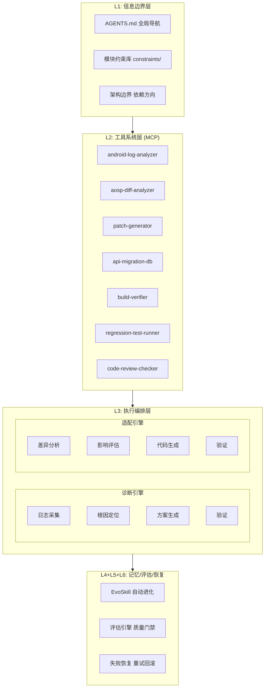

# TAHP 系统架构概览

> **版本**: v1.0 | **日期**: 2026-05-18 | **状态**: Approved
>
> 本文档为 TAHP (TECNO AI Harness Platform) 的系统架构总览，面向所有参与者和协作者。

---

## 1. 平台简介

TECNO AI Harness Platform (TAHP) 是服务于传音（TECNO）Android 底软集成部的**双引擎 AI 平台**，基于 **Agent = Model + Harness** 范式构建。

### 1.1 双引擎定位

| 引擎 | 核心场景 | 输入 | 产出 |
|------|---------|------|------|
| **诊断引擎** | Bug 分析（通话/短信/功耗/内核等） | 日志 + 复现步骤 + 设备信息 | 根因分析报告 |
| **适配引擎** | 版本升级 / 特性移植 / 运营商移植 | AOSP Diff + 约束规则 + 迁移规则库 | 代码 Patch 集合 |

### 1.2 核心理念

```
传统模式: Owner → [完整SOP] → [手动Skill] → [人工迭代]
TAHP模式: Owner → [约束条件(YAML)] → [系统自动生成/进化Skill] → [自动评估]
```

业务 Owner 只需提供**约束条件**（YAML 格式）和历史案例，系统自动完成 Skill 生成、进化、评估的全链路。

---

## 2. 核心架构图

### 2.1 整体架构

```
┌──────────────────────────────────────────────────────────────────┐
│                   TECNO AI Harness Platform                       │
│                                                                    │
│  ┌─────────────────────────────────────────────────────────────┐  │
│  │                    L1: 信息边界层                            │  │
│  │  ┌─────────────┐ ┌─────────────┐ ┌─────────────┐            │  │
│  │  │ AGENTS.md   │ │ 模块约束库  │ │ 架构边界    │            │  │
│  │  │ (全局导航)  │ │ constraints/│ │ (依赖方向)  │            │  │
│  │  └─────────────┘ └─────────────┘ └─────────────┘            │  │
│  └─────────────────────────────────────────────────────────────┘  │
│                               ↓                                    │
│  ┌─────────────────────────────────────────────────────────────┐  │
│  │                    L2: 工具系统层 (MCP)                     │  │
│  │  ┌──────────┐ ┌──────────┐ ┌──────────┐ ┌──────────┐       │  │
│  │  │ Android  │ │ AOSP     │ │ Patch    │ │ API迁移  │       │  │
│  │  │ 日志分析 │ │ Diff分析 │ │ 生成器   │ │ 规则库   │       │  │
│  │  └──────────┘ └──────────┘ └──────────┘ └──────────┘       │  │
│  │  ┌──────────┐ ┌──────────┐ ┌──────────┐ ┌──────────┐       │  │
│  │  │ Git操作  │ │ 编译构建 │ │ 回归测试 │ │ 代码审查 │       │  │
│  │  │ 工具     │ │ 验证     │ │ 运行器   │ │ 检查器   │       │  │
│  │  └──────────┘ └──────────┘ └──────────┘ └──────────┘       │  │
│  └─────────────────────────────────────────────────────────────┘  │
│                               ↓                                    │
│  ┌─────────────────────────────────────────────────────────────┐  │
│  │                    L3: 执行编排层 — 双引擎                  │  │
│  │                                                              │  │
│  │  ┌─── 诊断引擎 ───────────────────────────────────────┐     │  │
│  │  │ 日志采集→根因定位→方案生成→验证                      │     │  │
│  │  └─────────────────────────────────────────────────────┘     │  │
│  │                                                              │  │
│  │  ┌─── 适配引擎 ───────────────────────────────────────┐     │  │
│  │  │ 差异分析→影响评估→代码生成→验证                      │     │  │
│  │  └─────────────────────────────────────────────────────┘     │  │
│  └─────────────────────────────────────────────────────────────┘  │
│                               ↓                                    │
│  ┌─────────────────────────────────────────────────────────────┐  │
│  │              L4+L5+L6: 记忆/评估/恢复层                     │  │
│  │  ┌──────────────┐ ┌──────────────┐ ┌──────────────┐        │  │
│  │  │ EvoSkill     │ │ 评估引擎     │ │ 失败恢复     │        │  │
│  │  │ 自动进化     │ │ 质量门禁     │ │ 重试/回滚    │        │  │
│  │  └──────────────┘ └──────────────┘ └──────────────┘        │  │
│  └─────────────────────────────────────────────────────────────┘  │
│                                                                    │
│  ═══════════════════════════════════════════════════════════════  │
│  底层: Git + Claude Code/Codex CLI + Python 3.12+ + EvoSkill    │
│  ═══════════════════════════════════════════════════════════════  │
└──────────────────────────────────────────────────────────────────┘
```

### 2.2 Mermaid 架构图



---

## 3. 约束驱动 Harness 范式

### 3.1 Agent = Model + Harness

2026 年业界的核心公式：**模型是 CPU，Harness 是操作系统**。Harness 将状态、工具、反馈、约束和执行环境串联起来，为 Agent 提供结构化的执行环境。

### 3.2 Harness 六层架构

| 层级 | 名称 | 解决什么问题 | 实施优先级 |
|------|------|-------------|-----------|
| **L1** | **信息边界层** | Agent 该知道什么、不该知道什么 | **P0** |
| L2 | 工具系统层 | Agent 怎么和外部世界交互 | P0 |
| L3 | 执行编排层 | 多步骤任务怎么串起来 | P1 |
| L4 | 记忆与状态层 | 长任务中间结果怎么管理 | P1 |
| L5 | 评估与观测层 | Agent 怎么知道自己做对了没有 | P1 |
| **L6** | **约束、校验与恢复层** | 出错了怎么办 | **P0** |

### 3.3 约束驱动的核心理念

```
传统模式: Owner写SOP → 人工转Skill → AI按Skill执行 → 人工迭代
Harness模式: Owner写约束 → 系统自动生成Skill → 自动评估迭代

关键转变:
  从 "人写执行步骤" 升级为 "人写约束条件，系统自动推导执行逻辑"
  核心原则: If it cannot be enforced mechanically, agents will deviate.
```

---

## 4. 双引擎工作流程

### 4.1 诊断引擎

诊断引擎负责 Bug 根因分析，流程如下：

```
┌──────────┐    ┌──────────┐    ┌──────────┐    ┌──────────┐
│ 日志采集  │ →  │ 根因定位  │ →  │ 方案生成  │ →  │ 验证输出  │
│          │    │          │    │          │    │          │
│ logcat   │    │ 层级判定  │    │ 修复建议  │    │ 质量门禁  │
│ AT命令   │    │ 证据链   │    │ 代码Patch │    │ 格式检查  │
│ Modem日志│    │ 根因描述  │    │ 影响评估  │    │ 证据校验  │
└──────────┘    └──────────┘    └──────────┘    └──────────┘
```

**层级判定顺序**：Framework (Java) → RILJ (Java RIL) → RILC (C/HIDL) → Modem

**必产出维度**：root_cause_layer、reproducibility、impact_scope、fix_type、severity、root_cause_description、fix_suggestion

### 4.2 适配引擎

适配引擎负责版本升级、特性移植和运营商移植，覆盖三大 Pipeline：

```
版本升级 Pipeline:
  AOSP Diff分析 → 影响评估 → 策略分类 → 批量适配 → 编译验证 → 回归测试 → 适配报告

Feature移植 Pipeline:
  依赖分析 → 兼容性映射 → 代码转换 → 集成测试

运营商移植 Pipeline:
  需求解析 → 源码映射 → 差异生成 → 合规检查
```

**适配策略三级分类**：

| 策略 | 判定条件 | 处理方式 |
|------|---------|---------|
| 全自动 | 已知迁移模式 + 置信度 > 95% | 自动 patch → 编译 → 回归 |
| 半自动 | 置信度 70-95% | AI patch → 编译 → **人工审核** → 回归 |
| 人工 | 置信度 < 70% / 全新场景 | 生成任务清单 + 参考建议 |

---

## 5. 四域约束体系

TAHP 定义了四种约束域（Domain），覆盖所有业务场景：

| Domain | 引擎 | 输入 | 产出 | 约束文件 |
|--------|------|------|------|---------|
| `bug_analysis` | 诊断 | 日志/复现步骤 | 分析报告 | `bug-analysis.yaml` |
| `code_adaptation` | 诊断 | Bug修复/代码适配 | 代码 Patch | `code-adaptation.yaml` |
| `version_adaptation` | 适配 | 版本升级/Feature移植 | 批量 Patch | `version-adaptation.yaml` |
| `carrier_porting` | 适配 | 运营商需求 | Carrier Patch + 配置 | `carrier-porting.yaml` |

每个域都有完整的 YAML Schema 定义，Owner 按模板填写即可。约束文件的质量直接决定 AI 生成 Skill 的质量。

---

## 6. Skill 进化机制（EvoSkill）

### 6.1 进化循环

```
约束文件 (YAML) ──→ Skill生成器 ──→ 初始 SKILL.md
                                    │
                              EvoSkill 进化循环
                                    │
                    ┌───────────────┤
                    ↓               ↓
              执行失败案例    反馈历史
                    │               │
                    ↓               ↓
              Proposer 分析   去重 + 避免重复
                    │
                    ↓
              Generator 生成
              新/改进 Skill
                    │
                    ↓
              Evaluator 打分
                    │
                    ↓
              Frontier 保留
              最优 N 个版本
                    │
                    ↓
              ┌─────┘
              ↓ (下一轮迭代)
```

### 6.2 Frontier 管理

- 保留最多 N 个 Skill 变体（默认 N=3）
- 新 Skill 必须满足以下条件之一才替换已有 Skill：
  - 准确率更高（且其他指标不低于）
  - 准确率相同但效率更高
  - 准确率略低但泛化能力显著更好
- 被替换的 Skill 保留在 archive/ 目录

### 6.3 跨模型迁移

用固定 LLM 进化的 Skills 可将性能提升**迁移到其他 LLM**，实现"进化一次，到处可用"。

---

## 7. 质量门禁体系

### 7.1 三级门禁

| 级别 | 门禁项 | 失败处理 |
|------|--------|---------|
| **P0 (BLOCK)** | 编译通过 + Scope 合规 + 安全红线 + API 真实性 | 任一失败即阻止 |
| **P1 (WARNING)** | 编码风格 + Lint + 废弃 API + TODO 关联 | 累计超过阈值则警告 |
| **P2 (RECORD)** | 代码复杂度 + 重复率 + 注释覆盖 | 记录但不阻止 |

### 7.2 Skill 评估指标

| 指标 | 权重 | 目标值 |
|------|------|--------|
| 准确率 (Accuracy) | 40% | >= 85% |
| 完整性 (Completeness) | 20% | 100% |
| 一致性 (Consistency) | 15% | >= 90% |
| 时效性 (Efficiency) | 15% | <= 5min/案例 |
| 可解释性 (Explainability) | 10% | >= 80% |

详细评估指标体系参见 [评估指标体系文档](evaluation-metrics.md)。

---

## 8. MCP 工具集成架构

### 8.1 工具协议

所有工具通过 **MCP (Model Context Protocol)** 标准化接入，按需分发给 Agent。

### 8.2 工具清单

| 工具名 | 功能 | 优先级 | 适用引擎 |
|--------|------|--------|---------|
| `android-log-analyzer` | 解析 logcat/ril/atcmd 日志 | P0 | 诊断 |
| `aosp-diff-analyzer` | 对比两个 Android 版本的 framework diff | P0 | 适配 |
| `patch-generator` | 根据适配规则批量生成代码 patch | P0 | 适配 |
| `api-migration-db` | 管理 API 迁移规则库 | P1 | 适配 |
| `build-verifier` | 触发编译验证 | P0 | 诊断+适配 |
| `regression-test-runner` | 运行冒烟测试 + 功能回归 | P1 | 诊断+适配 |
| `code-review-checker` | 代码审查规则检查 | P2 | 诊断+适配 |

### 8.3 工具接口标准

所有 MCP 工具必须实现统一接口：`name`、`description`、`inputSchema`、`handler`，并支持前置验证 (`validate`)。

---

## 9. 目录结构说明

```
tahp/
├── AGENTS.md                          # 全局导航文件（所有 Agent 入口）
├── CLAUDE.md                          # Claude Code 专用配置
├── constraints/                       # 业务约束（Owner 唯一输入端）
│   ├── {module}/                      # 按模块组织
│   │   ├── module.yaml                # 模块基本信息（必须）
│   │   ├── bug-analysis.yaml          # Bug 分析约束
│   │   ├── code-adaptation.yaml       # 代码适配约束
│   │   ├── version-adaptation.yaml    # 版本适配约束
│   │   ├── carrier-porting.yaml       # 运营商移植约束
│   │   └── eval-data/                 # 评估数据集
│   │       ├── cases/                 # 测试案例 (YAML)
│   │       └── expected/              # 期望输出 (JSON)
│   └── shared/                        # 共享约束和规则
│       ├── coding-standards.yaml      # 全局编码规范
│       ├── android-platform.yaml      # Android 平台通用约束
│       └── api-migration-rules/       # API 迁移规则库（跨版本复用）
│
├── skills/                            # 自动生成的 Skills（EvoSkill 产出）
│   ├── .claude/skills/                # Claude Code 格式
│   └── .codex/skills/                 # Codex 格式（自动同步）
│
├── playbooks/                         # 执行编排剧本（Pipeline 定义）
│   ├── bug-analysis-pipeline.yaml
│   ├── code-adaptation-pipeline.yaml
│   ├── version-upgrade-pipeline.yaml
│   ├── feature-porting-pipeline.yaml
│   └── carrier-porting-pipeline.yaml
│
├── tools/                             # MCP 工具接口定义
│
├── docs/                              # 深度文档
│   ├── architecture/                  # 架构文档
│   │   └── system-overview.md         # 本文档
│   └── quality/                       # 质量文档
│       └── evaluation-metrics.md      # 评估指标体系
│
├── scripts/                           # 自动化脚本
│   ├── init_module.py                 # 模块初始化
│   ├── evaluate.py                    # Skill 评估
│   ├── run-evolution.py               # EvoSkill 进化
│   └── gate-check.py                  # 质量门禁检查
│
├── templates/                         # 模块初始化模板
│   └── module-template/               # 新模块骨架模板
│       ├── module.yaml.template
│       ├── bug-analysis.yaml.template
│       ├── code-adaptation.yaml.template
│       ├── version-adaptation.yaml.template
│       ├── carrier-porting.yaml.template
│       ├── constraints/               # 约束模板
│       └── eval-data/                 # 评估数据模板
│           ├── cases/
│           └── expected/
│
├── reports/                           # 评估报告输出
│   ├── evolution-reports/
│   └── quality-metrics/
│
└── requirements.txt                   # Python 依赖
```

---

## 10. 技术栈和依赖

| 层级 | 技术选型 | 说明 |
|------|---------|------|
| **Skill 进化引擎** | EvoSkill (Apache 2.0) | 从 Agent 失败中自动发现/进化 Skill |
| **Agent 运行时** | Claude Code (主力) + Codex CLI (备选) | 成熟度最高，EvoSkill 原生支持 |
| **工具协议** | MCP (Model Context Protocol) | 2026 年事实标准 |
| **工作流编排** | YAML Playbooks + Python 脚本 | 轻量 DAG 编排 |
| **版本管理** | Git | EvoSkill 原生分支管理 |
| **知识格式** | Markdown + YAML + JSON | AGENTS.md 标准，渐进式披露 |
| **运行环境** | Python 3.12+ | 纯本地运行，零服务器成本 |
| **可选: 可视化** | Dify (Docker 本地) | 非技术人员参与时使用 |
| **可选: 本地 LLM** | Ollama + Qwen2.5-Coder | 降低 API 成本，离线可用 |

### 10.1 里程碑

| 里程碑 | 时间 | 标志 |
|--------|------|------|
| M0 基础就绪 | 第 2 周 | 仓库结构完整，工具安装完毕 |
| M1 诊断 MVP | 第 4 周 | 试点模块 Bug 分析 Skill 能正确分析测试集 |
| M2 适配 MVP | 第 6 周 | 核心 MCP 工具就绪，回溯验证全自动率 >= 40% |
| M3 双引擎进化 | 第 8 周 | EvoSkill 双引擎进化稳定，Skill 准确率提升 >= 10pp |
| M4 推广 | 第 10 周 | >= 3 个模块接入双引擎 |

---

## 11. 相关文档

| 文档 | 路径 | 说明 |
|------|------|------|
| 方案设计 | `TECNO-AI-Harness-Platform-方案设计.md` | 完整系统方案 |
| 可视化架构 | `TAHP-Architecture-Overview.html` | 8 幅专业架构图 |
| 约束编写规范 | `TAHP-约束文件编写规范.md` | Owner 编写约束的标准 |
| AI 代码生成约束 | `TAHP-AI代码生成约束规范.md` | 防幻觉、防反复修改 |
| 版本适配约束 | `TAHP-版本适配约束规范.md` | 版本升级/运营商移植标准 |
| 评估与质量门禁 | `TAHP-评估与质量门禁规范.md` | Skill 质量评估标准 |
| 评估指标体系 | `docs/quality/evaluation-metrics.md` | 本文档的配套评估文档 |
