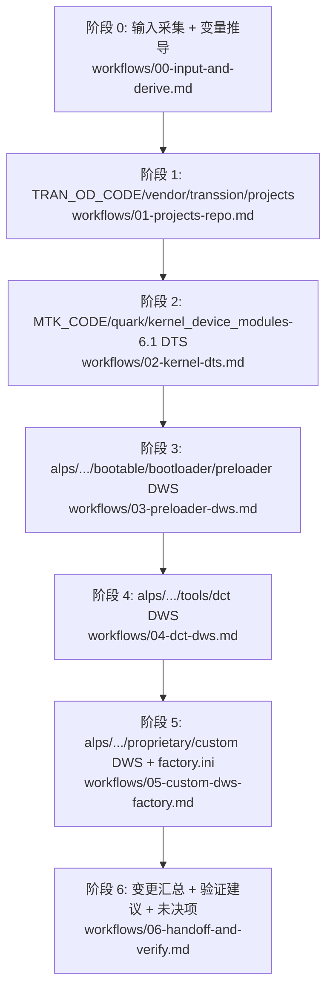

# DRV_Audio_Adapt

协助 MTK 平台 Audio P1 升级移植（bringup）：`vnd12 非榫卯→vnd16 榫卯` | `vnd14 非榫卯→vnd14 榫卯`。仅限升级移植场景。

## 设计哲学（读一次即可）

- **本质是"按事实结构化配置"，不是"凭印象选项卡"**。每个配置决策必须有证据来源，按以下优先级：
  1. 升级前对应文件（`ProjectConfig.mk` / 项目 DTS `pre_project_dts_path` / 平台 DTS `pre_platform_dts_path` / `.dws` / `audio_device.xml` / `aurisys_config*.xml`）。
  2. 软件配置表（开发者提供的截图或文本）。
  3. 本 SKILL `references/` 给出的 SOP 默认原则。
  4. 三层都缺时 **强制求助开发者**，禁止臆造。
- **升级后 DTS：格式跟模板，取值跟升级前（强制）**：阶段 2 写入升级后项目 DTS 时，**节点名、父子挂载、属性集合与书写格式** 必须严格按 [references/dts-node-templates.md](references/dts-node-templates.md) 的**升级后模板**落地；**禁止**照搬升级前 DTS 的节点形态（例如 DIO1520 解耦用的 `tran_audio`、在 `tran_audio_sliptswitch_gpio` 上挂 GPIO 等）。升级前项目 DTS **仅**用于读取属性**取值**（如 `reg` / `dev_index`、I2C 总线号、`tran_pa_type` / `tran_typec_type` 枚举值、GPIO 引脚号）；**不得**把升级前格式当作升级后的写法。模板未定义的节点名 **禁止臆造**。
- **TypeC 芯片类型判定**：HL1280 / DIO1520 / 3.5mm 以升级前项目 DTS（及开发者明确的硬件型号）判定；判定结果决定采用模板 §3 中哪一种 typec 节点，**不得**因升级后 sunmao 占位模板（如误留 HL1280）而改变芯片类型。
- **先勘察 → 再决策 → 后执行**：每个阶段先把 ① 变量/路径推导完，② 源文件清单与缺口枚举完，③ 改动预案讲清楚，再开始写文件。
- **分阶段（按 repo）执行 + checkpoint**：每个阶段结束给「本阶段改了什么 / 还差什么 / 是否继续」三栏摘要，开发者确认后再进下一阶段。
- **严格 SOP 执行（默认且强制）**：未经开发者显式确认不得跨阶段推进、不得补充模板外字段、不得因"看起来合理"自动修正历史配置。
- **对抗模型惯性**（必须主动抵抗）：
  - 不要凭"一般 MTK 经验"补 `ProjectConfig.mk` 宏控值。
  - 不要在源路径全部缺失时编造一份文件（例如PA bin 或 PA 参数等）。
  - 不要把 `vnd12 → vnd16` 的差异等同 `vnd14 → vnd14`（例如PA 算法 so 在 vnd12 → vnd16 不可复用）。
  - 不要假设软件配置表中所有字段都已给出；缺则问，不要默认。
  - 不要"先改了再说"——动手前先把变量与缺口表给开发者看一眼。
  - **不要**因升级后项目侧 `audio_device.xml` 与升级前项目"看起来差不多"就跳过 SOP 1.6（禁止整文件拷贝、禁止省略平台基线步骤、禁止省略去重终检）。
  - **不要**把 `{base_code}/kernel/**/{project_name_sunmao}.dts` 当作升级前项目 DTS；升级前项目 DTS **一定**在 `tran_projects_root` 下（§5.2），禁止用仓库根 `kernel/` 兜底。
  - **不要**混淆 **项目 DTS**（`{project_name_sunmao}.dts` → `pre_project_dts_path`）与 **平台 DTS**（`{platform_name}.dts` → `pre_platform_dts_path`）：二者解析流程独立（§5.2 / §5.3），禁止用项目 DTS 做 ADSP 检测，禁止用平台 DTS 抄 PA/TypeC 节点取值。
- **零偏离执行原则**：任何异常场景都必须停在当前 SOP 阶段，按"还差什么"和"强制提问条件"向开发者确认后再继续；禁止以任何形式跳出 SOP、禁止用专家推断替代 SOP 步骤。
- **强制提问条件（不能"我觉得"，必须停下问）**：
  1. 任一文件（例如PA文件【固件 / 参数 / aurisys_config】、aurisys_config_rv、aurisys_config_hifi3、audio_device.xml等）的所有候选源路径均不存在。
  2. 升级前 `ProjectConfig.mk` 找不到某宏控，且软件配置表无对应项。
  3. `tran_audio_controller` 的 GPIO（`typec_usb_change_gpio` / `audio_usb_switch_dio32020` / `mic_gnd_switch_dio1520`）在升级前 DTS 中存在但 DWS 中缺失（或反之）。
  4. `audio_device.xml` 中升级前项目层相对平台层的 diff 涉及移除/重命名节点（非纯叠加）。
  5. 软件配置表为图片但关键字段（PA 型号、MIC 个数、PHONE_MIC_MODE、HEADSET_MIC_MODE、SPK 个数 / PATH）OCR 不清晰。

### 硬约束

1. **零假设**：凡是 `references/` 未定义的字段、节点、宏控、文件复制来源，均不得自行决定；必须进入"还差什么"并提问。
2. **零跳步**：未收到开发者对当前 checkpoint 的明确放行，不得进入下一阶段，也不得先行改写下阶段文件。
3. **顺序锁定**：阶段必须按 `P0 → P1 → P2 → P3 → P4 → P5 → P6` 严格执行；禁止跨阶段回填、并行改写多阶段文件、或先改后补 checkpoint。
4. **零混搭**：当同一维度出现双命中（例如硬件为 DIO1520、升级后 DTS 残留 `hl1280` 占位）时，以**升级前判定的芯片类型**为准选用模板 §3 对应节点，删除与类型冲突的占位节点，不得两套并存落盘；落盘格式仍必须符合升级后模板，不得回退为升级前解耦格式。
5. **零扩写**：模板要求"节点仅保留 compatible"时，不得追加额外属性；`tran_audio_controller` 必须按模板字段完整落地。
6. **零兜底默认**：任何"看起来常见"的默认值都不能直接写入，除非在 `references/` 有明确默认原则且当前场景可用。
7. **节点挂载一致性**：DTS 音频节点必须放在与升级前一致的父节点下（如 `&i2cX` / `&odm`）；禁止仅改子节点内容而忽略父节点归属。

## 输入契约（硬格式，必须满足）

可一次性给齐，也可分次给；缺什么 SKILL 主动追问，**不臆造**：

1. `base_code`：升级前 vnd 代码分支绝对路径（包含 `tran_projects/{project_name1}/{project_name}/{project_name1}/` 这层）。
2. `base_code_sunmao`：升级后 vnd 代码分支绝对路径（包含 `vendor/transsion/projects/{project_name_sunmao}/` 这层）。
3. `scenario`：明确二选一——`vnd12_to_vnd16` 或 `vnd14_to_vnd14`。
4. `project_compile_option`：升级前的项目编译选项（如 `cm7w_h616_64_bsp` 这种串）。文本或截图均可，将被切分为 `project_name1` / `project_name2` / `project_name3` / ... 与全名 `project_name`。
5. `sw_config_table`：软件配置表（开发者提供截图或导出文本）。关键字段：SPK 个数 / SPK PATH、PA 型号、MIC 个数、MIC 类型 / `PHONE_MIC_MODE`、`HEADSET_MIC_MODE`、是否 TypeC 耳机等。
6. `mode`（可选，默认 `execute_phased`）：`execute_phased` 分阶段改文件 + checkpoint；`audit_only` 只读报告。

> 路径一律用正斜杠 `/`；变量替换规则与解析路径模板见 [references/variables.md](references/variables.md)。

## 阶段路由（默认顺序）

按下列顺序逐阶段执行；每阶段完成后必须给一次「checkpoint 摘要」并等开发者确认（`mode=audit_only` 时只输出摘要不写文件）：

阶段索引：

- 阶段 0：[workflows/00-input-and-derive.md](workflows/00-input-and-derive.md)
- 阶段 1：[workflows/01-projects-repo.md](workflows/01-projects-repo.md)
- 阶段 2：[workflows/02-kernel-dts.md](workflows/02-kernel-dts.md)
- 阶段 3：[workflows/03-preloader-dws.md](workflows/03-preloader-dws.md)
- 阶段 4：[workflows/04-dct-dws.md](workflows/04-dct-dws.md)
- 阶段 5：[workflows/05-custom-dws-factory.md](workflows/05-custom-dws-factory.md)
- 阶段 6：[workflows/06-handoff-and-verify.md](workflows/06-handoff-and-verify.md)

## 最小完备工具集（原子能力，描述边界不写步骤）

- **文件查找**：用 Glob 在 `{base_code}` / `{base_code_sunmao}` 下按相对路径定位升级前/升级后文件。
- **关键字检索**：用 Grep 搜宏控值、DTS keyword（`snd_audio_dsp:` / `mtk-dsp-type` / `hl1280` / `dio1520` / `typec_usb_change_gpio` / `audio_usb_switch_dio32020` / `mic_gnd_switch_dio1520`）。
- **读文件**：用 Read 读 `ProjectConfig*.mk` / `.dts` / `.dws` / `audio_device.xml` / `aurisys_config*.xml` / `factory.ini`。
- **改文件**：用 StrReplace 改宏控值；aurisys_config*.xml 中 `/vendor/etc/` → `/odm/etc/vconfig/audio/`（全文 `replace_all`，见 [pa-file-matrix.md §6](references/pa-file-matrix.md)）；用 Write 新建升级后侧不存在的目标文件。
- **复制文件**（PA 固件/参数 bin、aurisys_config*.xml、audio_device.xml、audiotest wav）：在 Windows 下用 Shell `copy` 或 `Copy-Item`（PowerShell），统一传正斜杠路径但调用前转换为系统兼容形式；不要假设 `cp` 可用。
- **图像理解**：开发者给截图（编译选项 / 软件配置表）时直接读图，**不准 OCR 不清楚还硬猜**——不清晰必须停下问。

## 安全红线（不可越线）

- 禁止凭"一般 MTK 经验"补宏控值或编造 PA bin / PA 参数。源全部缺失时只能停在当前阶段并询问开发者（标注未决项），**不得**自动生成 placeholder。
- **`vnd12 → vnd16` 的 PA 算法 so 必须重新跟 FAE 索取**：ARSI API 从 1.6.0 → 1.9.0 不兼容，**不得**把 vnd12 旧 so 复制到 vnd16。本 SKILL 必须把"找 FAE 索取升级后 so + 通知 AFE 升级前后 ARSI 版本/PA 算法库版本/集成方式（AP 侧 / ADSP HIFI / ADSP RV55）/参数是否可复用"作为强制未决项列出。
- 所有 `aurisys_config*.xml`（`aurisys_config.xml` / `aurisys_config_fs.xml` / `aurisys_config_rv.xml` / `aurisys_config_hifi3.xml`）移植后，**必须**将文中 **全部** `/vendor/etc/` 替换为 `/odm/etc/vconfig/audio/`（例：`/vendor/etc/audio_param` → `/odm/etc/vconfig/audio/audio_param`，`/vendor/etc/pa_param` → `/odm/etc/vconfig/audio/pa_param`）。**禁止**改 `/vendor/lib`、`/vendor/lib64`。详见 [pa-file-matrix.md §6](references/pa-file-matrix.md)。遗漏或残留 `"/vendor/etc/` 视为本 SKILL 失败。
- 升级后侧 PA 旧目录清理统一 **全量删除** 四个 PA 专用目录（`aw87xxx` / `oca72xxx` / `fs1599n` / `fs1589n`，存在即删），后续按当前 PA 类型在 PA 文件移植步骤中重新创建对应目录；**禁止** 因为"判定不准"而漏删某个 PA 目录，也 **禁止** 把 `{post_pa_root}/audio/` 整个目录删掉。
- 升级后侧 `audio/` 目录下残留 `audio_param/` 目录的删除 与 aurisys xml 中 `/vendor/etc/` → `/odm/etc/vconfig/audio/` 的路径改写 是 **两个独立操作**：xml 路径指向运行时 odm 分区，与本仓库 `audio/audio_param/` 源码目录不是同一对象。两者无顺序依赖，但 **都必须执行**，缺任何一项视为本 SKILL 失败。
- **`audio_device.xml` 必须严格执行 [workflows/01-projects-repo.md §1.6](workflows/01-projects-repo.md) 全部步骤（0→6）**：先删目标文件 → 复制升级后平台基线 → 计算升级前项目相对升级前平台的 diff → 叠加 → XML 校验 → 注释校验 → **path 去重终检**。**禁止**以"已与升级前一致"为由跳过任一子步骤；**禁止**把升级前项目 `audio_device.xml` 整文件覆盖到升级后项目侧；**禁止**使用会丢失注释/重排结构的 XML 解析后整文件重写方式。
- **`audio_device.xml` 叠加必须使用 [scripts/merge_audio_device_xml.py](scripts/merge_audio_device_xml.py)**（path 块 segment 重组 + 锚点插入）。**禁止**向第一个 `</mixercontrol>` 插入 diff（会导致文件截断至约 6KB）。脚本或等价实现成功后须自检：`dup=0`、文件大小 ≥ 平台基线 85%、仅 1 个 `</mixercontrol>`。详见 [workflows/01-projects-repo.md §1.6 常见错误](workflows/01-projects-repo.md)。
- **`audio_device.xml` 禁止重复 path**：落盘文件中，同一 path 键（`@name` + `@value`，`turnon`/`turnoff` 各算独立键）**全局只能出现 1 次**。叠加时不得"追加第二份"同键块；若基线中已有该键，必须用**升级前项目**中对应块 **替换**（非跳过、非并存）。终检发现重复键 → 删除非升级前项目来源的副本，**内容与位置均以升级前项目文件为准**；升级前项目文件中若同键出现多次，取该键在升级前项目中**最后一次**出现的完整块（含其紧邻前置注释）。去重后仍无法满足唯一性 → 停下问开发者。
- `audio_device.xml` / `aurisys_config*.xml` / `factory.ini` / `.dts` / `.dws` 中的现有注释属于有效上下文，默认必须保留。除非开发者明确要求删除，**不得**主动删注释；迁移增量块时其关联注释需一并迁移。
- `ProjectConfig.mk` 音频宏控仅允许写入 [references/projectconfig-macros.md](references/projectconfig-macros.md) 宏控表中定义的字段，**禁止臆造**新宏控（例如 `TRAN_AUDIO_DIO1520_SUPPORT`、`TRAN_AUDIO_TYPEC_DIO1520`）。
- 4 个 PA `*_SUPPORT` 宏控以"恰好 1 个 `yes`"为判定标准；其余 PA 宏控可为 `no` 或缺省不写，不要求强制补 `no`。
- DIO1520 的 typec switch 节点按固定模板整体落地：`tran_audio_sliptswitch` 与 `tran_audio_sliptswitch_gpio` 均仅保留 `compatible` 属性。
- **升级后 DTS 禁止照搬升级前节点格式**；仅可从升级前读取属性取值。模板外节点（如升级前解耦用的 `tran_audio`）**不得**写入升级后项目 DTS。
- DTS 节点移植：PA/HL1280 的 **I2C 总线号** 与 `reg`/`dev_index` 等取值与升级前一致；**节点结构** 必须符合 [dts-node-templates.md](references/dts-node-templates.md)。`tran_audio_controller` 与 DIO1520 的 `tran_audio_sliptswitch*` 必须在 `&odm` 下按模板书写；父总线号与升级前不一致时必须停下提问。
- `audio_policy_configuration.xml` / `audio_policy_engine*.xml` / `audio_effects.xml` 等不在本 SOP 范围；本 SKILL **不主动改动**这些文件。若发现需要改动，显式告知开发者，由开发者自行决策。
- 不替开发者执行 `git commit / git push / repo upload`；最终阶段仅给出"建议改动清单 + 验证命令"。
- 不替开发者修改 Gerrit topic / change-id；参考提交（cm7 / x6873 / x6885 / lj7）只读，不复述补丁、不抄袭代码。

## 输出契约（每个阶段强制）

每个阶段执行完（无论 `execute_phased` 还是 `audit_only`）必须按下面三栏给摘要，不可省略：

| 项 | 内容 |
| --- | --- |
| 本阶段改了什么 | 文件相对路径 + 关键改动一句话；引用本阶段对应 `references/`。 |
| 还差什么 | 缺失源文件 / 软件配置表未给的字段 / 需要开发者人工确认的歧义 / 强制未决项（如 vnd12 → vnd16 so）。 |
| 是否继续 | 默认询问开发者是否进入下一阶段；`audit_only` 模式下则附"本阶段建议的最终改动清单"。 |

## 共享参考（按需读取，避免一次性把全部拉进上下文）

- [references/variables.md](references/variables.md)：变量推导规则与全部路径模板。
- [references/projectconfig-macros.md](references/projectconfig-macros.md)：ProjectConfig.mk 宏控表与三级 fallback 决策。
- [references/pa-file-matrix.md](references/pa-file-matrix.md)：PA 固件 / SO / 参数 / aurisys_config 的源-目矩阵。
- [references/adsp-detection.md](references/adsp-detection.md)：ADSP 类型检测与 `aurisys_config_rv/hifi3.xml` 选型。
- [references/dts-node-templates.md](references/dts-node-templates.md)：`tran_audio_controller` 模板与 `tran_pa_type` / `tran_typec_type` enum。
- [references/dws-gpio-rules.md](references/dws-gpio-rules.md)：DWS GPIO 移植规则（preloader / dct / custom 共用）。
- [references/factory-ini-rules.md](references/factory-ini-rules.md)：工模 factory.ini 注释与字段规则。
- [references/verify-commands.md](references/verify-commands.md)：bringup 后建议的最小自检命令。
- [examples/reference-submissions.md](examples/reference-submissions.md)：cm7 / x6873 / x6885 / lj7 的 Gerrit topic 与阅读指引。
