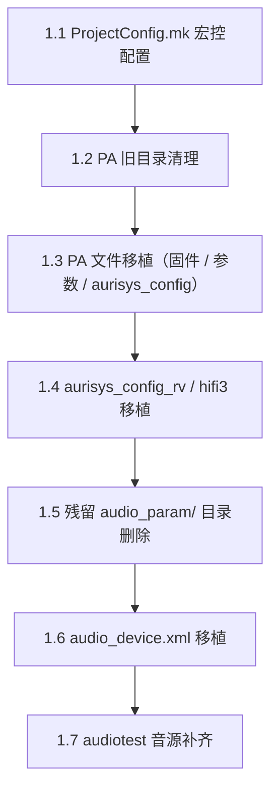

# 阶段 1：TRAN_OD_CODE/vendor/transsion/projects

**目标 repo**：`TRAN_OD_CODE/vendor/transsion/projects/{project_name_sunmao}/`

**前置**：阶段 0 已完成，变量确认表已被开发者认可。

## 一、阶段地图

按下列子步骤顺序执行，每一步都要先做"勘察 + 缺口枚举"再下笔。本阶段结束统一给一次 checkpoint 摘要。

## 1.1 `ProjectConfig.mk` 宏控配置

数据源：[references/projectconfig-macros.md](../references/projectconfig-macros.md)。

执行步骤：

1. 对 [projectconfig-macros.md §1](../references/projectconfig-macros.md) 的每个宏控，按 §0 三级 fallback 推导目标值；保留每个宏控的"来源 + 取值"二元组。
2. Read `{base_code_sunmao}/vendor/transsion/projects/{project_name_sunmao}/ProjectConfig.mk`：
   - 命中行：用 StrReplace 替换右值，保留赋值符号。
   - 未命中：在文件尾追加 `<macro> = <value>`。
3. 全部写入后执行 [projectconfig-macros.md §4](../references/projectconfig-macros.md) 的强制自检（4 个 PA `*_SUPPORT` 互斥：恰好 1 个 `yes`、双麦一致性等）。

**强制提问触发**：

- 三级 fallback 都查不到的宏控。
- 升级前文件与软件配置表冲突的宏控。
- 4 个 PA `*_SUPPORT` 自检不通过（判定标准：恰好 1 个 `yes`；其余可为 `no` 或缺省）。

## 1.2 PA 旧目录清理（全量删除四个 PA 目录）

数据源：[references/pa-file-matrix.md §0](../references/pa-file-matrix.md)。

执行步骤：

1. Glob `{base_code_sunmao}/vendor/transsion/projects/{project_name_sunmao}/audio/` 下的子目录，列出 `aw87xxx` / `oca72xxx` / `fs1599n` / `fs1589n` 中实际存在的项。
2. 对上述存在的 PA 子目录 **全部执行删除**（Shell `rmdir /s /q` 或 `Remove-Item -Recurse -Force`），不做"是否与当前 PA 类型匹配"的判定。
3. 当前 PA 类型对应的子目录将在 §1.3 中按需新建，并写入本轮要移植的文件；其他 PA 类型的目录将保持"不存在"状态。

**安全门**：

- 删除前在 checkpoint 中列出"将删除的目录列表"，**仅在 execute_phased 模式下** 实际执行；`audit_only` 模式下仅列清单。
- 禁止删除 `{post_pa_root}/audio/` 目录本身——该目录下还有其他非 PA 内容（`audio_device.xml`、`audiotest/` 等）。
- 仅删上述 4 个 PA 专用目录，不要扩大删除范围到 `audio_param/` 或其他子目录（`audio_param/` 的处理见 §1.5，与本步骤独立）。

## 1.3 PA 文件移植

数据源：[references/pa-file-matrix.md §1~§4](../references/pa-file-matrix.md)。

前置：§1.2 已把 4 个 PA 专用目录全部删除；本步骤需要先按当前 PA 类型 **新建** 对应子目录：

- 当前 PA = AW：`mkdir {post_pa_root}/audio/aw87xxx/`（含子目录 `smartpa_param/` 视需要再建）
- 当前 PA = FS1599N：`mkdir {post_pa_root}/audio/fs1599n/`
- 当前 PA = FS1589N：`mkdir {post_pa_root}/audio/fs1589n/`
- 当前 PA = OCA：`mkdir {post_pa_root}/audio/oca72xxx/`

> 当前 PA 类型 = §1.1 中 4 个 `TRAN_AUDIO_*_SUPPORT` 宏控里唯一为 `yes` 的那个（其余宏控缺省不写）。

之后对当前 PA 类型执行 4 类移植（按顺序）：

1. **固件**：1.x 节中的 `.bin` / `.fsm`。
2. **SO**：
   - `vnd14_to_vnd14`：跳过移植，但在 checkpoint 中明确"已跳过，使用公共 so"。
   - `vnd12_to_vnd16`：**禁止复制旧 so**。直接把 §7 强制未决项写入"还差什么"栏，明确告知"必须找 FAE 取升级后 so + 通知 AFE"。
3. **PA 参数**：`AW_DSP.bin` / `preset_*.bin` / `ocs_params.bin` 等。注意 FS1599N 有 5 个、FS1589N 有 6 个 preset，每个文件独立 OR 选源。
4. **aurisys_config**：`aurisys_config.xml` 或 `aurisys_config_fs.xml`。移植后 **立即** 执行 [pa-file-matrix.md §6](../references/pa-file-matrix.md)：全文 `/vendor/etc/` → `/odm/etc/vconfig/audio/`（`replace_all`），Grep 确认无残留 `"/vendor/etc/`。

操作要点：

- 每个文件按 OR 集合扫候选源：第一个存在的源即采用。多个源都存在且内容不同 → 默认采用项目层、并在 checkpoint 中显式提示开发者。
- 全部源都不存在 → 列入"还差什么"栏，等待开发者补提供；不要硬创空文件。
- 复制操作（Windows）：用 Shell `copy /Y "<src>" "<dst>"`（cmd）或 `Copy-Item -Force <src> <dst>`（PowerShell）；事先 `mkdir` 目标目录。

## 1.4 `aurisys_config_rv.xml` / `aurisys_config_hifi3.xml` 移植

数据源：[references/adsp-detection.md](../references/adsp-detection.md)。

执行步骤：

1. 按 [adsp-detection.md §2/§3](../references/adsp-detection.md) 检测 ADSP 类型：Read **`pre_platform_dts_path`**（阶段 0 §5.3 已解析的 `{platform_name}.dts`；**禁止**读 `pre_project_dts_path`）→ `no_adsp` / `rv55` / `hifi`。
2. **清空升级后侧两份目标文件（动手移植前先做）**：检查下列两个目标文件是否存在，存在则全部删除（无论本次检测结果选 rv 还是 hifi3）：
   - `{base_code_sunmao}/vendor/transsion/projects/{project_name_sunmao}/audio/aurisys_config_rv.xml`
   - `{base_code_sunmao}/vendor/transsion/projects/{project_name_sunmao}/audio/aurisys_config_hifi3.xml`
   - 这样做的原因：升级后侧可能从平台基线带来过 rv/hifi3 默认模板，与本轮要落的项目层版本不同；统一删干净后再按 ADSP 类型注入对应那一份，避免歧义。
   - 删除清单需在 checkpoint 中显式列出；`audit_only` 模式下仅列清单。
3. 按 [adsp-detection.md §4/§5](../references/adsp-detection.md) 决定需移植的 xml 与候选源路径：
   - `no_adsp`：跳过移植，但在 checkpoint 中明确"已检测无 ADSP，跳过 rv/hifi3 移植"。
   - `rv55`：移植 `aurisys_config_rv.xml`（只需要 rv，不要 hifi3）。
   - `hifi`：移植 `aurisys_config_hifi3.xml`（只需要 hifi3，不要 rv）。
4. 移植后执行 [pa-file-matrix.md §6](../references/pa-file-matrix.md)：`/vendor/etc/` → `/odm/etc/vconfig/audio/`（全文替换，规则同 §1.3）。
5. `vnd12_to_vnd16` 场景下 SOP 未覆盖 vnd12 侧源路径 → 跳出 SOP，列入"还差什么"，建议开发者咨询 AFE/参考 examples 中的相近平台。但 **第 2 步的清空仍然要做**——这样即使本次没注入新文件，升级后侧也不会残留旧 rv/hifi3 模板。

## 1.5 残留 `audio_param/` 目录删除（与 §1.3 / §1.4 的 aurisys 路径改写独立）

数据源：[references/pa-file-matrix.md §5](../references/pa-file-matrix.md)。

执行步骤：

1. 若 `{base_code_sunmao}/vendor/transsion/projects/{project_name_sunmao}/audio/audio_param/` 存在 → 删除整个目录。
2. 若不存在 → 跳过。

> 本步骤与 §1.3 / §1.4 中 aurisys xml 的 `/vendor/etc → /odm/etc/vconfig/audio` 路径改写 **互不影响**：xml 中的路径字符串指向运行时 odm 分区下的目录，而本步骤删的是升级后侧仓库里 `audio/` 下的 **源码目录**——二者是不同对象，没有顺序依赖，也无需互相检查。两步可按任意顺序执行。

## 1.6 `audio_device.xml` 移植

升级前/升级后文件路径来自 [variables.md §6](../references/variables.md)。

> **本步骤为强制 SOP，不得跳过或简化。** 禁止以「与升级前项目文件已一致」为由省略步骤 0~6；禁止将升级前项目 `audio_device.xml` 整文件复制到升级后项目侧。

### path 键与去重规则（先读）

| 概念 | 定义 |
| --- | --- |
| **path 键** | 一对 `@name` + `@value`（例：`dual_speaker_output` + `turnon`）；`turnon` 与 `turnoff` 各算独立键 |
| **唯一性** | 目标文件中每个 path 键 **全局仅允许 1 个** `<path>...</path>` 块 |
| **冲突裁决** | 同键在基线与升级前项目中均存在且内容不同 → **以升级前项目文件为准**（用升级前块 **替换** 基线中的同键块，**禁止**追加第二份） |
| **升级前同键多次** | 升级前项目文件内同键出现多次 → 以该键在升级前项目中 **最后一次** 出现的块为准（含其紧邻前置 `<!-- -->` 注释） |
| **仅平台新增** | 升级前项目文件中 **不存在** 的 path 键（如榫卯新增的 `speaker_2n1_output`）→ 保留升级后平台基线中的块，且仍须满足全局唯一 |

### 执行步骤（必须按 0→6 顺序完整执行）

**强制原则**：

- 严格执行「升级后平台基线 + 升级前项目相对升级前平台 diff 叠加」。
- **禁止**整文件覆盖升级前项目 `audio_device.xml`。
- **禁止** XML 解析后整文件重写（会丢注释/顺序）；仅允许文本块级迁移。
- 迁移增量块时，其紧邻项目注释须与块一并迁移。

**0. 清空升级后侧目标文件**

检查 `{base_code_sunmao}/vendor/transsion/projects/{project_name_sunmao}/audio/audio_device.xml`：

- 存在 → `Remove-Item -Force` 删除（checkpoint 列出路径）；`audit_only` 仅列清单。
- 不存在 → 跳过。
- 禁止在原文件上 merge；禁止先备份再删。

**1. 复制升级后平台基线**

将 `{base_code_sunmao}/device/mediatek/{platform_name}/audio_device.xml` 复制到 `{base_code_sunmao}/vendor/transsion/projects/{project_name_sunmao}/audio/audio_device.xml`。

**2. 计算升级前项目 diff**

对比：

- 升级前项目：`{base_code}/device/transsion/{project_name_sunmao}/audio_device.xml`
- 升级前平台：`{base_code}/device/mediatek/{platform_name}/audio_device.xml`

产出「项目层增量」清单：path 键集合 + 每个键的完整 `<path>...</path>` 块（及前置注释）。仅记录相对升级前平台有差异或仅项目存在的键。

**3. 叠加到新基线（禁止产生重复 path）**

对每个项目层增量 path 键：

1. 在目标文件中 **删除该键的全部已有块**（可能来自步骤 1 的平台基线，含文件前部与尾部重复）。
2. 将升级前项目文件中该键的权威块（见上表「升级前同键多次」规则）插入到 **与升级前项目相同的上下文锚点**（参照相邻 path 名/注释定位，禁止无脑堆到 `</mixercontrol>` 前）。
3. **禁止**在已存在同键块时再 append 一份。

仅存在于升级后平台、升级前项目不存在的 path 键：保留基线中的块，不做删除。

若 diff 涉及 path **删除** 或 **改名**（非纯内容/位置差异）→ **强制提问**，不得自动迁移。

#### §1.6 常见错误（必须避免）

| 错误做法 | 后果 | 正确做法 |
| --- | --- | --- |
| 用 `str.replace('</mixercontrol>', block + '</mixercontrol>', 1)` 或等价逻辑，把 diff 块插到**第一个** `</mixercontrol>` 前 | 文件被截断为几十 KB，`<mixercontrol>` 后大量 path / `outputdevice` 丢失 | 按 **path 块分段**（`parse_segments`）删除/插入；插入点 = 升级前项目中该块**前一个 path 键**在目标文件中的位置 |
| 用带 `(?:<!--.*?-->)*` 前缀的**单行正则**删除 `<path>` | 可能从文件头部注释一直匹配到很远的 `</path>`，误删整文件 | 用 [scripts/merge_audio_device_xml.py](../scripts/merge_audio_device_xml.py) 的 segment 重组，或等价实现 |
| 未对平台基线内**同 path 键多次**去重 | 终检 `dup_keys > 0` 失败（如 `I2S2_TO_CAPTURE2`） | 非 diff 键在基线中只保留**最后一次**出现的块，再叠加项目 diff |

**推荐工具（强制优先）**：阶段 1 §1.6 应调用 [scripts/merge_audio_device_xml.py](../scripts/merge_audio_device_xml.py)，不得手写简化版 merge。脚本成功输出须同时满足：

- `dup=0`
- 输出体积 ≥ 升级后平台基线的 **85%**
- 恰好 **1** 个 `</mixercontrol>`，且 `</mixercontrol>` 之后的 `outputdevice` 等与基线一致保留
- **换行自检**：不存在 `</path>        <!--` 或 `</path>        <path` 同行粘连；**不含空行**（与升级前项目一致，块与块之间单行衔接）

**4. XML 语法校验**

至少确认标签闭合、结构完整（可用 `xml.etree.ElementTree.parse` 等，仅作校验，不得 `write` 覆盖全文件）。

**5. 注释保留校验**

- 统计目标文件 `<!--` 数量，相对升级前项目不得异常减少。
- 每个叠加块的前置注释仍在正确上下文。

**6. path 去重终检（强制，未通过视为本步骤失败）**

1. 枚举目标文件全部 path 键，统计每个键出现次数。
2. **任一键出现次数 > 1** → 必须修复：
   - 保留与 **升级前项目文件** 中该键权威块一致的那一份（byte 级比对 `name`/`value` 下全部 `<kctl>` 子节点）。
   - 删除其余副本（通常来自未删净的平台基线块，或步骤 3 误追加）。
3. 修复后重新统计，直至 **所有 path 键计数均为 1**。
4. checkpoint 必须列出：`path 键总数`、修复前重复键列表（若有）、修复后重复键数（必须为 0）。

**禁止**用「跳过叠加以避免重复」代替「替换 + 去重」——平台基线与项目层同键内容不同时，必须走替换与终检，不得保留平台版本。

### 强制提问触发

- 升级前两份 `audio_device.xml` 中存在 path **删除** 或 **改名**。
- 升级后平台与升级前平台结构差异过大，无法按锚点插入。
- 步骤 6 去重后仍无法使某 path 键唯一，或升级前项目同键多次且内容不一致无法判定权威块。

### 阶段 1 checkpoint 中 §1.6 必报项

- 是否执行步骤 0~6（逐项 yes/no）
- 叠加的 path 键数量
- 因与平台同键而 **替换**（非跳过）的键数量
- path 去重终检：重复键数（必须为 0）
- 是否整文件拷贝升级前项目（必须为 no）

## 1.7 audiotest 音源补齐

数据源：SOP 原文（本表内联）。

执行步骤：

1. Glob `{base_code_sunmao}/vendor/transsion/projects/{project_name_sunmao}/audio/audiotest/` 下是否齐 6 个音源：`botspk.wav` / `handset.wav` / `rcv.wav` / `speaker.wav` / `speaker2.wav` / `topspk.wav`。
2. **6 个齐全** → 跳过本步，并在 checkpoint 中说明"audiotest 音源完整，已跳过"。
3. **缺 1 个或以上** → 在 `{base_code_sunmao}/vendor/transsion/projects/` 下的 **其他项目目录** 中找：
   - 优先同平台（`platform_name` 匹配）项目。
   - 其次同 PA 类型项目。
   - 命中即复制缺失文件过来。
4. 找不到来源 → 列入"还差什么"栏，请开发者从中央素材库提供。

## 二、阶段 1 Checkpoint

按 [SKILL.md §输出契约](../SKILL.md) 三栏给出：

| 项 | 内容 |
| --- | --- |
| 本阶段改了什么 | 7 个子步骤分别一句话总结；列出修改的文件相对路径；列出复制的 PA 文件清单；列出 aurisys 路径改写命中次数；§1.6 必报项（步骤 0~6 执行情况、叠加/替换 path 键数、**重复 path 终检=0**） |
| 还差什么 | 缺源 PA 文件清单 / vnd12→vnd16 强制未决项 / `mtk-dsp-type` 异常值 / audio_device.xml path 删除或改名冲突 / **audio_device.xml 去重终检未通过** / audiotest 音源缺失 / 4 个 PA `*_SUPPORT` 自检异常 / 升级前后 GPIO 取值冲突 / 任何 fallback 第三层都查不到的宏控 |
| 是否继续 | 默认询问开发者"是否进入阶段 2（kernel DTS）？" |

## 三、跳出条款（阶段 1 专属）

- 多 PA 共存（4 个 `*_SUPPORT` 出现多个 `yes`，或 0 个 `yes`） → 不进入 §1.2 删除步骤；先问开发者。
- 升级前 PA 根目录（`{base_code}/device/transsion/{project_name_sunmao}/`）不存在 → 整个 PA 移植子流程跳出，问开发者升级前 PA 文件实际位置。
- aurisys 路径改写命中次数为 0（理论上每个 aurisys xml 至少应命中一次） → 跳出，回查"是不是改了错的文件"。
- §1.6 未完成步骤 0~6、或 path 去重终检重复键数 ≠ 0、或采用整文件拷贝升级前 `audio_device.xml` → 视为阶段 1 失败，不得进入阶段 2。
