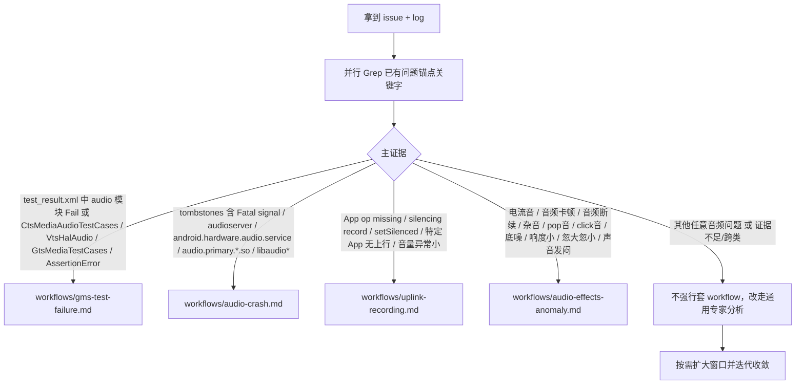

# Audio Bug Solver

协助开发者定位并修复 Android Audio 问题（不限问题形态）：录音、播放、通话、蓝牙、USB、音效链路、性能抖动、native crash、CTS/VTS/GTS 失败等。已覆盖场景走既有 workflow，未覆盖场景走通用专家分析。

## 设计哲学（读一次即可）

- 不写死线性步骤，基于现场证据自主判断层级归属（App / Framework / HAL / Kernel / 配置 / 硬件）。
- 同层次证据尽量**并行收集**（并行 Grep 关键字、并行 Read 入口代码），再做分析。
- 只输出有证据支撑的结论，不臆造根因。
- **灵活变通与结果导向（最高优先级，凌驾于具体 SOP 之上）**：本 SKILL 下面所有 workflow / keywords / case-studies 都是"辅助推理的脚手架"，不是教条。若严格按 workflow 执行后仍无法定位根因或推不出合理修复方案，必须立即跳出既定框架，调用自身对 Android 音频栈（AudioFlinger/AudioPolicy、AAudio/OpenSLES、tinyalsa/ALSA、AIDL/HIDL HAL、Binder、Mediatek/Qualcomm 音频子系统）的专家知识具体问题具体分析，实事求是。唯一评判标准是"最终解决实际问题"，不是"严格走完 SOP"。跳出框架时仍须遵守后文《红线与安全边界》。

## 输入契约（可按照要求的三段式输入，也可从输入中自行提取重要信息分析）

三段输入（`branch_root` + `log_dir` + `issue`）**不是硬性格式要求**。允许用户输入不按三段结构给出。用户可自然语言描述、贴路径片段、直接给出log文件、只给部分信息等。本 SKILL 可自主提取重要信息，然后根据已有信息进行分析。

三段输入的要求如下：
1. `branch_root`：分支代码绝对路径。该目录下应至少包含：
   - `frameworks/base/services/core/java/com/android/server/audio/`
   - `frameworks/av/services/audioflinger/`
   - `frameworks/av/services/audiopolicy/`
   - `vendor/transsion/system_modules/audio/frameworks/av/`
   - `vendor/transsion/system_modules/audio/frameworks/base/`
   - `vendor/mediatek/proprietary/hardware/audio/common/V3/aud_drv/`（**MTK HAL 层主要代码路径**；`audio.primary.mediatek.so` 的源码，本分支内可读可改）
2. `log_dir`：日志目录绝对路径。可能包含 `mobile_log/`（含 `main_log`/`events_log`/`kernel_log`）、`crash_log/`、`tombstones/`、`test_result.xml`、`audio_policy_configuration.xml` 等。
3. `issue`：问题详情。字段可包含且不限：
   - 现象描述（谁在什么场景下发生什么异常）。
   - 问题发生时间戳（用于在 `main_log` 中对齐窗口，缺失时模型需自行从日志里圈定异常时间段）。
   - 复现步骤、复现概率、机型、芯片平台（MTK/QCOM/Unisoc）、Android 版本、ROM 版本。

> SKILL 内所有代码路径均为**相对于 `branch_root` 的相对路径**。调用 Read/Grep 时请自行拼接 `{branch_root}/<relative_path>`。所有路径一律用正斜杠 `/`。

## 问题分诊与触发范围（思考框架，非硬流水线）

触发条件：**任何音频相关问题都应触发本 SKILL**。不要把触发限制在已有的 case。分诊只用于决定是否复用已有 workflow，不是进入本 SKILL 的门槛。

已有问题分诊关键字锚点（完整清单见 [references/log-keywords.md](references/log-keywords.md)）：

- 录音类稳定锚点：`App op`、`silencing record`、`setSilenced`、`AudioRecord: set`、`createRecord_l`、`AudioALSAStreamIn`（仅 MTK）。
- Crash 类稳定锚点：`Fatal signal`、`tombstone`、`>>> /vendor/bin/hw/android.hardware.audio.service`、`>>> audioserver`、`backtrace` 中的 `audio.primary.*.so` / `libaudioflinger.so` / `libaudiopolicymanager*.so`。
- GMS 类稳定锚点：`TestRunner: failed`、`AssertionError`、`CtsMediaAudioTestCases`、`VtsHalAudio`、`GtsMediaTestCases`、`test_result.xml` 中 `result="fail"` 且 `abi` 属性存在的 audio 模块。
- 音频效果/音质类稳定锚点：`underflow`、`underrun`、`XRUN`、`write blocked`、`delayed writes`、`setOutputDevice`、`Apply path`、`AudioFocus`、`flush`、`standby`、`setVolume`、`SmartPA calibration failed`、`AudioParam`。

## 最小完备工具集（原子能力）

本 SKILL 不造轮子，只约定原子能力的组合方式：

- **日志检索**：用 Grep，默认对 `{log_dir}` 递归，启用 `-n` 带行号。多锚点一次并行发起。
- **代码定位**：用 Read/Grep 结合 [references/code-map.md](references/code-map.md) 的入口类映射。
- **Tombstone 解析**：识别 `signal`、`Cause`、`Cmdline`、`pid/tid/name`、`backtrace` 中的 `BuildId` 与 so 名；需要行号时指导用户用 `llvm-symbolizer` / `addr2line` 对照 out 目录的 unstripped 符号。
- **XML 配置校验**：`audio_policy_configuration.xml` / `audio_policy_engine_*.xml` 定位 `mixPort` / `devicePort` / `flags` / `profile`。

## 输出契约（强制，不可省略）

最终回答必须按 [references/report-template.md](references/report-template.md) 四节给出，禁止只输出背景、关键字或纯现象描述：

1. 【证据链】：原始 log 行号引用 + 代码 `文件路径:行号` 引用，必要时给 log 片段与代码片段。
2. 【根因层级】：App / Framework / HAL / Kernel / 配置 / 硬件 / 第三方库（多选时按主次排序）。
3. 【修改方案】：具体到文件路径、函数、补丁思路；如果是 vendor 闭源 so，明确指出需对接的模块负责人与接口约束；禁止 test-aware 规避类方案。
4. 【验证方法】：最小复测步骤 + 需补抓的日志（例如 `adb logcat -b all`、`dumpsys media.audio_flinger`、`dumpsys audio`）。

## 路由到工作流

按分诊结果进入对应 workflow，并按需加载 references：

- 上行录音：[workflows/uplink-recording.md](workflows/uplink-recording.md)
- Audio Crash：[workflows/audio-crash.md](workflows/audio-crash.md)
- GMS 测试失败：[workflows/gms-test-failure.md](workflows/gms-test-failure.md)
- 音频效果/音质异常（杂音、卡顿、响度异常）：[workflows/audio-effects-anomaly.md](workflows/audio-effects-anomaly.md)

若不匹配以上任一 workflow（但仍是音频问题），必须执行“通用专家分析”：

1. 先基于现象做层级假设（App/Framework/HAL/Kernel/配置/硬件）。
2. 用日志与代码双证据验证假设，必要时扩大时间窗口与关键字集合。
3. 给出最小可合入修复建议（或明确外部依赖边界），并附可复现验证闭环。
4. 最终输出仍严格遵循 [references/report-template.md](references/report-template.md) 四节。

共享参考（按需读取，避免一次性把全部拉进上下文）：

- 代码入口速查：[references/code-map.md](references/code-map.md)
- 分层稳定关键字：[references/log-keywords.md](references/log-keywords.md)
- 输出报告模板：[references/report-template.md](references/report-template.md)
- 端到端案例：[examples/case-studies.md](examples/case-studies.md)

## SOP 失效时的跳出条款（结果导向）

workflow 是经验地图，不是铁轨。出现以下任一触发条件，立即跳出当前 workflow 的步骤顺序，改用专家推断：

- 按 workflow 的锚点 Grep 后，日志中**无一命中**，或命中的证据互相矛盾。
- 走完对应 workflow 的全部判据后，仍无法把现象归到单一层级（且不是"跨类"该有的正常歧义）。
- 现象不匹配当前已内置 workflow，但仍属 Audio 范畴。
- 日志时间戳与现象描述对不上、日志不完整、tombstone 缺失 backtrace 等"证据不足"的情形。
- workflow 给出的修改方案明显违反 Android 框架约束（例如改动会破坏 Binder 接口兼容性、打破 AIDL 版本协议、导致 CDD 非合规等）。

跳出后的行为要求：

1. 显式声明"workflow X 的步骤 Y 在此场景不适用，基于以下事实跳出"，保证可追溯。
2. 以 Android 音频栈的**一般性机制**为依据推断：线程模型（MixerThread/RecordThread/FastMixer/OffloadThread/DirectThread）、锁序、时钟与时间戳、`audio_patch` 生命周期、HAL AIDL/HIDL 的接口语义、`tinyalsa` 与 ALSA compress/offload 通路、音效挂载时机、Binder oneway/two-way 的语义差异等。
3. 允许引用本仓外的事实（上游 AOSP、芯片厂商公开文档）作为依据，但需明确"非本仓代码，仅提供推断依据"。
4. 最终仍按 [references/report-template.md](references/report-template.md) 四节输出，且在【证据链】节说明"本结论为跳出 SOP 的专家推断，主要依据为……"。
5. 跳出 ≠ 放飞。下方红线永远生效，不可用"跳出"为理由违反。

## 红线与安全边界

- **禁止 test-aware 定制**：任何根据调用方 UID/包名判定"是否 CTS/GTS/VTS"再切换系统行为的分支，属 GMS 违规，不得出现在修复方案里。产品化差异必须通过系统属性/产品 overlay 控制且默认与 AOSP 对齐。
- **vendor 闭源 so（如 `libvpnr.so`、`libaurisys*.so`、`libspeex*.so`、`libwebrtc*.so` 等第三方算法库）不可直接改**：只给出现象判断、可能调用模式、以及"需对接 MTK/QCOM 提交 patch"的建议，不要臆造源码改动。
- **MTK HAL 源码在本分支内是开放的**：`audio.primary.mediatek.so` 的实现源码位于 `vendor/mediatek/proprietary/hardware/audio/common/V3/aud_drv/`（`AudioALSAHardware`、`AudioALSAStreamIn/Out`、`AudioUSBCenter`、`AudioALSACaptureDataClient*`、`AudioALSAPlaybackHandler*` 等）。tombstone backtrace 出现 `audio.primary.mediatek.so` 时**优先在这里定位并给出真实补丁**，不再默认"转 MTK"。只有当 backtrace 指向第三方算法 so、或本分支内搜不到对应符号、或涉及 MTK 底层 DSP/SCP 固件协议时，才按"转厂商"处理。
- **`audio_policy_configuration.xml` 谨慎删 profile**：删 `AUDIO_OUTPUT_FLAG_SECURE` 或 `offload` 等 profile 前必须确认产品是否声明对应能力，避免掩盖功能缺失。
- **不要只复述 SOP**：原 SOP 中若与上述红线冲突（例如 `if (isCtsCaller(uid)) {...}` 这类示例），在本 SKILL 内已被修正，优先遵循本 SKILL。
