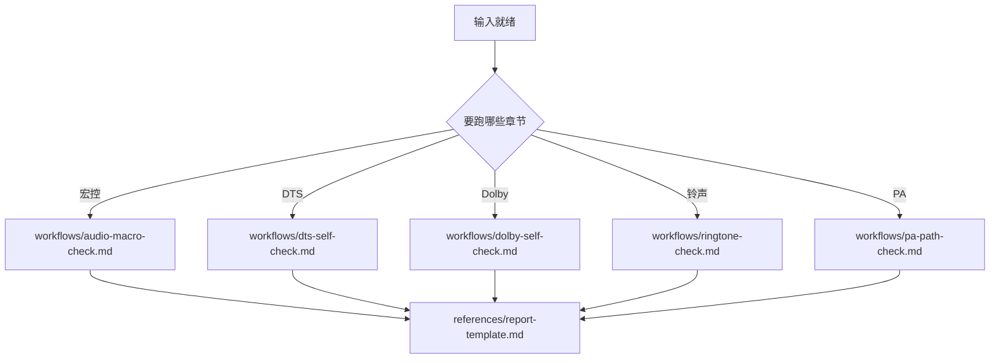

# Audio Self Check SOP

协助完成五类音频升级自检：宏控、DTS、Dolby、铃声资源、PA 参数路径。**细则在各 workflow 中**，本文件只做调度、输入、输出与红线。

## 设计哲学（读一次即可）

- 先路径存在性、后内容判断；SOP 要求“路径不存在则停止”时必须停止该分支。
- 只读对比与允许修改严格分离；允许修改仅限各 workflow 写明字段。
- 结论须有文件/目录证据，禁止猜测式通过；**最终回答必须中文**。
- `Glob` 在部分路径上可能假阴性；**铃声资源在 `升级后铃声资源路径` 下须按** `workflows/ringtone-check.md` **的 A→B→C→D 回退扫描**（含本机终端列目录）。

## 强制输入契约

每次执行至少确认：

| 参数 | 说明 |
|------|------|
| `代码基础路径` | 代码根目录绝对路径（文档内路径可写 `/`，实际执行按系统路径即可） |
| `项目名` | 工程目录名，如 `x6870_h781`、`cm8_h973` |

按章节触发时再要：

| 章节 | 额外必填 |
|------|-----------|
| 宏控 | `音频软件配置表` |
| DTS / Dolby | `升级前音效代码路径`（与当前分支对比用） |
| 铃声 | `铃声检查类型`、`升级后铃声资源路径` |
| PA | 无（仅用 `代码基础路径` + `项目名`） |

`铃声检查类型` 取值：`TECNO铃声检查` \| `Infinix铃声检查` \| `TECNO阿尔及利亚铃声检查` \| `Infinix阿尔及利亚铃声检查`。  
缺参先问再执行；禁止编造路径或参数。更细的推导与缺参规则见 [references/input-contract.md](references/input-contract.md)。

## 任务路由

默认顺序：宏控 → DTS → Dolby → 铃声 → PA；用户指定章节时只跑指定项，并在结论中写明未执行章节及原因。

## 工作流与参考

| 章节 | 入口 |
|------|------|
| 一 宏控 | [workflows/audio-macro-check.md](workflows/audio-macro-check.md) |
| 二 DTS | [workflows/dts-self-check.md](workflows/dts-self-check.md) |
| 三 Dolby | [workflows/dolby-self-check.md](workflows/dolby-self-check.md) |
| 四 铃声 | [workflows/ringtone-check.md](workflows/ringtone-check.md)（含触发 `铃声检查：<类型>`、扫描基线、各子项文案） |
| 五 PA | [workflows/pa-path-check.md](workflows/pa-path-check.md) |

- 结论模板：[references/report-template.md](references/report-template.md)
- 仅对比 / 可改边界：[references/change-boundary.md](references/change-boundary.md)
- 示例：[examples.md](examples.md)
- 铃声参考文档：<https://transsioner.feishu.cn/docx/AjcWd66AVoq192xUNHvcj5jVn0b>

## 原子能力（执行时遵守）

- **路径**：优先路径失败再试备选；`TranThread.cpp` 等若 `Glob` 不可靠，用 `Read`/`rg` 或终端确认存在后再判内容。
- **差异**：列出宏名/文件名、期望值、实际值；不要只写“不一致”。
- **修改**：仅改 workflow 允许节点；改动写入结论「改动项」。

## 阻塞与阶段性结论

遇以下情况不硬跑后续：关键路径双 miss、缺该章节必填参、参考表字段不足以对比。仍须输出**中文**阶段性结论：已完成项、阻塞原因、待用户补充项。

## 输出契约（强制）

最终全文格式必须遵守 [references/report-template.md](references/report-template.md)。

## 红线与安全边界

- 不得擅自改「仅对比」章节涉及文件与参考文档。
- 禁止伪造结果或跳过路径/目录校验。
- 禁止用英文替代中文结论；允许修改章节也不得改未声明字段。
