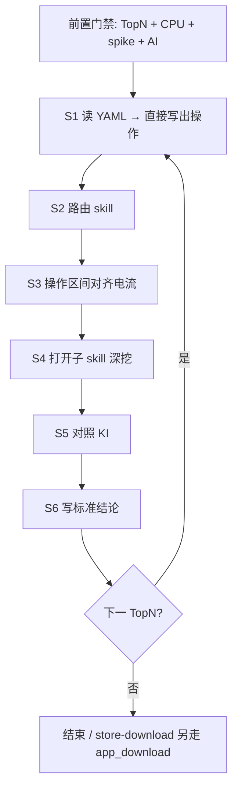

# DOU 亮屏场景归因 SOP

## 适用场景

每个 TopN 亮屏业务场景（`suffix`），在通用 CPU/电流/AI 已完成后做专属归因。

## 输入

- `top_scenes` 含本 suffix
- `cpu_analysis_<suffix>.json`、`current_cpu_spike_<suffix>.json`、`ai_analysis_<suffix>.json`
- `meta_report` 场景 YAML（`read_scene_yaml_ops.py`）

## 执行流程

S1 读 YAML → S2 路由子 skill → S3 对齐电流 → S4 深挖 → S5 对照 KI → S6 写结论（详见 §2）。

## 输出

每个 suffix 一份标准归因结论（含 YAML 操作时间轴、主因、证据、建议）。

## 门禁

见 §1 前置门禁；不通过则停止本 SOP。

> **文档型完整 SOP（推荐阅读）**：[SOP-DOU亮屏场景归因分析.md](./SOP-DOU亮屏场景归因分析.md)（含 **§4 滑动场景共性**；含滑动步的场景先走 §4）  
> 本文为 Agent Skill 入口摘要；日常作业与各场景逐步分析以文档型 SOP 为准。

| 项 | 内容 |
|----|------|
| **编号** | `SOP-DOU-SCENARIO-01` |
| **归属** | `flow/dou_2/scenario/` |
| **上游** | [`../SKILL.md`](../SKILL.md)（场景对比→TopN→CPU→电流+AI） |
| **本文件职责** | **描述各场景需要什么**（命中哪个子 skill、该步预期电流、结论必填项） |
| **YAML 用法** | **读一下，直接写出来**（操作步/`t0/t1`/`op_kind` 落入结论，不作二次改写） |
| **原则** | 按行为不按 App；不考虑 DATA/WIFI；**YAML 操作优先于 case_desc** |



---

## 0. 适用范围与用法

**适用**：每个 TopN 亮屏业务场景（`suffix`），在通用 CPU/电流/AI 已完成后做专属归因。

**本 SOP 写什么**

| 内容 | 说明 |
|------|------|
| 场景需要 | S2 路由表、S3 `op_kind` 预期电流、S6 结论模板、子 skill P0 深挖入口 |
| 不写什么 | 不替代 YAML 事实；不凭 Excel `desc` 臆造操作分段 |

**YAML 怎么用**：用脚本读出 `business_steps` 后，**原样落到结论**（主贡献步名、时间窗、`op_kind`）；再拿这些区间去对齐电流。不要「解读改写」成另一套时间轴。

**不适用**：灭屏长待机（走 `standby_*`）；仅脚本问题可忽略场景（`ignorable_scenes`）。

**禁止**：
- 跳过 YAML，只凭 Excel `desc` 分段
- 读了 YAML 却不写进结论 / 另编一套操作描述
- 命中子 skill 后只贴综合 AI、不按本 SOP 对齐电流
- 把 setup（解锁/打开 App/回轴）尖峰当主因

---

## 1. 前置门禁（不通过则停止本 SOP）

对当前 `suffix`，下列文件必须已存在（亮/灭屏分卷目录与 `dou_2` 约定一致）：

| # | 产物 | 说明 |
|---|------|------|
| 1 | `top_scenes` 含本 suffix | 来自 TopN |
| 2 | `cpu_analysis_<suffix>.json` | `dou_2` §4 |
| 3 | `current_cpu_spike_<suffix>.json` | 含 `diff_segments` / spike |
| 4 | `ai_analysis_<suffix>.json` | 综合 AI（可作参考，不作唯一依据） |

缺任一 → 先回 `dou_2` 主流程补齐，再进入 S1。

---

## 2. 标准作业程序（每个 suffix 严格执行）

### S1 — 读 YAML，直接写出操作时间轴

**目的**：拿到真实操作事实并**立刻写入本 suffix 结论草稿**（步名、`[t0,t1)`、`op_kind`），后续 S2–S6 只基于这份写出的时间轴，不再改写。

**动作**

```powershell
python analysis/domain/power/flow/dou_2/scenario/scripts/read_scene_yaml_ops.py `
  "<高功耗目录>\meta_report" "<suffix>"
```

文件形态：`meta_report/*_{pass|error}_dou3_<suffix>.yaml`

**门禁**

| 结果 | 处理 |
|------|------|
| `ok=true` 且有 `business_steps` | **直接写出**各业务步 → 进入 S2 |
| 找不到 yaml | 结论注明「无场景 YAML」；用 Excel `desc` 走 S2，电流无法按步对齐，证据弱一档 |
| `case_desc_vs_ops_warning` 非空 | **必须原样写入结论**；后续路由与分段以 YAML 为准 |

**写出字段**（结论里保留，勿二次概括丢时间）：  
`route_text`、`business_steps[]`（`step_name`、`t0_sec`、`t1_sec`、`op_kind`、`expected_current_shape`）

**Setup 降权**（写出时可标注 setup，但不计入主因）：  
`确保退到桌面`、`识别黑屏解锁`、`左右滑桌面`、`搜索打开*`、`退到桌面`/`退回桌面`、`单用例结束机械手回轴`

---

### S2 — 路由子 skill（命中即停）

**匹配文本** = `route_text`（优先） + `case_desc` + Excel `desc`（去掉 `-DATA`/`-WIFI`）

| 序 | 命中条件 | 打开 |
|----|----------|------|
| 1 | `小窗` / (`长视频`+滑动\|划动\|播放) / `PIP` | [scenario-dou-video-scroll-pip](scenario-dou-video-scroll-pip/SKILL.md) |
| 2 | `发布` / 社交`录制`+`Share` / `发布动态` | [scenario-dou-content-publish](scenario-dou-content-publish/SKILL.md) |
| 3 | `CapCut` / `剪辑`（非 Gallery 滤镜） | [scenario-dou-media-edit](scenario-dou-media-edit/SKILL.md) |
| 4 | Gallery / `拍照` / `浏览图片` / (`换滤镜` 且 Gallery) | [scenario-dou-camera-gallery](scenario-dou-camera-gallery/SKILL.md) |
| 5 | `导航` / Maps+`目的地` | [scenario-dou-maps-nav](scenario-dou-maps-nav/SKILL.md) |
| 6 | `应用下载` / Play+下载 / `应用商店` | [scenario-dou-store-download](scenario-dou-store-download/SKILL.md) |
| 7 | `文档` / Drive / `滑动查看文档` | [scenario-dou-document-browse](scenario-dou-document-browse/SKILL.md) |
| 8 | `Chrome` / `浏览网页` / `打开*网页` | [scenario-dou-web-browse](scenario-dou-web-browse/SKILL.md) |
| 9 | `主页待机` / `应用界面待机` / 步骤`*待机` | [scenario-dou-app-idle-home](scenario-dou-app-idle-home/SKILL.md) |
| 10 | `滑动浏览` / `短距划` / `循环滑动` / `主界面观看` / `购物浏览` / `壁纸浏览` | [scenario-dou-feed-scroll](scenario-dou-feed-scroll/SKILL.md) |

**易混（强制）**

| 情况 | 选 | 勿选 |
|------|----|------|
| desc=拍照，YAML=`换滤镜` | camera-gallery（按滤镜脉冲） | 只谈快门 HAL |
| Instagram 观看/滑动 | feed-scroll | content-publish |
| Instagram 录制+Share | content-publish | feed-scroll |
| Youtube 滑动+小窗 | video-scroll-pip | feed-scroll |
| Drive 文档 | document-browse | web-browse |
| CapCut | media-edit | content-publish |
| GCash/Grab 待机 | app-idle-home | feed-scroll |

未命中 → `skill_id=none`，仍做 S3 通用对齐，结论写「无匹配场景 skill」。

**动作**：`Read` 命中目录下 `SKILL.md`。

---

### S3 — 操作区间对齐电流波动

**输入**：S1 的 `business_steps` + `current_cpu_spike_<suffix>.json`  
**时间轴**：YAML `t0/t1` 与 pt5/`diff_segments` **同一场景起点**。

**对每个业务步 `[t0, t1)` 执行**

1. 取出重叠的 `diff_segments`（`mean_diff_ma`、`delta_from_prev_ma`）
2. 取出落入区间的 `spike_windows`
3. 取出对应 `cpu_in_segment` Top 进程
4. 对照该步 `expected_current_shape` / 下表 → 判定 **符合操作预期** 或 **异常**

| op_kind | 预期电流 | 异常（需深挖） |
|---------|----------|----------------|
| `app_idle` | 平坦中高平台，尖峰稀疏 | 平台过高；或密周期尖峰 |
| `feed_scroll` / `video_or_feed_scroll` | 中高平台 + 与滑动节奏对齐的周期尖峰 | 停滑不掉电；尖峰过密；沙箱空转 |
| `video_watch` / `video_pip` | 高平台、相对平滑 | 小窗段仍密尖峰；解码不释放 |
| `media_filter_edit` | 每次操作脉冲簇 + 中高平台 | 无操作时平台仍很高 |
| `camera_shot` | 快门/后处理尖峰簇 | 无尖峰结构的持续高平台 |
| `content_record` / `content_publish` | 录制抬升→上传台阶 | 结束后平台不回落 |
| `store_download` | 下载段持续中高 | 无 DOWNLOADING 却抬升 |
| `maps_nav` | 高平台持续 | 与定位无关的密尖峰 |
| `document_browse` | 中平台 + 翻页尖峰 | 整段被同步抬高 |
| `web_browse` | 打开尖峰 + 滚动尖峰 | 只报沙箱不报宿主（KI-001） |
| `media_edit` | 高平台（GPU/多路 decode） | 预览/导出未拆分 |
| `setup` / `app_launch` | 短尖峰 | **禁止当主因** |

**多段场景**：必须按 YAML 步拆开写（例：滑动段 vs 小窗段；浏览段 vs 下载段；录制 vs Share）。

**公平性**：high/low 同一步 `actual_time` 差很大 → 先标脚本差异，再谈版本回归。

---

### S4 — 子 skill 深挖

按 S2 打开的 `SKILL.md` 做 P0 检查（进程/log 锚点）。  
S3 判为「符合预期」→ 结论可写操作形态差异，仍须给出主进程。  
S3 判为「异常」→ 按子 skill 异常路径 + 重叠时段 CPU/log 定位。

`store-download`：必须引用 [`../app_download/SKILL.md`](../app_download/SKILL.md) / `app_download_result` narrative。

---

### S5 — 已知问题门禁

打开 [`../known_issues.md`](../known_issues.md)：

| 命中 | 处理 |
|------|------|
| 是 | 结论标注 `KI-xxx`，按条目「处理建议」书写，勿当新回归反复深挖 |
| 否 | 写「非已知问题库条目」 |

**门禁**：须同时满足条目中的量化门槛（如 KI-001 要求 CPU **≥ 约 70%**）；仅进程名相似但未达门槛 → **不命中**。

常见：KI-001 沙箱（高 CPU ≥70%）；KI-002 `messenger.sms`（划动误触类）。

---

### S6 — 输出标准结论（缺项不合格）

按下列模板填写（每 TopN 一条）。**YAML 步名与时间窗直接抄 S1 写出结果**，不要改写成笼统描述。

```text
【SOP-DOU-SCENARIO-01】
- skill_id:
- suffix / 场景名(desc):
- YAML 操作与用时（逐步，禁止只写总时长）:
  - <step_name> [<t0>, <t1>) 用时=<actual_time>s op_kind=   ← 每个操作一行
  - …
- desc与操作校正: <无 / warning原文>
- 功耗差异 Δ: <mAh 或均流，与 TopN 一致>
- 电流形态: <平台 | 周期尖峰 | 脉冲簇 | 泄漏> ；是否符合该步预期: <是/否>
- 主因进程: <包名/进程；有沙箱写清宿主关系>
- 证据:
  - 电流: diff_segment 或 spike 相对时刻 …
  - CPU/log: …
- KI: <KI-xxx | 非已知问题库条目>
- 建议验证:
```

**合格标准**：上表字段齐全；YAML（或无 YAML 声明）已写出；至少 1 个业务步时间窗 + 1 个电流证据 + 1 个进程/log 证据。

---

## 3. 批量执行顺序

```
for each TopN suffix (亮屏优先):
  检查前置门禁
  S1 → S2 → S3 → S4 → S5 → S6
全部完成后:
  若存在商店/下载类 → 确认 app_download 已跑（dou_2 §10）
  再进入 collect / topn_summary / HTML（dou_2 主流程）
```

本 SOP **不替代** `dou_2` 的 HTML/总结步骤；职责是：**把各场景需要写清楚**，并保证每个 TopN 把 YAML 操作读出后落到「操作↔电流」专属结论。

---

## 4. 附录 A — YAML 业务步实样

来源：`meta_report/*_pass_dou3_<suffix>.yaml` → `data.step_time_datas`。  
**每个操作单独一行标注用时 `actual_time`**（非场景总时长）。完整逐步表见各子 skill「YAML 业务步（实样）」；下表仅索引。

| skill | 代表 suffix | 说明 |
|-------|-------------|------|
| app-idle-home | 00547 / 00565 | GCash/Grab：逐步含 setup+业务各自用时 |
| feed-scroll | 00551 / 00585 / 00594 / 00616 / 00662 | IG/Meesho/Pinterest/FB/Shopee：每段滑动各自用时 |
| video-scroll-pip | 00572 | 滑动 / 进入资源 / 小窗 各步各自用时 |
| camera-gallery | 00545 | 滤镜两段各自用时（非拍照） |
| content-publish | 00589 | 录制/长按/回放/Share 各步各自用时 |
| document-browse | 00598 | 打开 / 滑动文档 各步各自用时 |
| maps-nav | 00611 | 导航段用时 |
| store-download | 00646 | 滑动/搜索/下载/卸载 各步各自用时 |
| web-browse | 00576 / 00671 | 打开网页 / 循环滑动 各步各自用时 |
| media-edit | 00673 | CapCut 实为待机一步用时 |

结论字段须写：**每步** `step_name` + `[t0,t1)` + `actual_time`（不得只写整场景总时长）。

## 5. 附录 B — 子 skill 目录

| skill_id | 路径 |
|----------|------|
| scenario-dou-app-idle-home | `scenario-dou-app-idle-home/SKILL.md` |
| scenario-dou-feed-scroll | `scenario-dou-feed-scroll/SKILL.md` |
| scenario-dou-video-scroll-pip | `scenario-dou-video-scroll-pip/SKILL.md` |
| scenario-dou-camera-gallery | `scenario-dou-camera-gallery/SKILL.md` |
| scenario-dou-content-publish | `scenario-dou-content-publish/SKILL.md` |
| scenario-dou-document-browse | `scenario-dou-document-browse/SKILL.md` |
| scenario-dou-maps-nav | `scenario-dou-maps-nav/SKILL.md` |
| scenario-dou-store-download | `scenario-dou-store-download/SKILL.md` |
| scenario-dou-web-browse | `scenario-dou-web-browse/SKILL.md` |
| scenario-dou-media-edit | `scenario-dou-media-edit/SKILL.md` |

## 6. 附录 C — 维护

| 变更 | 改哪里 |
|------|--------|
| 新操作关键字 / op_kind | `scripts/read_scene_yaml_ops.py` → `OP_KIND_RULES` + 本 SOP S3 表 |
| 新路由 | 本 SOP S2 表 + 附录 A/B + 新建子 `SKILL.md` |
| 新 KI | `../known_issues.md` |

依赖：`pip install pyyaml`（读 YAML 脚本）。
