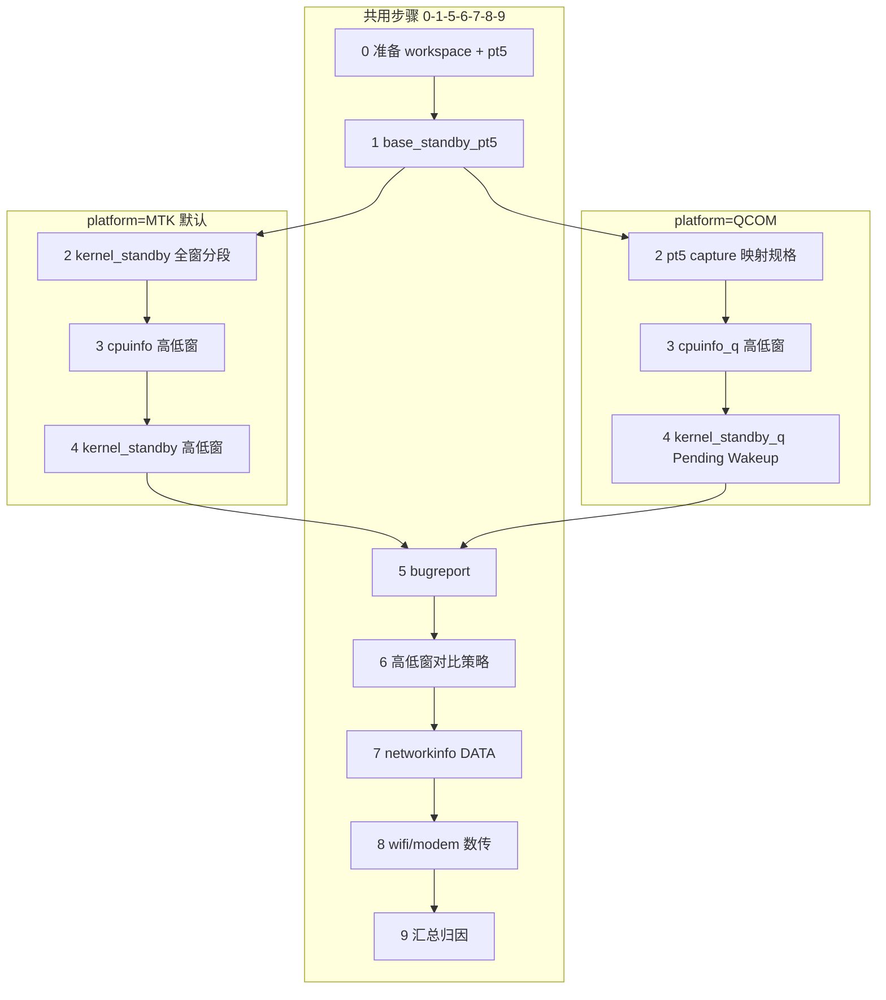

# flow_power_standby_short — 短待机分析（README）

> 权威细则见同目录 [SKILL.md](./SKILL.md)。本文侧重**流程总览**与 **MTK / 高通分支**，方便新人快速上手。

## 一句话

拆机短待机（10min / 1h）用 **pt5 实测电流** + **时长规格**（MTK：日志灭屏段；QCOM：pt5 capture）判定是否超标，再在 **高/低功耗子窗** 上对比 CPU、kernel、bugreport、数传证据，输出**唯一主因**与下一步 owner。

## 适用规格

| 规格 | 灭屏有效时长 | 说明 |
|------|-------------|------|
| **10min** | 8.5 ~ 11.5 min | 目标 10 min ±1.5 min |
| **1h** | 55 ~ 65 min | 目标 60 min ±5 min |

电流等级（Wi-Fi / DATA 统一，看 `Stdby_Curr`）：达标 ≤60；Major(C) 60~70；Critical(B) 70~80；Block(A) >80 mA。

## 三个入口参数

进入 flow 前先确认：

| 参数 | 取值 | 作用 |
|------|------|------|
| **`platform`** | 省略 / `MTK`（默认）或 `QCOM` / `高通` | 决定步骤 2 规格来源及步骤 3/4 用哪套 CPU / kernel skill |
| **`standby_type`** | `WIFI` / `DATA`（`jira_triage.py` 推断） | 仅影响步骤 7~8 走 Wi-Fi 还是蜂窝数传 |
| **工作区** | `temp/<DATE>/<KEY>/` | `downloads/`（pt5）、`converted/`（日志）、`analysis/`（报告） |

```bash
python flow/standby_short/scripts/jira_triage.py --workspace temp/<DATE>/<KEY>
# → standby_type；勿用输出的 threshold_ma（那是长待机 25/30 mA）
```

`platform` 可由编排写入 `jira_info.json`，或由 Agent 分析前显式指定；**不写 = MTK**。

## 平台分流（核心）



| 维度 | MTK（默认） | 高通 QCOM |
|------|------------|-----------|
| 日志目录 | `converted/APLog/`（`*_linli_666.txt`） | `mobilelog/` 等含 **`kernellogcat-log.*`** |
| 前置转换 | `base_mtk_kernellog_convert` | **不需要** |
| 灭屏关键字 / 规格时长 | `tc_screen_notifier_callback` → `screen_segments` | **无 kernel 分段**；用 pt5 `capture_time_*` 映射 10min/1h |
| 步骤 2 | [base_kernel_standby](../../base/kernel_standby/SKILL.md) 全窗分段 | 规格用 pt5 capture；kernel 留步骤 4 |
| 步骤 4 Kernel | [base_kernel_standby](../../base/kernel_standby/SKILL.md) | [base_kernel_standby_q](../../base/kernel_standby_q/SKILL.md) |
| 步骤 3 CPU | [base_cpuinfo](../../base/cpuinfo/SKILL.md) | [base_cpuinfo_q](../../base/cpuinfo_q/SKILL.md) |
| 唤醒主因 | 26M/LPM、R12、`suspend wake up by` | **Pending Wakeup Sources Top3**（无 26M 不阻塞） |
| CPU 异常维度 | 包名 `Package` | 包名 `Package`（comm 启发式还原，明细含 Thread） |

## 与长待机的差异（简表）

| 维度 | 长待机 | 短待机 |
|------|--------|--------|
| 平均电流来源 | `base_batteryinfo` | **`base_standby_pt5`（禁止 batteryinfo）** |
| 电流阈值 | 25/30 mA 等 | **60/70 mA（Stdby_Curr）** |
| 10min/1h 规格 | 人工/JIRA | **MTK：日志灭屏段；QCOM：pt5 capture 时长** |
| 应用异常阈值 | 一套（每小时） | **§2.1（10min）/ §2.2（1h）两套** |

## Skill 编排总表

### 共用（MTK / 高通相同）

| 步骤 | Skill | 说明 |
|------|-------|------|
| 0 | `base_prepare_workspace` | 深路径 → `converted/` |
| 0 | `base_mtk_kernellog_convert` | **仅 MTK** |
| 1 | `base_standby_pt5` | 解析 `.pt5` → `Stdby_Curr`、高低功耗子窗、采集时间 |
| 5 | `base_bugreport_standby` | 持锁 / alarm / power_rank |
| 7 | `base_networkinfo` | 仅 **DATA**；先 `--probe` |
| 8 | `base_wifi_data` / `base_modem_data` | 按 `standby_type` 二选一 |

### 按平台分叉（步骤 2 / 3 / 4）

| 步骤 | MTK | 高通 QCOM |
|------|-----|-----------|
| **2** 规格判定 | `wakeup_source.py` 全窗 → `screen_segments` | **pt5 `capture_time_*` 映射 §2**（不调 q 做分段） |
| **3** CPU 高低窗 | `cpuinfo.py` `-d APLog` `-t max/min` | `cpuinfo_q.py` `-d mobilelog` `-t max/min` |
| **4** Kernel 高低窗 | `wakeup_source.py` `-d APLog` `-t max/min` | `wakeup_source_q.py` `-d mobilelog` `-t max/min`（仅 Pending Wakeup） |

### 显式禁用

- **`base_batteryinfo`**：短待机无电量曲线，**禁止调用**。

## 执行流程（步骤详解）

### 0. 前置

```
下载 → base_prepare_workspace → [MTK] base_mtk_kernellog_convert
```

高通：确保 `downloads/.../mobilelog/kernellogcat-log.*` 可用即可。

### 1. pt5（先于灭屏段）

```bash
python base/standby_pt5/scripts/base_pt5.py temp/<DATE>/<KEY> --tool standby --format json
```

产出：`Stdby_Curr`、`capture_time_*`、`max/min_power_time_*`、`max/min_power_value`。  
无 pt5 且无手动电流 → **阻塞**。本步**不**做「达标提前结束」。

### 2. 规格判定 + sleep_time

**目的**：得到 `sleep_time_*`、`standby_duration_spec`（有效规格后才可做 ≤60 提前结束）。

| 平台 | 做法 |
|------|------|
| **MTK** | `wakeup_source.py` 全窗 → `screen_segments`；0 段结束；1 段直用；≥2 段与 `capture_time_*` 重叠最大；无 capture 且多段 → 结束 |
| **QCOM** | **不用** `wakeup_source_q` 分段；`sleep_time_*`=`capture_time_*`，时长映射 §2；无 capture → 结束 |

| 情况 | 处理 |
|------|------|
| 规格无法判定 | 「待机时长无效需复测」，**提前结束** |
| 规格有效且 `Stdby_Curr ≤ 60` | 「功耗满足标准」，**提前结束** |

**MTK** 示例：

```bash
python base/kernel_standby/scripts/wakeup_source.py -d temp/<DATE>/<KEY>/converted/APLog
```

**高通**：本步不强制调 `wakeup_source_q`；Pending Wakeup 在步骤 4 带 `-t` 统计。

### 3. CPU 高低功耗窗

`-t` 使用步骤 1 的 `max_power_time_*` / `min_power_time_*`（无子窗时降级 `sleep_time_*` 单窗）。

| 平台 | 命令 | 报告 |
|------|------|------|
| MTK | `cpuinfo.py` | `cpu_max_report.txt` / `cpu_min_report.txt` |
| QCOM | `cpuinfo_q.py` | `cpu_max_q_report.txt` / `cpu_min_q_report.txt` |

异常阈值套 **§2.1 或 §2.2**；结论须写清异常应用/进程（§2.4）。

### 4. Kernel 高低功耗窗

同步骤 3 时间窗，各跑 max / min 一次。

| 平台 | 关注字段 |
|------|----------|
| MTK | `AP_suspend_failed`、`frequent_wakeup`、`26M_LPM_abnormal`、`top_wakeup_sources` |
| QCOM | `pending_wakeup_sources_top3`、`pending_wakeup_hit_count`（无 screen/电源键） |

### 5 ~ 8. 共用链路

- **5** bugreport：定责窗口 = `sleep_time_*`
- **6** 对比策略：`min_power_value ≤ 60` → 优先看**差异项**；否则看**共性项**
- **7** networkinfo：仅 DATA；`ready=false` 则 skip
- **8** 数传：WIFI → `base_wifi_data`；DATA → `base_modem_data`；缺工具记「数传量化阻塞」

### 9. 汇总归因

| 平台 | 主因优先级（示例） |
|------|-------------------|
| MTK | AP suspend 失败 → 26M/LPM → 频繁唤醒 R12 → 数传 |
| QCOM | Pending Wakeup Top3 → 异常应用 CPU → 数传（勿用电源键主因） |

唯一主因 + 责任模块/应用 + 机制 + 下一步 owner。

## 证据与阈值（查阅 SKILL.md）

- **§2.1 / §2.2**：应用异常辅助阈值（10min / 1h 两套，勿混用）
- **§2.3**：证据来源（含平台分列）
- **§2.4**：CPU 异常输出字段
- **§3**：26M/LPM 主模块判定（**仅 MTK**）

## 输出报告结构

```text
=== 分析结论 ===
最终结论：<责任模块/应用> + <机制> + <下一步> + <根因>

=== 问题描述 ===
平台：<MTK / QCOM>
待机类型：<WIFI/DATA>
短待机规格 / 待机时长 / Stdby_Curr / 功耗等级 ...

=== 功耗子窗口（pt5）===
最低/最高功耗窗口、高低窗对比策略 ...

=== 时长与规格（步骤2）===
灭屏段列表、选用段、standby_duration_spec ...

=== 系统休眠唤醒状态信息 ===
（MTK）AP suspend / 频繁唤醒 / 26M/LPM ...
（QCOM）Pending Wakeup Top3 / pending_wakeup_hit_count ...

=== CPU 负载信息 ===
MTK / QCOM：异常 Top 应用（Package）...

=== 网络 / 数传 ===
（按 standby_type 与步骤 7~8 填写）
```

完整模板见 [SKILL.md §输出模板](./SKILL.md)。

## 快速命令清单

```bash
# 1. 分诊
python flow/standby_short/scripts/jira_triage.py --workspace temp/<DATE>/<KEY>

# 2. pt5
python base/standby_pt5/scripts/base_pt5.py temp/<DATE>/<KEY> --tool standby --format json

# 3a. MTK 灭屏分段
python base/kernel_standby/scripts/wakeup_source.py -d temp/<DATE>/<KEY>/converted/APLog --format json

# 3b. QCOM 灭屏分段
python base/kernel_standby_q/scripts/wakeup_source_q.py -d <mobilelog_dir> --format json

# 4a. MTK CPU 高窗
python base/cpuinfo/scripts/cpuinfo.py -d temp/<DATE>/<KEY>/converted/APLog \
  -t "<max_start>" "<max_end>" -o temp/<DATE>/<KEY>/analysis --report-name cpu_max_report.txt

# 4b. QCOM CPU 高窗
python base/cpuinfo_q/scripts/cpuinfo_q.py -d <mobilelog_dir> \
  -t "<max_start>" "<max_end>" -o temp/<DATE>/<KEY>/analysis --report-name cpu_max_q_report.txt
```

## 相关文档

| 文档 | 说明 |
|------|------|
| [SKILL.md](./SKILL.md) | 完整 SOP、阈值、输出模板 |
| [domain/power/SKILL.md](../../SKILL.md) | 功耗域 skill 索引 |
| [flow_power_standby_long](../standby_long/SKILL.md) | 长待机 flow 对照 |
