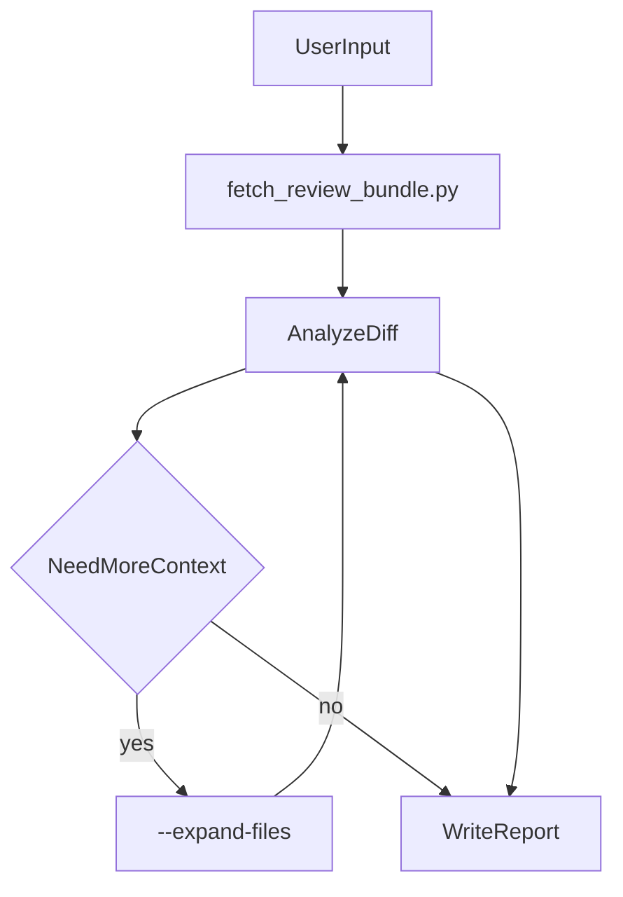

# Gerrit Code Review

Automated code review for Transsion Gerrit changes and topics.

## When to Use

- User provides a Gerrit change URL or change number
- User provides a topic URL or `topic:xxx`
- User asks for gerrit code review / review a Gerrit submission

## Input Examples

Gerrit 提交示例：`https://gerrit.transsion.com/c/MTK_CODE/quark/kernel_device_modules-6.12/+/1540692`

topic 提交示例：`https://gerrit.transsion.com/q/topic:x6850_b_mp`

Also accepts: pure change number (`1540692`), `topic:xxx`.

## Authentication

Gerrit HTTP API uses Basic Auth (`user` + password). Configure **login password** as `userpassword` in cred file (or `GERRIT_USER_PASSWORD` env). Transsion Gerrit uses **LDAP** for web login; REST Basic Auth typically accepts only the **HTTP Password** from **Settings → HTTP Password**. When Basic Auth fails, the client automatically tries **LDAP web login + session cookie** (if `userpassword` is set), then falls back to `password` (HTTP Password) when configured.

Do not paste HTTP passwords into chat or SKILL.md. Reset via Gerrit **Settings → HTTP Password** if leaked.

### Credential priority

1. **`--cred-file` on `fetch_review_bundle.py`** — highest priority when explicitly passed
2. **TAHP Console Gerrit 账号** (recommended for tahp-console / AI 自检)
3. Environment variables `GERRIT_USER` + `GERRIT_USER_PASSWORD` (or legacy `GERRIT_HTTP_PASSWORD`; optional `GERRIT_HOST`)
4. [`cred.json`](cred.json) in this skill directory (local / legacy fallback)

### TAHP Console credential paths

When running under **TAHP** (tahp-console → AI 自检 → Gerrit Code Review), credentials are managed in **设置 → Gerrit 账号** and stored on the BFF host (not in git).

| File | Purpose |
|------|---------|
| `<TAHP_PROJECT_ROOT>/.tahp-config/gerrit.json` | Saved from Console settings (host, user, password) |
| `<TAHP_PROJECT_ROOT>/.tahp-config/gerrit-cred.runtime.json` | Runtime copy written before each review task; **prefer this path** when the Agent instruction provides `--cred-file` |

`<TAHP_PROJECT_ROOT>` is the TAHP repo root (contains `skills/` and `knowledge-base/`). Override with env `TAHP_PROJECT_ROOT` if auto-detection differs.

Relative path from this skill directory:

```text
../../../../.tahp-config/gerrit-cred.runtime.json
../../../../.tahp-config/gerrit.json
```

JSON shape (same as `cred.json`):

```json
{
  "host": "https://gerrit.transsion.com",
  "user": "<gerrit-login>",
  "userpassword": "<login-password>",
  "password": "<http-password-optional-fallback>"
}
```

When `userpassword` fails with 401, `password` (HTTP Password) is retried automatically if present.

**TAHP Agent rule**: If instructions include `--cred-file <absolute-path>`, use that path. Otherwise, if `.tahp-config/gerrit-cred.runtime.json` or `.tahp-config/gerrit.json` exists under `<TAHP_PROJECT_ROOT>`, pass it to `fetch_review_bundle.py` with `--cred-file`. If neither exists, tell the user to configure **设置 → Gerrit 账号** in tahp-console.

## Workflow



### Step 1: Fetch review bundle (required)

Run from any working directory.

**TAHP Console / AI 自检** — use the runtime cred file when present:

```bash
python scripts/fetch_review_bundle.py "<input>" --cred-file "<TAHP_PROJECT_ROOT>/.tahp-config/gerrit-cred.runtime.json" --output review-bundle.json --pretty
```

If only the saved settings file exists, use `.tahp-config/gerrit.json` instead.

**Generic / Cursor skill path** (Windows example):

```bash
python "%USERPROFILE%/.cursor/skills/gerrit_code_review/scripts/fetch_review_bundle.py" "<input>" --output review-bundle.json --pretty
```

Add `--expand-files` when diff context is insufficient (GPIO/DTS, interfaces, macros).

Optional credential override (any environment):

```bash
python scripts/fetch_review_bundle.py "<input>" --cred-file path/to/cred.json
```

Under TAHP, `path/to/cred.json` is typically `<TAHP_PROJECT_ROOT>/.tahp-config/gerrit-cred.runtime.json`.

The script prints `report_path=` and `report_url=` (clickable `file://` URL for the Markdown report).

### Step 2: Analyze diffs

1. Read `review-bundle.json`
2. Note **`modules`** / **`modules_display`** at bundle root (and per-change `modules` for topics)
3. For each change, review `patch_text` (decoded unified diff)
4. Use `expanded_files` or re-run with `--expand-files` when needed
5. Apply checklist in [check-items.md](check-items.md)

### Step 3: Write report (Markdown)

Write a complete **Markdown** file (`.md`). Output **must** contain these 5 sections:

1. 基本信息
2. 问题统计
3. 详细问题列表和改善建议
4. 影响范围
5. 测试建议
   1. P0 - 必须测试
   2. P1 - 强烈建议
   3. P2 - 建议测试

Use [report-template.md](report-template.md) for structure and heading conventions. Severity levels: **Critical / High / Medium / Low**.

**模块信息**（必填）：

- 使用 `review-bundle.json` 顶层的 `modules_display`（如 `LCM/TP/Sensor`）写入 Markdown **基本信息 → 模块** 行
- 在 **影响范围** 中补充模块相关说明（可参考 `modules` 数组）
- Topic 报告：合并所有 Change 的模块，去重后写入一条 **模块** 字段
- 若 `modules` 为空，显示 `未识别`，并在影响范围中说明依据不足

模块由 [`scripts/module_detector.py`](scripts/module_detector.py) 根据文件路径、标题、patch 自动识别，规则见 [module-rules.md](module-rules.md).

**Formatting rules**:

- Use `##` for the 5 main sections (e.g. `## 1. 基本信息`)
- Use `###` for subsections (e.g. `### P0 - 必须测试`, severity groups under section 3)
- Use Markdown tables for 基本信息 and 问题统计
- Use ordered lists (`1.`) for P0/P1/P2 test items
- Do **not** wrap the report in HTML; plain Markdown only

**Report output directory** (Windows default):

- Default: `D:\code_review_report`
- Create the directory if it does not exist (scripts call `ensure_report_dir()` automatically)
- Override via environment variable `GERRIT_REPORT_DIR`
- Non-Windows: falls back to current working directory unless `GERRIT_REPORT_DIR` is set

**Report file naming** (under report directory):

- Single change: `D:\code_review_report\review-report-{change_id}.md`
- Topic (merged summary): `D:\code_review_report\review-report-topic-{topic_slug}.md`

After `fetch_review_bundle.py` runs, use the printed `report_path=` value as the write target.

**Topic policy**: fetch all changes under the topic, produce **one merged report** (not separate reports per change).

### Step 4: Terminal summary

After writing the Markdown report, print a concise summary with these parts:

1. **Change/topic info** — change number or topic name, subject, project, **模块** (`modules_display` from bundle, e.g. `LCM/TP/Sensor` or `通信`)
2. **问题统计** — Critical / High / Medium / Low counts
3. **主要发现** — brief top findings (1–3 bullets)
4. **测试建议** — **copy section 5 from the Markdown report verbatim** (P0 / P1 / P2 lists; do not paraphrase, summarize, or reorder)
5. **Report** — output a **clickable link** to open the Markdown report, using the `report_url=` value from Step 1:

```markdown
[打开报告](file:///D:/code_review_report/review-report-1540692.md)
```

Use the exact `report_url=` printed by the fetch script (do not invent the path). Markdown link format ensures the path is clickable in the terminal/chat.

## Python Scripts

| Script | Purpose |
|--------|---------|
| [`scripts/gerrit_client.py`](scripts/gerrit_client.py) | Auth, input parsing, Gerrit REST API, report path/URL helpers |
| [`scripts/module_detector.py`](scripts/module_detector.py) | Infer affected modules (LCM/TP/…/通信) from paths and diff |
| [`scripts/fetch_review_bundle.py`](scripts/fetch_review_bundle.py) | CLI entry; outputs JSON bundle for agent |

**Do not** use inline PowerShell curl or one-liner Python for Gerrit access. Always use these scripts.

## Review Bundle JSON Shape

```json
{
  "input": "...",
  "kind": "change|topic",
  "host": "https://gerrit.transsion.com",
  "topic": "optional",
  "modules": ["LCM", "TP"],
  "modules_display": "LCM/TP",
  "changes": [
    {
      "number": 1540692,
      "subject": "...",
      "project": "...",
      "branch": "...",
      "status": "NEW",
      "owner": "...",
      "modules": ["LCM"],
      "files": [{"path": "...", "lines_inserted": 1, "lines_deleted": 0}],
      "patch_text": "unified diff text",
      "expanded_files": {}
    }
  ]
}
```

## Additional Resources

- Review checklist: [check-items.md](check-items.md)
- Report format: [report-template.md](report-template.md)
- Module detection rules: [module-rules.md](module-rules.md)
