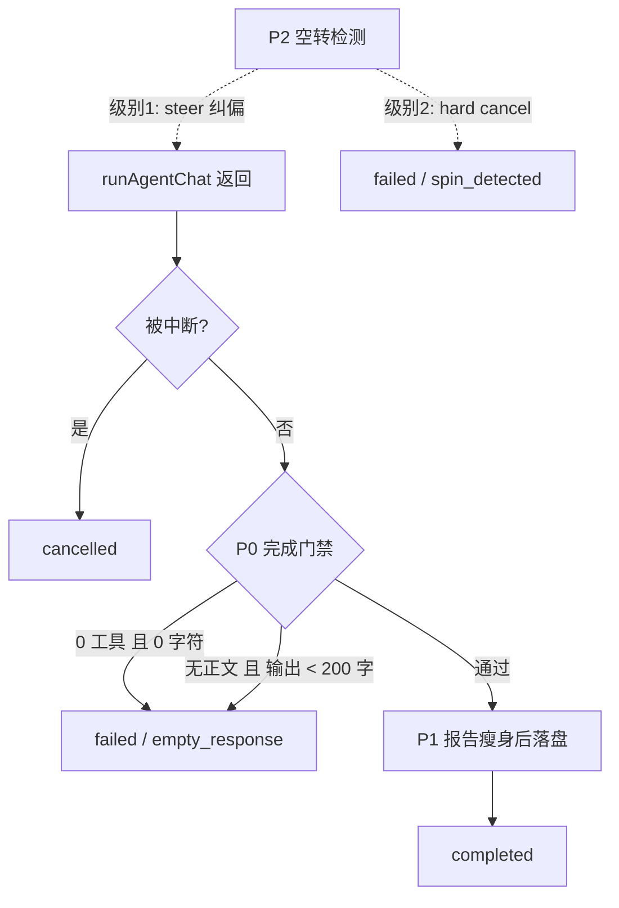
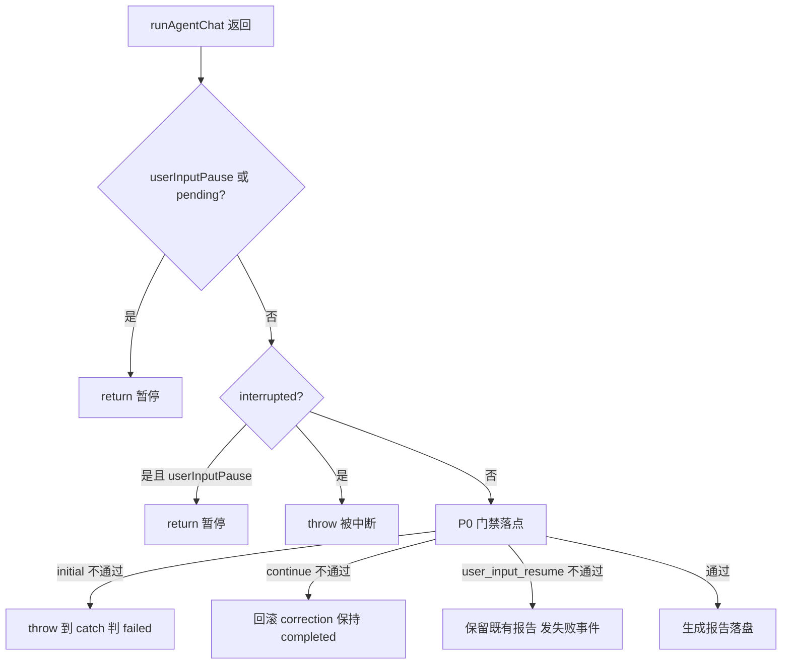

# 智能诊断报告质量门禁与空转治理方案

> 状态：P0 已实现（P1 / P2 未实现；二次复核 2026-08-24）
> 范围：智能诊断完成路径的结果校验、报告落盘瘦身、模型空转检测与处置
> 关联：[hermes-0.20.4-upgrade-verification.md](hermes-0.20.4-upgrade-verification.md)
> 影响模块：`tahp-console` BFF 智能诊断（`packages/server/src/services/tahp/bug-analysis.ts`）、Hermes profile 配置
> 不覆盖：AI 适配调试 / 适配流水线 / 质量验测的同类门禁（如需另立方案）

---

## 1. 背景

Hermes 0.20.4 灰度期间，智能诊断出现两类「任务标记为成功、报告实际无效」的情况。两者都不是升级引入的功能缺陷，而是**升级放大了 TAHP 侧一直缺失的结果校验**。

| 编号 | 任务 | 现象 | 报告状态 |
|---|---|---|---|
| A | X6885O6AEE-8677 | 12 秒结束，0 工具调用，0 字符输出 | completed |
| B | X6885O6AEE-12980 | 约 25 万字输出，14:06–14:27 共 21 分钟无工具调用，期间反复输出 `Let me type the function calls` | completed |

---

## 2. 根因分析

### 2.1 完成路径无任何结果校验

任务只要 `runAgentChat` 没抛异常、没被中断，就无条件判成功，报告 `status` 是字面量（`bug-analysis.ts` 1548–1618）：

```ts
ctx.llmResponse = fullResponse
// ...
ctx.status = 'completed'
// ...
const report = {
  // ...
  status: 'completed',
  tool_call_count: toolCallCount,
  llm_response: fullResponse,
  report_body: reportBody,
}
```

无论 `fullResponse` 是 0 字还是 25 万字废话，落盘结果一致。这是问题 A 的直接原因。

### 2.2 空返回是模型侧的确定性行为，不是链路故障

Hermes 0.20.4 自带空响应守卫（`hermes-agent-main/agent/empty_response_guard.py`）：连续两次 `output_tokens == 0` 且 `(model, provider, finish_reason)` 签名相同时判定为确定性空返回，跳过剩余重试直接走 fallback 链。任务 A 仅 12 秒结束，符合该短路特征。

该守卫由 profile `config.yaml` 的 `agent.empty_response_guard` 控制（默认 `enabled: true`、`cost_threshold_usd: 0.25`）。本机未显式配置，走的是默认值；需要时可以关掉或调参，但关掉只会让空返回多试几次，**不会**让 TAHP 把空跑标成失败。

**结论**：同 profile 原样重试价值很低，应判失败并交由人工或换模型重跑。

### 2.3 空转文本无检测、无上限、且在报告里存了两份

`onText` 回调目前只做阶段标记、Skill 标记、用户输入标记提取，没有任何异常模式检测（`bug-analysis.ts` 1464–1492）：

```ts
onText: (delta) => {
  emit(taskId, 'task.message', { level: 'stream', text: delta })

  const fullSoFar = (ctx.llmResponse || '') + delta
  ctx.llmResponse = fullSoFar
  ingestStageMarkersFromText(taskId, ctx, fullSoFar, stageMarkerState, { continueMode: isContinue })
  // ...
}
```

同时 `llm_response` 与 `conversation_rounds[].assistant` 存的是同一个 `fullResponse`，25 万字的运行会产出约 50 万字的 JSON 报告。

任务 B 的 `report_body` 提取其实是干净的（正常从 `## 1. 摘要` 开始，`extractBugAnalysisReportBody` 工作正常），废话全部堆在这两个原始流字段里。但要注意该函数的兜底行为：找不到 `1. 摘要` 标题时会**原样返回全文**（`bug-analysis-stages.ts` 165–175），任务 B 只是侥幸有标题。

### 2.4 唯一兜底是 30 分钟超时，空转窗口刚好卡在下面

```ts
// bug-analysis.ts:96
const sharedBridgeClient = new AgentBridgeClient({ timeoutMs: 30 * 60_000 })
```

21 分钟无进展不会触发任何机制，页面上也看不出区别，用户只能看到 Agent 一直在「输出」。

### 2.5 模型侧无单轮输出上限

`%LOCALAPPDATA%\hermes\config.yaml` 当前为 `agent.max_turns: 60`、`agent.reasoning_effort: medium`，**未配置 `max_tokens`**，单轮输出没有硬上限。deepseek-v4-pro 把 deliberation 当普通 content 输出（而非结构化 reasoning 块），Hermes 无从过滤，只能整段流给前端并计入 `llm_response`。

---

## 3. 方案总览

分三批推进，按「风险从低到高、收益从高到低」排序。

| 批次 | 内容 | 改动面 | 风险 |
|---|---|---|---|
| P0 | 完成门禁 + 失败报告扩充（`failure_reason` / `tool_call_count` / 截断输出）+ `restoreCtxFromReport` 修复 | 判定纯函数并入 `bug-analysis-stages.ts` + `bug-analysis.ts` catch 路径 | 低 |
| P1 | 报告瘦身（去重 + 截断 + 原文外置） | 落盘层 + 两处上下文恢复路径 | 中（见 5.2） |
| P2 | 空转检测 + 空闲看门狗 + 模型参数 | 流回调状态机 + 全局配置 | 中 |

P1 的风险在初稿中被低估：它不是纯落盘改动，`llm_response` 同时是续问上下文的恢复源，截断会静默降级续问质量。详见 5.2。

判定流程：



上图描述的是 `initial` 首轮。`continue` / `user_input_resume` 不通过门禁时**不得**把整任务打成 `failed`，见 4.3。

---

## 4. P0：完成门禁、失败报告与状态透传

### 4.1 门禁判定

`runSingleBugAnalysis` 在 `runAgentChat` 返回后有两处「等待用户输入」的提前 return（`bug-analysis.ts` 1532、1540）。门禁必须插在它们**之后**、`ctx.llmResponse = fullResponse`（1548）**之前**，否则会把正常暂停误判为空返回。

通过后直接 `throw` 自定义错误，复用第 1677 行起的既有 catch 分支 —— `failed` 状态、`task.failed` 事件、批量任务 `job.failed` 计数、会话销毁全部自动生效。失败字段写入 catch 里那份失败报告（见 4.2），不要改成功路径上硬编码的 `status: 'completed'`。

```ts
const produced = fullResponse.trim().length
const bodyLen = extractBugAnalysisReportBody(fullResponse).trim().length

if (produced === 0 && toolCallCount === 0) {
  throw new BugAnalysisEmptyResultError('Agent 空返回（0 工具调用 / 0 字符输出）')
}
if (bodyLen === 0 && produced < MIN_MEANINGFUL_CHARS) {
  throw new BugAnalysisEmptyResultError(`Agent 输出过短且无报告正文（${produced} 字符）`)
}
```

判定阈值建议 `MIN_MEANINGFUL_CHARS = 200`。用自定义错误类型而非裸 `Error`，便于在 catch 里区分并写入 `failure_reason`。

### 4.2 失败报告扩充与 `failure_reason`

门禁 `throw` 后走 catch，落盘的是**另一份精简失败报告**（`bug-analysis.ts` 1722–1735），成功路径那次 `writeFileSync` 在失败时不会执行。因此不要改成功报告里的 `status: 'completed'`——改了也没效果。

当前失败报告不含 `llm_response`、`report_body`、`tool_call_count`：

```ts
const report = {
  task_id: taskId,
  jira_key: ctx.jiraKey,
  jira_url: ctx.jiraUrl,
  module: ctx.module,
  status: 'failed',
  error: msg,
  started_at: ctx.startedAt,
  completed_at: ctx.completedAt,
  user_description: ctx.userDescription,
  extra_context: ctx.extraContext,
  skills_used: ctx.skillsUsed,
  skills_improved: ctx.skillsImproved || [],
}
```

P0 必须在同一批把它扩充为：

- `failure_reason?: string`（门禁失败写 `'empty_response'`；P2 空转中断写 `'spin_detected'`）
- `tool_call_count`
- 截断后的部分输出（复用 P1 的 `LLM_RESPONSE_MAX_BYTES` 上限即可；P1 未上线前可先用同一常量）

目的：`/tahp/reports` 不再出现「打开是空的成功报告」；灰度期空返回率可按 `failure_reason` 聚合；空转被 P2 中断时，已产出的部分内容仍可复盘。

**顺序约束**：该项必须在 P2 的自动中断（6.2 级别 2）之前完成。否则一旦开始自动中断空转任务，中断前已产出的内容全部丢失，复盘难度反而比现状更大。

**附带收益**：评测用例候选是按 `report.status !== 'completed'` 过滤的（`eval/case-builder.ts` 93、`eval/adapt-case-builder.ts` 96）。当前空跑报告标 `completed`，会被当作合法候选进入评测集。P0 之后这类报告自动被排除，评测层无需改动即可受益。

### 4.3 已知边界：非首轮不能直接沿用门禁

`runSingleBugAnalysis` 有三种模式（`bug-analysis.ts` 1350）：`initial` / `continue` / `user_input_resume`。catch 目前只回滚 `isContinue && correction`（1691–1702）：

```ts
if (isContinue && correction) {
  const idx = ctx.corrections.lastIndexOf(correction)
  if (idx >= 0) ctx.corrections.splice(idx, 1)
  ctx.status = 'completed'
  // ...
}
```

`user_input_resume` 若不单独处理，门禁失败会把**整个任务**打成 `failed` 并覆盖首轮已落盘的报告。该轮是首轮的延续，首轮成果已在磁盘上，行为应与 `continue` 一致。

| 模式 | 门禁不通过时 |
|---|---|
| `initial` | `throw` → catch 判 `failed`，写带 `failure_reason` 的失败报告 |
| `continue` | 撤销本轮 `correction`，发 `task.continue_failed`，任务保持 `completed` |
| `user_input_resume` | 与 `continue` 相同：保留既有报告，发失败事件，不覆盖首轮成果 |

门禁落点与三种模式的关系：



### 4.4 配套修复：`restoreCtxFromReport` 状态透传

`restoreCtxFromReport` 把状态写死为 `completed`（`bug-analysis.ts` 1334）：

```ts
function restoreCtxFromReport(taskId: string, report: Record<string, unknown>): BugAnalysisTaskCtx {
  return {
    // ...
    status: 'completed',
    phase: 'COMPLETED',
    progress: 100,
```

而续问门禁读的是 `ctx?.status || report?.status`（`bug-analysis.ts` 1273）：内存中无 ctx 时（服务重启后）走恢复分支，失败报告也会被还原成 `completed`，从而绕过 1277 行的「仅已完成的分析任务可补充继续」判断。

这是**升级前就存在的潜在问题**，目前靠后面的 `bridgeSessionAlive` 检查兜住（失败任务的会话已在 `finally` 中销毁）。但 P0 会显著增加磁盘上失败报告的数量，暴露面变大，因此应在同一批修掉：`status` / `phase` / `progress` 改为按 `report.status` 透传，而非硬编码。

### 4.5 明确不做的事

不在 TAHP 侧对同一 profile 自动重试空返回（理由见 2.2）。若后续要做重试，应是「换模型 / 换 profile 且限一次」，属于独立需求。

---

## 5. P1：报告瘦身

1. `conversation_rounds[].assistant` 改存 `reportBody` 而非 `fullResponse`。续问轮需要的是上一轮结论，不是过程叙述，改后续问上下文质量反而更好。
2. `llm_response` 设上限（建议 64KB），超限截断并追加 `\n\n[... 已截断，完整原文见 <path>]` 标记。
3. 超限时把完整流写到任务日志目录旁的 `task-<id>.raw.txt`，保留排障能力。

### 5.1 兼容性：展示与 JIRA 备注路径安全

`postBugAnalysisJiraComment`（`bug-analysis.ts` 1912）读取的是 `extractBugAnalysisReportBody(String(report.report_body || report.llm_response || ''))`：`llm_response` 仅作兜底，且会再抽一遍正文。截断不影响正常展示与备注。仅当 `report_body` 为空时会看到截断标记，而这种情况在 P0 之后本身就会被判失败。

### 5.2 兼容性：续问上下文重建路径**不**安全（复核修正）

初稿称「`llm_response` 仅作兜底，截断无影响」，该结论只对展示 / JIRA 备注成立。实际有两处会把 `llm_response` 当作**上下文原文**读回：

1. `restoreCtxFromReport`（`bug-analysis.ts` 1340–1341）——`prevResponse` 与 `llmResponse` 双双从 `report.llm_response` 恢复：

```ts
prevResponse: typeof report.llm_response === 'string' ? report.llm_response : undefined,
llmResponse: typeof report.llm_response === 'string' ? report.llm_response : undefined,
```

2. `buildConversationHistoryFromReport`（`bug-analysis.ts` 1311–1313）——`conversation_rounds` 缺失时，用 `llm_response` 充当 assistant 轮：

```ts
if (report?.llm_response) {
  history.push({ role: 'assistant', content: String(report.llm_response) })
}
```

若只做截断而不管这两处，服务重启后对历史任务续问，Agent 拿到的是被砍掉尾部的上一轮输出，且**没有任何报错**，属于静默降级。

**因此 P1 增加两条强制约束**：

- 第 1 项（`conversation_rounds[].assistant` 改存 `reportBody`）与第 2 项（截断 `llm_response`）**必须同批上线**。前者保证 `conversation_rounds` 始终存在且内容完整，`buildConversationHistoryFromReport` 就永远走第 1301 行的正常分支，不会退到 `llm_response` 兜底。
- `restoreCtxFromReport` 的 `prevResponse` / `llmResponse` 改为优先取 `report_body`，`llm_response` 降为二级兜底。

### 5.3 行为变化说明

`conversation_rounds[].assistant` 改存 `reportBody` 后，续问时 Agent 看不到上一轮的过程叙述、`TAHP_STAGE` 标记与 `TOOLS_INVOKED` 段（这些正是 `extractBugAnalysisReportBody` 剥离的内容）。这是本方案有意的取舍：续问需要的是上一轮结论而非过程。但需要一条端到端用例确认续问质量未退化，见第 8 章。

---

## 6. P2：空转检测、看门狗与模型参数

现网 `config.yaml` 已有 `tool_loop_guardrails`（`warnings_enabled: true`、`hard_stop_enabled: false`，含 `idempotent_no_progress` 阈值）。它只覆盖**工具循环**（同一工具反复失败 / 无进展），对任务 B 那种 **0 工具调用的纯文本空转**不会触发。P2 补的是这条空白，不是重复造轮子。

### 6.1 空转判定信号

不用文本相似度（成本高、误判多），改用**「距上次进展的文本增量」**：

- 维护 `charsSinceProgress`，在 `onToolStarted`（`bug-analysis.ts` 1493）与阶段标记命中时清零；
- `onText` 中累加，超过 `SPIN_CHAR_THRESHOLD`（建议 20000）判定为空转。

### 6.2 分级处置

| 级别 | 触发 | 动作 |
|---|---|---|
| 1 | 首次判定 | 通过 bridge `steer` 注入纠偏指令：「停止叙述你将要调用什么工具，立即发出工具调用」 |
| 2 | 纠偏后再次判定 | `hard cancel` 中断，任务标失败，`failure_reason: 'spin_detected'` |

`steer` 通道已存在且可用，无需新增桥接能力：客户端 `agent-bridge/client.ts:440`，桥接侧 `agent-bridge/hermes_bridge.py:1162`（内部会检查 `agent.steer` 属性存在性）。

级别 2 依赖 4.2 已把失败报告扩充完毕，否则中断前的部分输出会全部丢失。

### 6.3 空闲看门狗

维护 `lastProgressAt`（工具调用或阶段推进时刷新）。超过 `IDLE_WARN_MS`（建议 5 分钟）无进展时 emit 一条 warn 级活动事件，让页面上能明确看到「疑似空转」，而不是与正常思考无法区分。

这条纯观测、无副作用，可与 6.1 同批上线，也可先单独上。

顺带说明传输侧成本：空转文本是逐 delta `emit(taskId, 'task.message', { level: 'stream', text: delta })` 推给前端的（`bug-analysis.ts` 1466），25 万字意味着同等量级的 socket 推送与前端字符串累积。P1 的落盘瘦身**不解决**这部分开销，只有 6.2 的提前中断才能真正止损。若灰度期观察到前端卡顿，可考虑对 `level: 'stream'` 事件做节流合并，但属于独立优化，不在本方案内。

### 6.4 模型侧参数

在诊断 profile 的 `config.yaml` 中：

- 新增单轮 `max_tokens` 上限，杜绝一轮 25 万字；
- 试将 `agent.reasoning_effort` 由 `medium` 降为 `low`。deepseek-v4-pro 的空转正是「reasoning 预算高但未走结构化 reasoning 块」的典型表现。

> **注意**：6.4 属于全局配置，会影响所有共用该 profile 的业务（AI 适配调试、适配流水线、质量验测），必须与 6.1 / 6.3 分开灰度，不可同批上线。

### 6.5 提示词加固

在 `buildBugAnalysisInstructions`（`bug-analysis.ts` 1133）中显式加入约束：不要描述打算调用哪个工具，直接发出调用。

---

## 7. 新增配置项

| 常量 | 建议值 | 作用 |
|---|---|---|
| `MIN_MEANINGFUL_CHARS` | 200 | 无报告正文时的最小有效输出长度 |
| `LLM_RESPONSE_MAX_BYTES` | 65536 | `llm_response` 落盘上限 |
| `SPIN_CHAR_THRESHOLD` | 20000 | 判定空转的无进展文本增量 |
| `IDLE_WARN_MS` | 300000 | 空闲告警阈值 |

初期以模块内常量实现，观察一轮灰度后再决定是否提升为可配置项。

---

## 8. 验证方案

按 `tahp-verify-commit` 规则，改动落在 `tahp-console/packages/server`，最低验证为：

```bash
cd tahp-console
npm test
npm run build
```

### 8.1 前提：判定逻辑必须先抽成纯函数

`bug-analysis.ts` 是带 `writeFileSync`、socket `emit`、Bridge 客户端调用的大型有状态模块，直接对 `runBugAnalysis` 写单测需要大量 mock，成本与脆弱度都不可接受。但仓库里**已有现成范式**：

- 纯函数放在 `bug-analysis-stages.ts`（含门禁要调用的 `extractBugAnalysisReportBody`）
- 单测放在 `tests/server/bug-analysis-report-extract.test.ts`、`tests/server/bug-analysis-config.test.ts`（`716e3c55`，2026-07-27）

因此 P0 实现时**必须**把判定逻辑抽成无副作用的纯函数，**并入** `bug-analysis-stages.ts`（门禁要调同文件的 `extractBugAnalysisReportBody`，避免再拆一个 `bug-analysis-gate.ts`）：

```ts
export type RunOutcome =
  | { ok: true }
  | { ok: false; failureReason: 'empty_response'; message: string }

export function evaluateRunOutcome(fullResponse: string, toolCallCount: number): RunOutcome
```

单测只针对该纯函数，`bug-analysis.ts` 里只保留一次调用与 `throw`。同理，P2 的空转计数器也应抽成纯状态机（输入 delta / 工具事件，输出是否触发），而不是散落在回调闭包里。

### 8.2 单测用例（针对纯函数）

- 空返回（`fullResponse=''`，`toolCallCount=0`）→ `ok: false`，`failureReason='empty_response'`；
- 短输出无正文（< `MIN_MEANINGFUL_CHARS`）→ `ok: false`；
- 正常报告（含 `1. 摘要` 标题）→ `ok: true`；
- 有工具调用但输出为空 → `ok: true`（不误杀，说明 Agent 确有动作，交由人工判断）；
- 空转状态机：`onToolStarted` 后计数归零，阶段标记命中后归零。

### 8.3 集成 / 端到端用例（需手工或半自动）

- 空返回任务 → 批量任务 `job.failed` 递增、`task.failed` 事件到达前端、失败报告含 `failure_reason` 与 `tool_call_count`；
- 续问轮空返回 → 任务保持 `completed`，发 `task.continue_failed`，`corrections` 已回滚；
- `user_input_resume` 轮空返回 → 首轮报告不被覆盖，任务保持 `completed`；
- 重启服务后对历史任务续问 → 上下文完整（验证 5.2 的两条约束确实生效，这是 P1 最容易静默出错的地方）；
- 超长输出 → 落盘截断、`report_body` 完整、原文外置文件存在；
- 跑一条真实 JIRA 诊断，确认报告落盘路径与 `jira_workspace` 行为无变化。

---

## 9. 灰度与回滚

- P0 / P1 随下一次 Console 发布上线，观察 48 小时内 `failure_reason='empty_response'` 的出现频次，作为模型 / 接口稳定性的基线指标。
- P2 的 steer / 中断逻辑建议先只上「检测 + 告警」（6.3），确认无误判后再打开自动处置（6.2）。打开级别 2 前必须确认 4.2 的失败报告扩充已上线。
- 回滚：P0 / P1 为纯代码改动，`git revert` 即可；6.4 的 `config.yaml` 参数需单独记录改前值，回滚后重启 Agent Bridge 生效。

---

## 10. 已并入 P0 的原遗留项

原「失败报告不含 `llm_response` / `tool_call_count`」已提升为 4.2，不再单列后续项。顺序约束（必须早于 P2 级别 2）仍写在 4.2 与 6.2。

当前无其它独立遗留项。P1 截断与失败报告截断共用 `LLM_RESPONSE_MAX_BYTES`，实现时注意常量只定义一次。

---

## 11. 复核记录

### 第一轮（初稿对照代码）

初稿完成后对照代码做了一轮逐条复核，修正与补充如下。

**修正（初稿结论有误）**

1. **P1 兼容性结论只对展示成立**。初稿称 `llm_response` 仅作展示兜底、截断无影响；实际 `restoreCtxFromReport` 与 `buildConversationHistoryFromReport` 都会把它当上下文原文读回，截断会导致续问静默降级。已补入 5.2，并把 P1 风险等级从「低」上调为「中」。
2. **「直接给 `runBugAnalysis` 补一条单测」成本不可接受**。`bug-analysis.ts` 带落盘 / socket / Bridge，必须先抽纯函数再测。第一轮误写成「`tests/` 下无任何 bug-analysis 测试」；第二轮已更正，见下。

**补充（初稿遗漏）**

3. `restoreCtxFromReport` 硬编码 `status: 'completed'`，会让失败报告绕过续问状态门。属升级前既有问题，但 P0 会放大暴露面，已列为 P0 配套修复（4.4）。
4. P0 对评测层有正向副作用：评测用例候选按 `status === 'completed'` 过滤，空跑报告将不再进入评测语料（4.2）。
5. 空转的 socket 推送成本 P1 解决不了，只有 P2 的提前中断能止损（6.3）。

### 第二轮（2026-08-24，对照当前 `master`）

`skills_improved` 快照合入后行号整体下移；并核对了测试目录与 catch 路径。

**修正**

1. **8.1 的「没有任何 bug-analysis 测试」不成立**。`tests/server/bug-analysis-config.test.ts` 与 `bug-analysis-report-extract.test.ts` 已由 `716e3c55`（2026-07-27）引入，后者测的正是 `extractBugAnalysisReportBody`。门禁应并入 `bug-analysis-stages.ts` 并沿用该范式，而不是新建 `bug-analysis-gate.ts`。
2. **4.2「成功报告改读 `ctx.status`」是空操作**。门禁 `throw` 后走 catch 的精简失败报告，成功路径那次写入不会执行。`failure_reason` 必须写进 catch；原第 10 章失败报告扩充提升为 P0（现 4.2）。
3. **4.3 漏了 `user_input_resume`**。三种模式里 catch 只回滚 `continue`；resume 轮触发门禁会覆盖首轮报告。已定为与 `continue` 相同：保留既有报告。门禁落点明确在两处 user-input 提前 return 之后、1548 行赋值之前。
4. **5.1 的 call site 说错了**。`bug-analysis.ts` 1912 是 `postBugAnalysisJiraComment`（JIRA 备注），不是「报告详情读取」，且外层还套了 `extractBugAnalysisReportBody`。结论（`llm_response` 作兜底）不变。

**补充**

5. `empty_response_guard` 由 `agent.empty_response_guard` 控制（默认开启）；本机未显式配置。补入 2.2。
6. 现网已有 `tool_loop_guardrails`，只覆盖工具循环，对 0 工具纯文本空转不触发。补入第 6 章，避免与 P2 重复讨论。

**当前核对无误的引用**

`bug-analysis.ts` 96 / 1133 / 1273 / 1277 / 1311–1313 / 1334 / 1340–1341 / 1350 / 1464–1492 / 1493 / 1532 / 1540 / 1548–1618 / 1677–1737 / 1691–1702 / 1722–1735 / 1912；`bug-analysis-stages.ts` 165–175；`agent-bridge/client.ts` 440；`agent-bridge/hermes_bridge.py` 1162；`eval/case-builder.ts` 93；`eval/adapt-case-builder.ts` 96；`agent/empty_response_guard.py`；`config.yaml` 的 `max_turns: 60` / `reasoning_effort: medium` / 无 `max_tokens` / `tool_loop_guardrails` / 默认 `empty_response_guard`。
