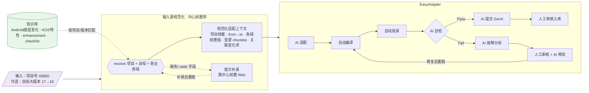

# EasyAdapter 后续流程 — 输入源规范化

> **本次范围说明**：本文的**整机适配流水线（AI 适配→编译→烧录→自检→…）属既有手动流程，仅作上下文**。
> 本轮真正要建设的只有一段：**用户端「选择/输入项目 → 从中心前置库拉取该项目全部前置 → 自动填充前置表单」**（下图 `输入源规范化` 节点），落地口径以 [`PLAN-中心前置库-可执行.md`](./PLAN-中心前置库-可执行.md) 为准。
> **是否/何时启动适配由人工决定，本轮不做自动启动编排。**
>
> **实现依托**：中心前置库拉取接口（见 `PLAN` §3.2）。
> **载体**：本文用 Mermaid 维护可编辑流程图（原 PNG 不便迭代）。

---

## 1. 输入源表述：改前 → 改后

| 维度 | 改前 | 改后 |
|------|------|------|
| 用户输入 | 人工整理的知识库变化项（底层变化 / KOS 特性 / enhancement / checklist…） | **仅项目号 `X6850`**（可选：目标大版本 `17→18`） |
| 上下文组装 | 人工搬运喂入 | 系统 `resolve` 自动拉中心前置库 → 生成「规范化适配上下文」 |
| 知识库角色 | 直接输入源 | **匹配维度**：按项目/版本自动关联变化项与 checklist，不再手工搬运 |
| 缺失/过期 | 无机制 | 缺失或 `stale` 字段 → 提示补录（跳中心前置 Web）后再启动 |
| 可复现 | 依赖个人整理，难复现 | 输入项目号即可复现同一套前置上下文 |

**一句话**：`输入 = 项目号`；`前置信息 = 中心前置库自动解析`；`知识库 = 自动匹配的变化项与 checklist`。

---

## 2. 改进后的整体流程图



> 主链与原图一致（AI 适配 → 编译 → 烧录 → 自检 →Pass 提 Gerrit / Fail 走故障分析+修改回流），仅把最左侧「输入源」升级为「项目号输入 + 输入源规范化」。

---

## 3. 输入源节点详解（「输入项目即启动」）

### 3.1 输入契约（最小输入）

| 字段 | 必填 | 示例 | 说明 |
|------|------|------|------|
| `project_code` | ✅ | `X6850` | 唯一必填；对应中心 ProjectProfile |
| `target_campaign` | 可选 | `a17-to-a18` | 省略则取该项目 **active 战役** |
| `workspaces/domains` | 可选 | 全部 | 省略则解析该战役全部已填域 |

> 达成「**只输项目号就能跑**」：其余全部由中心默认（active 战役 + 全域）补齐。

### 3.2 规范化过程（resolve）

```text
项目号 X6850
   │  GET /api/tahp/sync/adapt-prereqs/resolve?project_code=X6850
   ▼
中心前置库：
   ├─ 定位 ProjectProfile(X6850)
   ├─ 选 active 战役（from_os→to_os）
   ├─ 汇总各业务域 form_data（TP/充电/Modem…）
   ├─ 附变更 checklist（版本P1/功能/驱动/烧录/认证）
   └─ 关联知识库变化项（按项目/版本匹配）
   ▼
规范化适配上下文（结构化 JSON）→ 驱动 AI 适配
```

### 3.3 缺失与过期处理（保证可启动且不带病跑）

| 情况 | 行为 |
|------|------|
| 项目不存在 | 阻断启动，引导去中心前置 Web 建档案 |
| 必填前置缺失 | 列出 `incomplete_required[]`，提示补录后再启动（可选强制/可选警告放行） |
| `stale` 路径字段（升版未更新） | 黄标提醒人工核对，不静默使用旧路径 |
| 无 active 战役 | 提示选择/新建战役 |

---

## 4. 与前置库 / 知识库的衔接

| 来源 | 提供 | 机制 |
|------|------|------|
| **中心前置库** | 项目档案 + 战役 + 各域前置值 | `resolve`（§3.2） |
| **知识库** | 变化项（底层/KOS/enhancement）+ checklist | 按 `project/版本/域` 匹配后并入上下文 |
| **本机 Console** | 载入上下文 → AI 适配 | 默认「仅填空 + stale 黄标」，人工确认后再跑 |

> 输入源规范化 = 前置库 `resolve` + 知识库匹配，二者合并为一份「规范化适配上下文」。

---

## 5. 对既有方案文档的影响

- 不改中心前置库存储/权限设计；**新增一个「按项目号一键解析」的入口语义**，底层仍是 §3.2 `resolve`。
- 建议在 `PLAN` §8 的 **A6（Console 载入）** 里，把入口交互从「选 project + campaign + domain」升级为「**输入/选择项目号即启动**，campaign/domain 走默认」，与本文对齐。

---

## 6. 待确认

| # | 决策点 | 建议默认 |
|---|--------|----------|
| 1 | 必填前置缺失时 | **警告可放行**（草稿态跑），而非硬阻断；关键项（如 aosp_root）硬阻断 |
| 2 | 知识库变化项匹配键 | 项目号 + `from_os/to_os` + 业务域 |
| 3 | 是否保留「高级模式」手动指定 campaign/域 | **保留**，默认走一键 |
