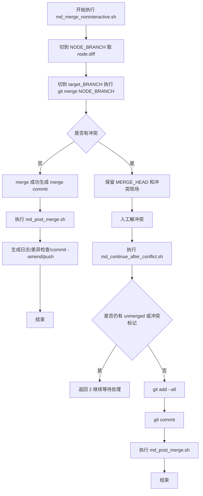
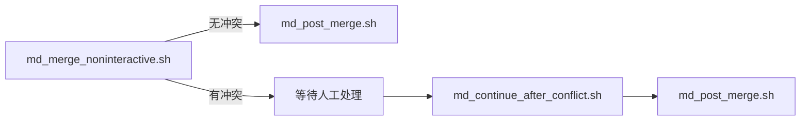
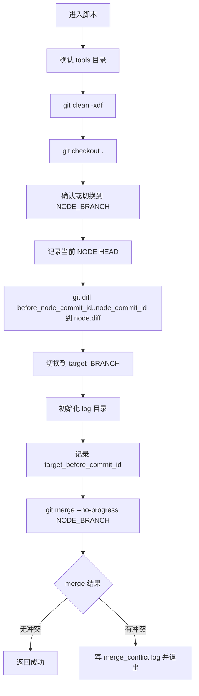
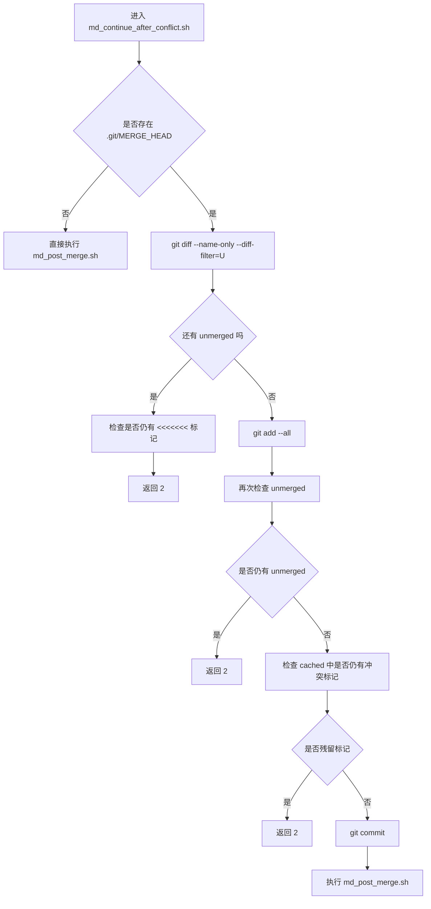
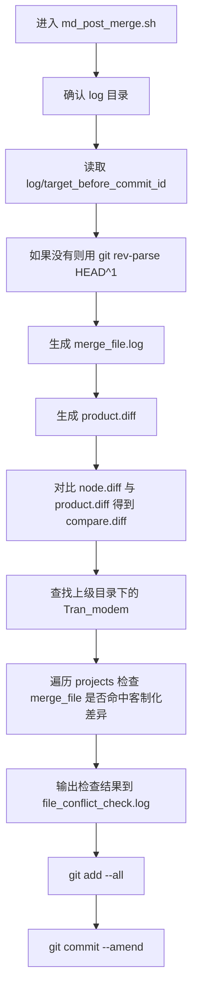
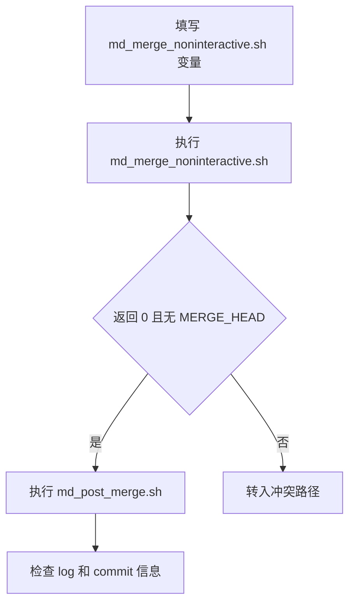
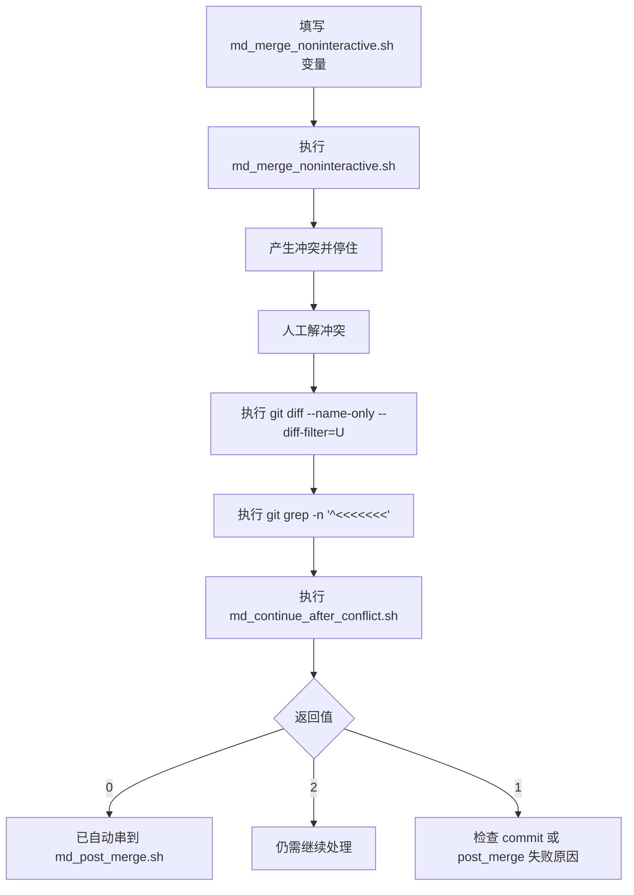

# Merge Script Usage Guide

> **2026-08 更新（主流程）**：`AutoPatchMerger` / Console Modem 基线已改为优先使用**目标仓内**的 `tools/md_merge.sh`，不再上传独立的 `md_merge_noninteractive.sh` 作为合入入口。
>
> - 合入前：读取仓内脚本 → 填写头部变量 → 将冲突处的 `read y` 改为 `exit 1`（保留 MERGE_HEAD）
> - 有冲突：工具暂停，等同脚本停在「请输入 y」之前
> - 续跑：`bash tools/md_merge.sh --apm-continue`，等同输入 `y`，随后走仓内 `check_diff_file` / `update_before_node_commit_id`
> - 下方关于 `md_merge_noninteractive.sh` / `md_continue_after_conflict.sh` / `md_post_merge.sh` 的说明保留作遗留/手工参考

## 1. 文档目的

本文档说明以下 3 个**遗留**脚本的用途、执行时机、前置条件、使用方法、返回码和典型流程：

- `md_merge_noninteractive.sh`
- `md_continue_after_conflict.sh`
- `md_post_merge.sh`

这 3 个脚本原本是给网页模式和 `AutoPatchMerger` 主流程调用的模板脚本。当前主流程已改为直接编排仓内 `tools/md_merge.sh`；下列内容仍可用于理解历史行为或手工排障。

如果需要单独使用，也可以手工复制到目标仓库执行，但需要先理解它们的运行假设和风险。

## 2. 先看整体关系

这 3 个脚本的关系如下：



再换一个“谁调谁”的视角：



## 3. 使用前必须知道的事实

### 3.1 这 3 个脚本不是完全独立的通用脚本

它们默认假设自己运行在目标 `modem` Git 仓库中，并且仓库根目录下存在：

- `.git/`
- `tools/`
- `log/`

其中：

- `md_merge_noninteractive.sh` 会创建和刷新 `log/`
- `md_continue_after_conflict.sh` 会依赖 `tools/md_post_merge.sh`
- `md_post_merge.sh` 会读取 `log/target_before_commit_id`、`log/node.diff`

也就是说，这 3 个脚本有明显的上下游依赖关系，不建议随意拆开跨场景使用。

### 3.2 它们默认要在目标仓库根目录执行

脚本开头都带有这样的逻辑：

```bash
if [ -d tools/ ]; then
    echo location is right, keep build
else
    cd ..
fi
```

这表示脚本默认希望自己当前位于仓库根目录，至少能看到 `tools/` 目录。

### 3.3 它们是“模板脚本”

脚本头部这些变量，正常是由 Python 主流程动态替换的：

```bash
NODE_BRANCH=
target_BRANCH=
AP_lable=
DESCRIPTION=基线升级
JIRAID=
before_node_commit_id=
```

如果你要手工单独执行，必须先把这些变量填成真实值。

## 4. 风险提示

在手工使用前，请先确认你接受以下行为：

- `md_merge_noninteractive.sh` 会执行 `git clean -xdf`
- `md_merge_noninteractive.sh` 会执行 `git checkout .`
- `md_post_merge.sh` 会执行 `git commit --amend`
- `md_continue_after_conflict.sh` 会执行 `git add --all`

这些操作意味着：

- 未跟踪文件会被删除
- 当前工作区未提交修改会被丢弃
- 最后一个提交会被改写
- 未仔细检查时，可能把不希望提交的内容一起 `git add`

因此建议：

- 只在专门用于 merge 的工作仓中执行
- 执行前先备份或确认工作区干净
- 尽量在测试分支先演练一次

## 5. 推荐目录和准备方式

假设你的目标仓库是：

```text
/path/to/modem_repo
```

推荐目录形态如下：

```text
/path/to/modem_repo
├─ .git/
├─ tools/
│  ├─ md_merge_noninteractive.sh
│  ├─ md_continue_after_conflict.sh
│  └─ md_post_merge.sh
└─ ...
```

推荐准备步骤：

```bash
cd /path/to/modem_repo
mkdir -p tools
cp /your/source/md_merge_noninteractive.sh tools/
cp /your/source/md_continue_after_conflict.sh tools/
cp /your/source/md_post_merge.sh tools/
chmod +x tools/md_merge_noninteractive.sh
chmod +x tools/md_continue_after_conflict.sh
chmod +x tools/md_post_merge.sh
```

然后按实际场景修改脚本头部变量。

## 6. 公共变量说明

### 6.1 变量含义

| 变量名 | 含义 | 是否必填 | 用于哪些脚本 |
| --- | --- | --- | --- |
| `NODE_BRANCH` | 源分支，作为 merge 输入分支 | 是 | 3 个脚本 |
| `target_BRANCH` | 目标分支，作为 merge 落地方向 | 是 | 3 个脚本 |
| `AP_lable` | Patch 标签，写入提交信息 | 是 | 3 个脚本 |
| `DESCRIPTION` | 描述信息，写入提交信息 | 建议填写 | 3 个脚本 |
| `JIRAID` | Jira 单号，写入提交信息 | 是 | 3 个脚本 |
| `before_node_commit_id` | merge 前记录的 NODE 分支 commit，用于生成 `node.diff` | `md_merge_noninteractive.sh` 必填 | 仅 `md_merge_noninteractive.sh` |

### 6.2 示例配置

下面是一个常见示例：

```bash
NODE_BRANCH=master
target_BRANCH=PRODUCT_V_v0mp1rc_NR15_common
AP_lable=V13.29
DESCRIPTION=BASELINE_UPGRADE
JIRAID=AR-UIF-0001-001-010
before_node_commit_id=abcdef1234567890abcdef1234567890abcdef12
```

### 6.3 如何拿到 `before_node_commit_id`

在目标仓库执行：

```bash
git rev-parse <NODE_BRANCH>
```

例如：

```bash
git rev-parse master
```

## 7. 脚本一：`md_merge_noninteractive.sh`

### 7.1 用途

`md_merge_noninteractive.sh` 是整个流程的起点，用于把 `NODE_BRANCH` 合并到 `target_BRANCH`。

它主要做 4 件事：

1. 清理工作区并确认当前分支状态
2. 从 `NODE_BRANCH` 侧生成 `node.diff`
3. 切到 `target_BRANCH` 执行 `git merge`
4. 生成 `log/` 下的 merge 相关日志

### 7.2 它做了哪些关键操作

简化后的核心动作如下：



### 7.3 前置条件

执行这个脚本前，需要保证：

- 当前目录是目标 Git 仓库
- 本地已经存在 `NODE_BRANCH` 和 `target_BRANCH`
- `before_node_commit_id` 已填写
- 你确认当前工作区允许被 `git clean -xdf` 和 `git checkout .` 清理

### 7.4 使用方法

先编辑 `tools/md_merge_noninteractive.sh` 头部变量，再执行：

```bash
cd /path/to/modem_repo
bash tools/md_merge_noninteractive.sh
echo $?
```

### 7.5 返回码说明

| 返回码 | 含义 |
| --- | --- |
| `0` | merge 成功，未检测到冲突 |
| `1` | merge 失败，或检测到冲突，需要停住 |

### 7.6 执行后你应该看什么

建议立即检查：

```bash
git branch --show-current
test -f .git/MERGE_HEAD && echo "仍在merge态" || echo "不在merge态"
ls log
cat log/merge_conflict.log
```

重点文件：

- `log/merge_conflict.log`
- `log/merge_file.log`
- `log/target_before_commit_id`
- `log/node.diff`

### 7.7 典型结果判断

- 如果返回 `0` 且没有 `.git/MERGE_HEAD`，说明 merge 已完成，可以继续执行 `md_post_merge.sh`
- 如果返回 `1` 且存在 `.git/MERGE_HEAD`，说明进入冲突态，应先解冲突，再执行 `md_continue_after_conflict.sh`

## 8. 脚本二：`md_continue_after_conflict.sh`

### 8.1 用途

`md_continue_after_conflict.sh` 用于“冲突已经发生，并且你已经处理过冲突内容”之后的继续执行。

它并不负责做 merge，本质上是做下面这些事：

1. 检查当前是否还在 merge 状态
2. 检查是否还有 unmerged 文件
3. 检查是否还残留 `<<<<<<<` 冲突标记
4. 自动 `git add --all`
5. 自动 `git commit`
6. 调用 `md_post_merge.sh` 做后处理

### 8.2 执行逻辑



### 8.3 前置条件

执行这个脚本前，通常应满足：

- 之前执行过 `md_merge_noninteractive.sh`
- 当前仓库仍处于 merge 冲突态，或至少保留了相关日志和提交上下文
- 你已经手工解决完冲突文件
- `tools/md_post_merge.sh` 已存在且可执行

### 8.4 使用方法

先确认脚本头部变量已填写，然后执行：

```bash
cd /path/to/modem_repo
bash tools/md_continue_after_conflict.sh
echo $?
```

### 8.5 推荐先做的自检

正式执行前，建议先看：

```bash
git diff --name-only --diff-filter=U
git grep -n '^<<<<<<<'
```

理想情况是这两条命令都没有输出。

### 8.6 返回码说明

| 返回码 | 含义 |
| --- | --- |
| `0` | 继续执行成功，已完成 `git commit` 并进入后处理 |
| `1` | 提交或后处理失败 |
| `2` | 仍有冲突，或者还有未清理干净的冲突标记 |

### 8.7 你需要特别注意的点

- 如果 `.git/MERGE_HEAD` 不存在，它会直接调用 `md_post_merge.sh`
- 它默认使用 `git add --all`，所以会把当前所有改动都加入暂存区
- 它内部依赖 `md_post_merge.sh`，不能只放一个脚本单独跑

## 9. 脚本三：`md_post_merge.sh`

### 9.1 用途

`md_post_merge.sh` 是 merge 完成后的收尾脚本，用来生成差异日志、检查客制化冲突，并整理最终提交信息。

它既可以在“无冲突 merge 成功后”执行，也可以在“冲突解决并 commit 之后”执行。

### 9.2 它做了哪些关键操作

主要逻辑如下：



### 9.3 前置条件

执行前建议保证：

- 当前仓库已经完成 merge 或 continue 后的提交
- `log/target_before_commit_id` 存在，或 `HEAD^1` 能正确代表 merge 前状态
- 如果要使用客制化差异检查，当前仓库上级目录能找到 `*Tran_modem*`

### 9.4 使用方法

```bash
cd /path/to/modem_repo
bash tools/md_post_merge.sh
echo $?
```

### 9.5 关键输出文件

执行后通常会得到：

- `log/merge_file.log`
- `log/product.diff`
- `log/compare.diff`
- `log/file_conflict_check.log`
- `log/md_build.log`

### 9.6 返回结果理解

这个脚本没有像前两个脚本那样清晰区分多种返回码语义，但通常可以这样理解：

- 返回 `0`：后处理基本完成
- 返回非 `0`：多半是客制化检查环境不满足，或 `git commit --amend` 失败

### 9.7 你需要特别注意的点

- 它会执行 `git commit --amend`
- 如果上级目录找不到 `*Tran_modem*`，客制化差异检查会失败
- 如果 `log/node.diff` 不存在，`compare.diff` 只会写入 `log/node.diff not found`

## 10. 两条最常见的使用路径

### 10.1 路径 A：无冲突

适合场景：

- 你想手工复用脚本完成一次标准 merge
- merge 成功后直接补做后处理

操作顺序：



建议命令：

```bash
cd /path/to/modem_repo
bash tools/md_merge_noninteractive.sh

test -f .git/MERGE_HEAD && echo "conflict" || echo "clean"

bash tools/md_post_merge.sh
```

### 10.2 路径 B：有冲突

适合场景：

- merge 后进入冲突态
- 你已经人工修改冲突文件，准备继续

操作顺序：



建议命令：

```bash
cd /path/to/modem_repo
bash tools/md_merge_noninteractive.sh

# 手工处理冲突后再检查
git diff --name-only --diff-filter=U
git grep -n '^<<<<<<<'

bash tools/md_continue_after_conflict.sh
```

## 11. 推荐的手工操作手册

如果你要在远端或本地 Linux 仓库中单独复用这 3 个脚本，建议按下面顺序做。

### 11.1 第一步：准备脚本

```bash
cd /path/to/modem_repo
mkdir -p tools
cp /your/source/md_merge_noninteractive.sh tools/
cp /your/source/md_continue_after_conflict.sh tools/
cp /your/source/md_post_merge.sh tools/
chmod +x tools/*.sh
```

### 11.2 第二步：填写变量

至少需要保证 3 个脚本头部变量一致。推荐做法是三份脚本都填成同一组值。

### 11.3 第三步：先跑 merge

```bash
bash tools/md_merge_noninteractive.sh
rc=$?
echo "rc=$rc"
```

### 11.4 第四步：根据结果分叉

如果无冲突：

```bash
test -f .git/MERGE_HEAD && echo "still merge" || echo "merge done"
bash tools/md_post_merge.sh
```

如果有冲突：

```bash
# 手工修改冲突文件
git diff --name-only --diff-filter=U
git grep -n '^<<<<<<<'
bash tools/md_continue_after_conflict.sh
```

### 11.5 第五步：检查结果

建议检查：

```bash
git log --oneline -n 3
ls log
cat log/md_build.log
cat log/file_conflict_check.log
```

## 12. 常见问题

### 12.1 为什么脚本一开始就把我当前改动清掉了

因为 `md_merge_noninteractive.sh` 内部有：

```bash
git clean -xdf
git checkout .
```

这是为了保证 merge 环境干净，但对手工使用来说风险很高。

### 12.2 为什么 `md_continue_after_conflict.sh` 返回 2

通常表示下面几种情况之一：

- 还有 unmerged 文件
- 文件中还残留 `<<<<<<<`
- `git add --all` 后 index 中仍然有冲突痕迹

这时不要继续强推流程，而是先把冲突文件清理干净。

### 12.3 为什么 `md_post_merge.sh` 报 `Tran_modem` 相关错误

因为它会在当前仓库的上级目录查找 `*Tran_modem*`，并读取其中的 `projects/` 目录做客制化差异检查。如果你的运行环境没有这部分目录，它就可能失败。

### 12.4 为什么 `compare.diff` 内容不完整

因为它依赖 `log/node.diff`。如果你不是通过 `md_merge_noninteractive.sh` 进入后续流程，而是单独执行 `md_post_merge.sh`，可能缺少这个文件。

### 12.5 能不能只跑 `md_post_merge.sh`

可以，但要明确它不是完整流程入口。你单独跑它时，通常只适用于：

- merge 已经成功完成
- `HEAD` 状态合理
- 你只想补日志、做差异检查、更新 commit message

## 13. 推荐结论

如果你的目标是“单独复用脚本”，推荐理解为下面两条规则：

1. `md_merge_noninteractive.sh` 是入口，负责 merge
2. `md_continue_after_conflict.sh` 是冲突后的继续入口，并且内部会串 `md_post_merge.sh`
3. `md_post_merge.sh` 是收尾，不建议当作完整流程入口理解

最常见的两组命令就是：

无冲突：

```bash
bash tools/md_merge_noninteractive.sh
bash tools/md_post_merge.sh
```

有冲突：

```bash
bash tools/md_merge_noninteractive.sh
# 手工解冲突
bash tools/md_continue_after_conflict.sh
```

如果后续还需要，我可以再基于这份文档继续补两类内容：

- “网页模式调用这 3 个脚本”的时序图
- “把这 3 个模板脚本改造成可带命令行参数的独立脚本”的改造方案
